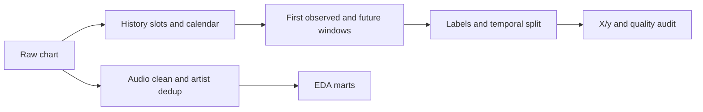

# Tiền xử lý Top 50 theo thị trường trong 8 tuần

Notebook: notebooks/01_preprocess_market_forecast.ipynb. Các nhánh cũ được giữ để đối chiếu.

Grain: track_id + chart_country. Tổng mẫu 103,194; đủ điều kiện học 76,126.

Train 35,452; validation 6,696; test 14,607; pending 8,431.

Nhãn: có rank <= 50 ở cùng thị trường trong t0+7 đến t0+56 ngày; t0 không tính.

Chỉ gán nhãn chính khi đủ cả 8 tuần Top 50 và không chạm biên nguồn. Global là một thị trường riêng.

First observed không phải debut đã xác minh. Dữ liệu chỉ đại diện bài từng vào Top 200.

prediction_time chưa biết; proxy t0+4 ngày là giả định công bố, không phải timestamp nguồn.

Audio snapshot được giả định ổn định; chưa xác minh có sẵn tại t0. Popularity snapshot không vào X/y.

X_*/y_* có cùng thứ tự và khóa. fit imputer/scaler/encoder chỉ trên train ở notebook 03_model.

Chia theo thời gian, purge cửa sổ nhãn và giữ track_id tách biệt. Artist overlap chỉ được audit.

Bản thu khác ID có thể còn chồng lấn; quality/duplicate_recording_review.csv là danh sách rà soát.

EDA: mart_audio_trend_weekly, mart_country_year, mart_artist_chart. COVID/WHR/GDP không thuộc X mặc định.

Streams theo thị trường không cộng Global với quốc gia. Tổng mô tả cấp bài ưu tiên Global trong mỗi bài-tuần.

Nguồn, SHA256, điểm chưa xác minh: source_manifest.json. Không tự gán GDP unit hay giấy phép.

