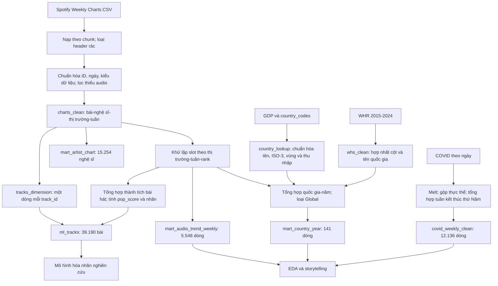
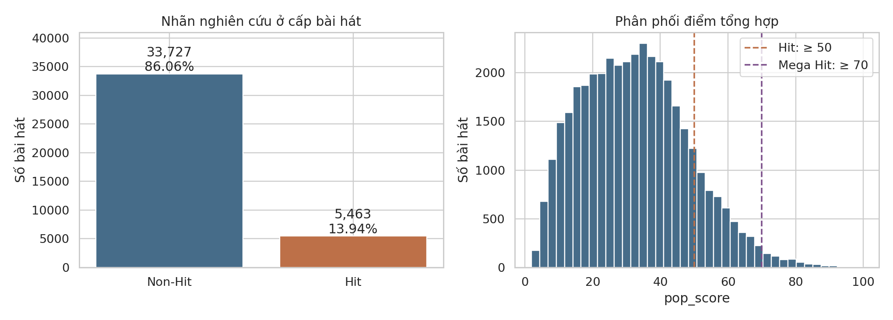
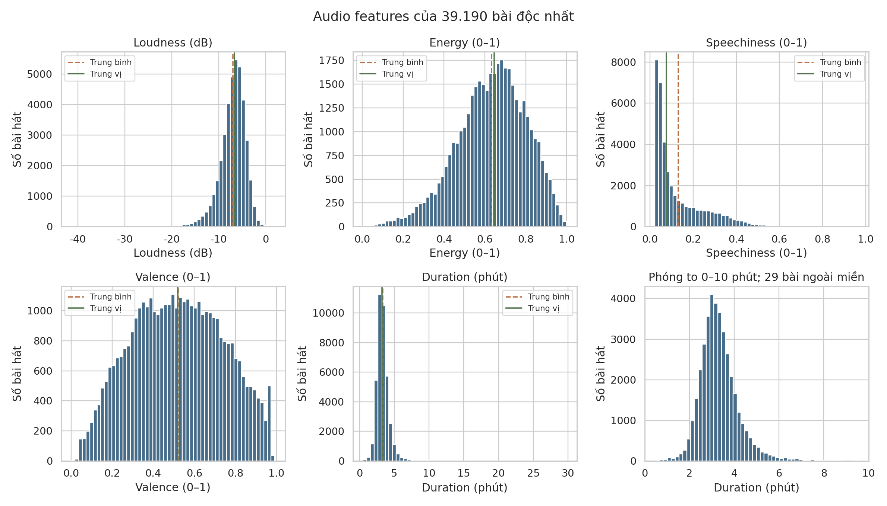
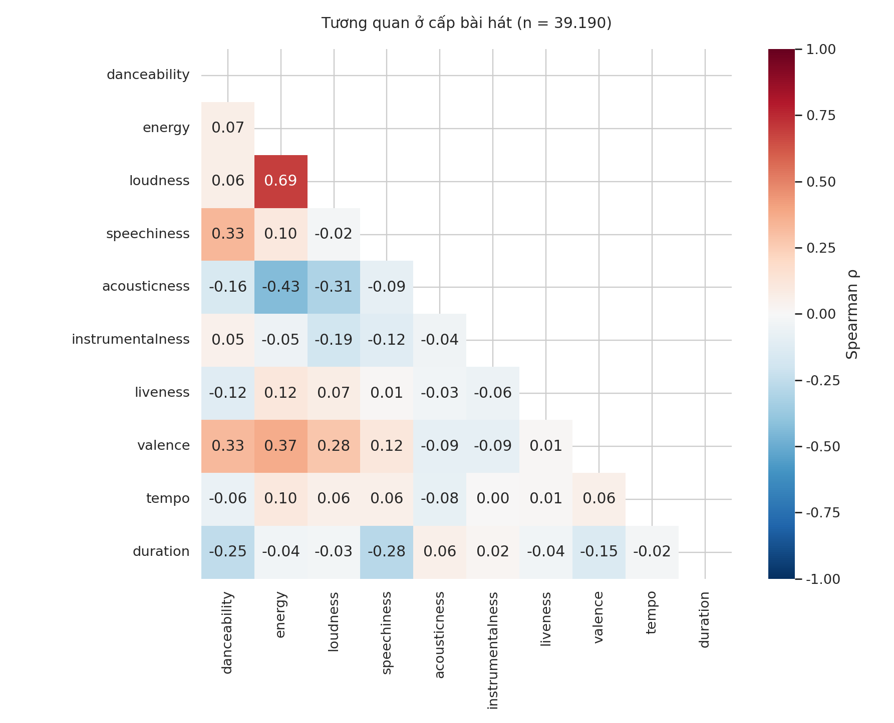
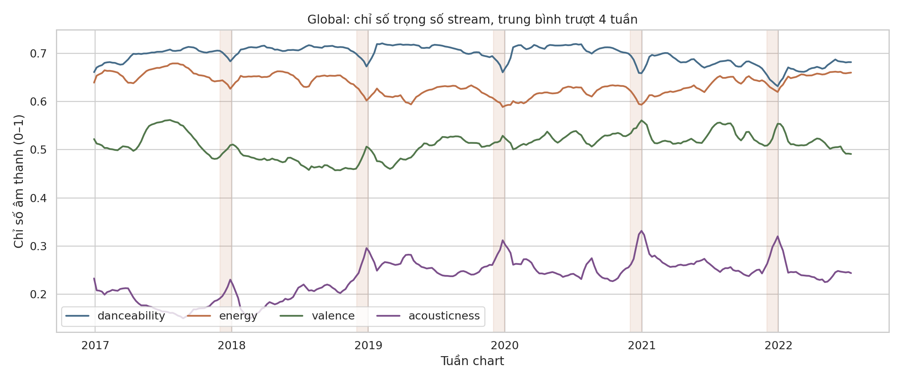

# BÁO CÁO CUỐI KÌ: SPOTIFY AUDIO TRENDS ANALYTICS

**Học phần:** Tương tác dữ liệu trực quan (IDVI)  
**Phạm vi:** II. Cơ sở và mô tả dữ liệu; III. Pipeline và tiền xử lý; IV. Khám phá dữ liệu (EDA).  
**Ngày đối chiếu:** 06/10/2026.

## Cơ sở đối chiếu repository

Đề tài Spotify Audio Trends Analytics nghiên cứu mối liên hệ giữa đặc điểm âm thanh, thành tích trên bảng xếp hạng và bối cảnh quốc gia, đồng thời xây dựng dữ liệu phục vụ phân loại mức độ thành công của bài hát. Repository được tổ chức theo chuỗi công việc: nạp dữ liệu, tiền xử lý, khám phá, mô hình hóa và kể chuyện bằng dữ liệu. Trong phiên bản hiện tại, `notebooks/01_preprocess.ipynb` là nơi triển khai các phép biến đổi và xuất bảng; `src/data_loader.py` chủ yếu cung cấp cấu hình và hàm nạp dữ liệu. Các notebook `02_eda.ipynb`, `03_model.ipynb` và `04_story.ipynb` đảm nhiệm những bước phân tích tiếp theo.

Báo cáo sử dụng mã thực thi của notebook và các tệp hiện có trong `data/processed/` làm căn cứ chính; các nhận xét định lượng được tính lại trực tiếp trên dữ liệu. Cách đối chiếu này cần thiết vì README vẫn mô tả kiến trúc Master Dataset và tập ML của phiên bản trước. Kiến trúc hiện tại gồm các bảng sạch và data mart chuyên biệt, với tập ML 39.190 bài hát. Những kết quả dưới đây phản ánh phiên bản dữ liệu đang lưu trong repository, không phải dữ liệu Spotify cập nhật đến năm 2026.

## II. Cơ sở và mô tả dữ liệu

### 2.1. Các khái niệm sử dụng trong nghiên cứu

**Đặc trưng âm thanh (audio features)** là những thuộc tính số mô tả bản thu âm. Chúng cho phép chuyển một đối tượng khó biểu diễn trực tiếp như âm nhạc thành các biến có thể thống kê, trực quan hóa và sử dụng trong học máy. Trong đề tài, các đặc trưng gồm mức độ phù hợp để khiêu vũ (`danceability`), năng lượng (`energy`), độ lớn âm thanh (`loudness`), mức độ lời nói (`speechiness`), tính mộc (`acousticness`), tính không lời (`instrumentalness`), dấu hiệu biểu diễn trực tiếp (`liveness`), sắc thái tích cực (`valence`), nhịp độ (`tempo`), thời lượng (`duration`), cao độ chủ đạo (`key`) và điệu thức (`mode`). Theo định nghĩa Spotify, energy và valence được biểu diễn trên thang 0–1; loudness có đơn vị dB; tempo có đơn vị BPM; thời lượng gốc có đơn vị mili giây. Các chỉ số này mô tả âm thanh của bản thu, không trực tiếp đo tâm trạng của người nghe. [Spotify Web API – Audio Features](https://developer.spotify.com/documentation/web-api/reference/get-audio-features).

**Bảng xếp hạng (chart)** là tập các bài hát được sắp thứ hạng trong một thị trường và khoảng thời gian xác định. Dữ liệu nghiên cứu ghi nhận bảng Top 200 theo tuần, bao gồm thứ hạng và lượt stream của bài hát. Vì vậy, một bản ghi chart phản ánh sự hiện diện của bài hát trong một thị trường–tuần, không phải một bài hát mới hay một người nghe riêng lẻ. Lượt stream là số lượt nghe được ghi nhận cho bài hát trên chart, không phải số người dùng duy nhất.

**Phân loại nhị phân** là bài toán học máy có hai nhãn đầu ra. Trong nghiên cứu này, hai nhãn là Hit và Non-Hit, được tạo từ điểm tổng hợp `pop_score`. Mô hình sẽ học mối liên hệ giữa thuộc tính bài hát và nhãn nghiên cứu. Do cả hai nhóm đều được lấy từ những bài từng vào chart, Non-Hit chỉ có nghĩa là chưa đạt ngưỡng điểm của nghiên cứu; không có nghĩa bài hát hoàn toàn thất bại trên thị trường.

**Kể chuyện bằng dữ liệu (data storytelling)** là quá trình kết nối câu hỏi, bằng chứng định lượng, biểu đồ và diễn giải thành một lập luận có mạch. Với đề tài này, câu chuyện có thể bắt đầu từ đặc điểm chung của các bài đã vào chart, tiếp tục với khác biệt giữa thị trường và biến động theo thời gian, rồi đặt các biến động đó trong bối cảnh hạnh phúc quốc gia hoặc COVID-19. Việc diễn giải cần phân biệt kết quả quan sát được với giả thuyết giải thích.

**Dashboard tương tác** là giao diện kết hợp nhiều biểu đồ và chỉ số, cho phép người dùng thay đổi bộ lọc, thời gian, thị trường hoặc đặc trưng cần quan sát. Streamlit cung cấp giao diện ứng dụng, còn Plotly hỗ trợ biểu đồ với thao tác rê chuột, phóng to và lựa chọn dữ liệu. Các mart tổng hợp giúp giảm lượng dữ liệu cần xử lý khi tương tác. Tuy nhiên, cần phân biệt thiết kế dữ liệu phục vụ dashboard với trạng thái tích hợp ứng dụng: `dashboard/app.py` hiện vẫn tham chiếu tệp master/sample của kiến trúc cũ; báo cáo này không xem toàn bộ giao diện đã được chuyển sang mart mới.

### 2.2. Nguồn dữ liệu và phạm vi thời gian

Dữ liệu dự án được lấy từ các nguồn thứ cấp. Bảng Spotify là nguồn trung tâm; dữ liệu quốc gia, GDP, hạnh phúc và COVID bổ sung bối cảnh. Repository không có nhật ký tải xuống hay hồ sơ xác nhận ngày nhóm thu thập từng tệp. Do đó, báo cáo phân biệt **khoảng thời gian quan sát trong dữ liệu** với **ngày tải hoặc thu thập dữ liệu của nhóm**, vốn chưa xác định được.

| Tệp dữ liệu thô | Quy mô | Nguồn gốc và thời gian quan sát | Vai trò, đơn vị và lưu ý |
|---|---:|---|---|
| `spotify-weekly-charts.csv` | 1.787.999 dòng × 36 cột | Repo ghi nhận nguồn Kaggle của yelexa; trang nguồn có tên Spotify Weekly Top 200 Songs Streaming Data. Global: 29/12/2016–14/07/2022; các quốc gia: 04/02/2021–14/07/2022 | Thứ hạng 1–200, stream theo tuần, metadata bài hát và audio features |
| `global_deaths.csv` | 1.143 dòng × 290 cột | Repo ghi nhận bản phân phối CONVENIENT/Kaggle từ JHU CSSE. Có 1 dòng hành chính và 1.142 ngày, từ 23/01/2020–09/03/2023 | Số tử vong phát sinh theo ngày; có điều chỉnh âm; không phải toàn bộ cột đều là quốc gia độc lập |
| `whs_years_updated.csv` | 1.510 dòng × 46 cột | Bản tổng hợp World Happiness Report 2015–2024; repo chưa xác định đầy đủ người tổng hợp và URL bản tải | Điểm đánh giá cuộc sống 0–10, thứ hạng và các biến giải thích theo quốc gia–năm báo cáo |
| `gdp_data.csv` | 13.365 dòng × 4 cột | Repo ghi nhận World Bank Open Data qua Kaggle/Sazidul Islam; năm 1960–2022 | Được notebook diễn giải là GDP danh nghĩa bằng USD; repo chưa lưu mã chỉ tiêu World Bank để xác nhận đầy đủ định nghĩa của `value` |
| `country_codes.csv` | 217 dòng × 3 cột | Repo ghi nhận metadata World Bank qua cùng nguồn Kaggle | Mã ISO-3, vùng địa lý và nhóm thu nhập; không có năm hiệu lực của phân loại trong tệp |

Trang [Kaggle của yelexa](https://www.kaggle.com/datasets/yelexa/spotify200) xác nhận tên tập dữ liệu Spotify được repo dẫn nguồn. Tuy nhiên, phần giấy phép của bản tải cụ thể chưa được xác thực trong lần đối chiếu này; vì vậy không gán một giấy phép Creative Commons cụ thể cho tệp Spotify. Với bản tổng hợp WHR và bản COVID trung gian trên Kaggle, repo cũng chưa lưu đầy đủ thông tin phiên bản và giấy phép của bên phân phối lại.

Nguồn gốc JHU CSSE công bố dữ liệu theo CC BY 4.0, yêu cầu ghi công và đề nghị trích dẫn công trình của Dong, Du và Gardner khi sử dụng trong ấn phẩm. World Bank công bố điều khoản chung CC BY 4.0, trừ những ngoại lệ ghi trong metadata và các điều khoản bổ sung. Những thông tin này xác nhận điều kiện của nguồn gốc, không thay thế việc kiểm tra metadata của từng bản phân phối thứ cấp. [JHU CSSE – Terms of Use](https://github.com/CSSEGISandData/COVID-19), [World Bank – Summary Terms of Use](https://data.worldbank.org/summary-terms-of-use).

World Happiness Report dựa trên Gallup World Poll. Nguồn chính thức cho phép tải miễn phí dữ liệu đánh giá cuộc sống và đóng góp của sáu nhân tố trong Figure 2.1; quyền truy cập dữ liệu Gallup chi tiết hơn có thể cần yêu cầu hoặc đăng ký. Đặc biệt, `year` trong bản WHR nên được hiểu là năm báo cáo; điểm xếp hạng thường dựa trên trung bình khảo sát nhiều năm, không phải phép đo chỉ diễn ra trong một năm dương lịch. [WHR – Data Sharing](https://www.worldhappiness.report/data-sharing/), [WHR – FAQ](https://www.worldhappiness.report/faq/).

### 2.3. Quy mô, grain và khóa của các bảng phân tích

Grain là ý nghĩa của một dòng dữ liệu. Xác định grain trước khi tổng hợp giúp tránh lẫn cấp bài hát với cấp lần xuất hiện trên chart, hoặc cấp quốc gia với cấp thị trường Global.

| Bảng | Quy mô hiện tại | Grain | Khóa duy nhất |
|---|---:|---|---|
| `mart_audio_trend_weekly` | 5.548 dòng × 29 cột | Một thị trường trong một tuần | (`chart_country`, `week`) |
| `mart_country_year` | 141 dòng × 42 cột | Một quốc gia trong một năm có quan sát chart | (`chart_country`, `year`) |
| `ml_tracks` | 39.190 dòng × 30 cột | Một bài hát theo Spotify track ID | `track_id` |
| `covid_weekly_clean` | 12.136 dòng × 4 cột | Một quốc gia/thực thể trong một tuần; có thêm Global | (`country`, `week`) |

Mart tuần chứa 74 thị trường: 73 quốc gia và Global. Global có 290 tuần; tổng số tuần–thị trường của các quốc gia là 5.258. Mart quốc gia–năm loại Global, gồm 68 quốc gia năm 2021 và 73 quốc gia năm 2022, tạo thành 141 dòng. Đây là bảng panel không cân bằng, không phải 73 quốc gia đều có dữ liệu ở cả hai năm. COVID có 74 thực thể × 164 tuần, bao phủ đến tháng 03/2023; khi phân tích cùng Spotify chỉ dùng phần thời gian giao nhau.

### 2.4. Data dictionary rút gọn

#### a. `mart_audio_trend_weekly`

| Trường/nhóm trường | Kiểu hoặc đơn vị | Ý nghĩa |
|---|---|---|
| `chart_country`, `week` | Tên thị trường; datetime | Thị trường và ngày thứ Năm gắn nhãn tuần |
| `total_streams` | Lượt stream | Tổng stream của các slot chart đã khử lặp nghệ sĩ |
| `track_count` | Số slot | Số bản ghi chart sau khử lặp; thường là 200 nhưng có tuần thiếu |
| `new_entries` | Số slot | Số lượt xuất hiện được đánh dấu mới trong tuần; không nhất thiết là bài mới phát hành |
| `{feature}_mean` | Đơn vị của feature | Trung bình không trọng số trên các slot của tuần |
| `{feature}_weighted` | Đơn vị của feature | Trung bình có trọng số stream trên các slot của tuần |

Hai nhóm audio áp dụng cho 12 trường: `danceability`, `energy`, `key`, `mode`, `loudness`, `speechiness`, `acousticness`, `instrumentalness`, `liveness`, `valence`, `tempo`, `duration`. Các biến 0–1 giữ thang đo gốc; loudness là dB, tempo là BPM và duration là mili giây. `key` là mã lớp cao độ, không phải đại lượng liên tục; trung bình mã key không có ý nghĩa âm nhạc trực tiếp. Trung bình `mode` 0/1 có thể diễn giải là tỷ lệ điệu trưởng theo cách gán mã của Spotify.

#### b. `mart_country_year`

| Trường/nhóm trường | Kiểu hoặc đơn vị | Ý nghĩa |
|---|---|---|
| `chart_country`, `year`, `country_code` | Tên; năm; ISO-3 | Quốc gia, năm chart và mã chuẩn |
| `yearly_streams`, `slot_count`, `n_weeks` | Lượt stream; số slot; số tuần | Khối lượng chart thực tế trong phần năm có dữ liệu |
| `{feature}_mean`, `{feature}_weighted` | Đơn vị gốc | 24 chỉ số âm thanh được tổng hợp trực tiếp từ slot quốc gia–năm |
| `wb_region`, `wb_income_group` | Phân loại | Vùng và nhóm thu nhập từ bảng lookup |
| `chart_region`, `chart_language` | Chuỗi/phân loại | Metadata của thị trường chart; ngôn ngữ thị trường không xác nhận ngôn ngữ từng bài hát |
| `happiness_rank`, `happiness_score` | Thứ hạng; điểm 0–10 | Thứ hạng và đánh giá cuộc sống trong năm báo cáo WHR |
| `gdp_factor`, `social_support`, `healthy_life`, `freedom`, `generosity`, `corruption` | Giá trị số theo nguồn WHR | Các trường giải thích được hợp nhất từ nhiều tên cột qua các năm; cần kiểm tra định nghĩa trước khi so sánh liên năm |

`gdp_factor` không phải GDP danh nghĩa bằng USD và không được thay thế cho `gdp_usd`. Mart hiện tại không có cột GDP danh nghĩa. Tên `corruption` cũng không tự xác định chiều tốt/xấu của chỉ số, vì notebook hợp nhất các trường “Trust” và “Explained by” từ nhiều năm.

#### c. `ml_tracks`

| Trường/nhóm trường | Kiểu hoặc đơn vị | Ý nghĩa và vai trò |
|---|---|---|
| `track_id`, `track_name` | Chuỗi | Định danh và tên bài hát |
| `artist_id`, `artist_names`, `artists_num`, `artist_genre` | Chuỗi; số nghệ sĩ | Metadata; `artist_id` và genre được lấy từ dòng đầu của bài, không phải danh sách đầy đủ mọi nghệ sĩ/thể loại |
| `release_date`, `release_date_clean`, `release_year`, `release_month` | Chuỗi; datetime; năm; tháng | Ngày phát hành gốc và các trường chuẩn hóa |
| 12 audio features | Thang đo/đơn vị như trên | Thuộc tính bản thu, phục vụ EDA và đầu vào mô hình |
| `peak_rank` | Thứ hạng | Thứ hạng quan sát tốt nhất trên các slot, lấy min của `rank` |
| `nweek` | Số tuần | Số nhãn tuần khác nhau mà bài xuất hiện ở ít nhất một thị trường |
| `total_streams` | Lượt stream chart cộng gộp | Tổng trên slot Global và quốc gia; không phải tổng lượt nghe toàn cầu đã loại giao thoa |
| `n_countries` | Số quốc gia, 0–73 | Số thị trường quốc gia từng xuất hiện, loại Global |
| `pop_score` | Điểm tổng hợp 0–100 | Biến mục tiêu liên tục do nghiên cứu xây dựng |
| `is_hit`, `is_mega_hit` | Nhị phân 0/1 | Lần lượt đạt ngưỡng 50 và 70 điểm |
| `hit_tier` | Phân loại | Nhóm Niche, Moderate, Popular, Mega Hit theo `pd.cut` |

#### d. `covid_weekly_clean`

| Trường | Kiểu hoặc đơn vị | Ý nghĩa |
|---|---|---|
| `country` | Chuỗi | Tên đã ánh xạ theo hệ tên Spotify; Global là tổng từ toàn bộ thực thể nguồn trước khi lọc 73 quốc gia |
| `week` | Ngày; cần parse datetime khi nạp CSV | Thứ Năm kết thúc nhóm ngày thứ Sáu–thứ Năm |
| `weekly_deaths` | Ca tử vong | Tổng số phát sinh/điều chỉnh trong tuần; hiện vẫn có giá trị âm |
| `cumulative_deaths` | Ca tử vong | Tổng tích lũy `weekly_deaths` theo thực thể từ đầu chuỗi đã nhập |

### 2.5. Định nghĩa nhãn Hit và phạm vi mẫu

Nghiên cứu định nghĩa:

\[
\mathrm{is\_hit}_i=\begin{cases}1,&\mathrm{pop\_score}_i\geq50\\0,&\mathrm{pop\_score}_i<50.\end{cases}
\]

Tập hiện tại có **5.463 bài Hit, chiếm 13,94%**, và **33.727 bài Non-Hit, chiếm 86,06%**. Đây là ngưỡng heuristic của nghiên cứu. Con số 50 là điểm trên thang `pop_score`, **không đồng nghĩa bài thuộc Top 50**, cũng không phải chỉ số popularity chính thức do Spotify cung cấp. Điểm tổng hợp còn xét thời gian hiện diện, độ phủ quốc gia và lượng stream; việc từng đạt thứ hạng 50 hoặc tốt hơn không tự động làm nhãn Hit bằng 1.

Phạm vi mẫu là giới hạn quan trọng: cả 39.190 bài đều đã xuất hiện trên chart trong dữ liệu. Các bài chưa từng vào chart không có mặt. Do đó, phân phối âm thanh và tỷ lệ Hit mô tả một tập bài đã được chọn lọc theo thành tích, không đại diện toàn bộ danh mục Spotify. Mô hình phân loại trên tập này ước lượng khả năng đạt ngưỡng điểm **trong phạm vi bài từng vào chart**, chưa đủ cơ sở để suy rộng thành xác suất một bài bất kỳ trở thành hit.

## III. Pipeline và tiền xử lý

### 3.1. Kiến trúc luồng dữ liệu

Pipeline được tổ chức thành ba tầng: dữ liệu thô, bảng sạch và mart phục vụ phân tích. Tách bảng sạch khỏi mart giúp giữ lại thông tin chi tiết để đối chiếu, đồng thời giảm chi phí nạp dữ liệu cho các phân tích lặp lại. Khác với kiến trúc cũ trong README, notebook hiện tại không xuất một master CSV duy nhất mà tạo các bảng theo grain sử dụng.

**Hình 1. Sơ đồ luồng tiền xử lý và tổng hợp.**



COVID được giữ trong một bảng riêng và ghép với  mart tuần khi phân tích; notebook không lưu các cột COVID bên trong `mart_audio_trend_weekly`. GDP được làm sạch để dựng lookup và kiểm tra độ khớp, nhưng giá trị GDP không được ghép vào mart quốc gia–năm hiện tại.

### 3.2. Môi trường, thư viện và cấu trúc thư mục

Dự án sử dụng Python và Jupyter Notebook. `requirements.txt` liệt kê pandas, NumPy, Streamlit, Plotly, Matplotlib, Seaborn, NetworkX, scikit-learn, statsmodels, joblib, Jupyter, ipykernel, openpyxl và tqdm. Pandas/NumPy phục vụ thao tác bảng và tính toán; Matplotlib/Seaborn phục vụ EDA tĩnh; Streamlit/Plotly phục vụ tương tác; scikit-learn và statsmodels phục vụ mô hình hóa, thống kê. Notebook EDA còn import SciPy; ghi và đọc Parquet cần engine như PyArrow hoặc fastparquet, nhưng các phụ thuộc này chưa được ghi trực tiếp trong requirements. File requirements dùng ngưỡng phiên bản tối thiểu thay vì khóa phiên bản, nên chưa bảo đảm tái lập hoàn toàn cùng môi trường.

`data/raw/` chứa năm tệp CSV đầu vào; `data/processed/` chứa bảng sạch và mart; `src/` chứa mã nạp dùng chung; `notebooks/` chứa bốn bước nghiên cứu; `dashboard/` chứa ứng dụng và tài nguyên giao diện; `models/` lưu sản phẩm mô hình; `docs/` chứa tài liệu; `scratch/` chứa mã thử nghiệm. CSV phù hợp để trao đổi và kiểm tra thủ công, còn Parquet giữ kiểu dữ liệu và giảm dung lượng khi nạp các bảng lớn. ML được xuất cả CSV và Parquet. Mã hiện tại cần thực thi notebook tiền xử lý để tái tạo đầu ra; chạy riêng `src/data_loader.py` không thực hiện toàn bộ pipeline như hướng dẫn cũ của README.

### 3.3. Chuẩn hóa và làm sạch bảng xếp hạng

Loader đọc CSV theo chunk 500.000 dòng, chọn 30 cột sử dụng thay vì nạp toàn bộ 36 cột. Các cột ảnh, bìa album, chỉ số CSV và trường kỹ thuật không cần cho phân tích được loại khỏi cấu hình nạp. Những dòng có chuỗi `rank` hoặc `streams` tại chính cột số tương ứng được xác định là header lặp. Sau khi loại **73 header rác**, số dòng giảm từ **1.787.999 xuống 1.787.926**.

Các trường thành tích được chuyển bằng `pd.to_numeric(errors='coerce')`. Loader điền 0 cho lỗi chuyển đổi của streams và một số trường thứ hạng; đây là quy tắc đang triển khai, không phải bằng chứng mọi giá trị được điền đều là số 0 thực. Các trường âm thanh được chuyển sang float32 để tiết kiệm bộ nhớ. Tuần được chuyển sang datetime; mã bài và nghệ sĩ được tách từ URI để giữ ID 22 ký tự. Các cột `country`, `region`, `language` được đổi thành `chart_country`, `chart_region`, `chart_language` để phân biệt với metadata nguồn khác.

Ngày phát hành được parse bằng `format='mixed'`, hỗ trợ chuỗi chỉ có năm, năm–tháng hoặc ngày đầy đủ. `release_year` lấy từ bốn chữ số đầu; `days_to_chart` bằng chênh lệch giữa ngày chart và ngày phát hành đã parse. Ngày chỉ có năm hoặc tháng được parser bổ sung thành ngày cụ thể, nên `release_month` và tuổi bài hát có thể chứa độ chính xác giả. Đối chiếu bảng sạch còn ghi nhận 1.873 dòng có `days_to_chart < 0`; notebook chưa sửa hoặc loại các dòng này. Chúng cần được diễn giải như bất nhất metadata hoặc phiên bản phát hành cần xác minh.

Notebook loại **395 dòng thiếu ít nhất một trong 12 audio features**, còn **1.787.531 dòng × 35 cột**. Việc này tránh phải suy đoán âm thanh của bản thu, nhưng cũng làm mất một số slot chart. Genre được chuẩn hóa chữ thường; giá trị thiếu, rỗng hoặc giá trị kỹ thuật được chuyển thành `unknown`. Tập ML còn 2.074 bài có genre unknown: không có NaN không đồng nghĩa thông tin thể loại đầy đủ về nội dung.

`is_new_entry` được tạo khi `previous_rank` là -1 hoặc thiếu; `previous_rank` sau đó chuyển sang kiểu nguyên có thể khuyết. 167.519 ô thiếu ở trường này được giữ lại trong bảng sạch vì không có thứ hạng trước để ghi nhận. `key`, `mode` dùng kiểu số nguyên nhỏ; số nghệ sĩ dùng int16; các cột phân loại lặp lại dùng category. Tuy nhiên, notebook không triển khai lọc ngoại lệ cho toàn bộ audio features: dữ liệu vẫn có 25 bài loudness dương và 29 bài dài hơn 10 phút. Những bản ghi này cần được rà soát theo ngữ cảnh, không được mặc nhiên coi đã được xử lý chỉ vì bảng đầu ra không còn NaN.

### 3.4. Bảng xếp hạng nhiều nghệ sĩ và khử nhân bản trọng số

Bảng `charts_clean` có grain **bài hát–nghệ sĩ–thị trường–tuần**, với khóa (`track_id`, `artist_id`, `chart_country`, `week`). Một bài hợp tác có thể xuất hiện nhiều dòng trong cùng tuần và thị trường, mỗi dòng dành cho một nghệ sĩ. Đây là cấu trúc hợp lệ cho phân tích nghệ sĩ, nhưng nếu cộng streams trực tiếp trên các dòng sẽ đếm lặp thành tích của bài hát.

Để tạo mart âm thanh và nhãn bài hát, notebook thực hiện:

```python
df_slots = df_charts_clean.drop_duplicates(
    subset=['chart_country', 'week', 'rank']
)
```

Sau bước này có **1.109.375 slot** trên toàn bộ thị trường. Riêng cấp quốc gia, 1.691.599 dòng nghệ sĩ trở thành 1.051.382 slot, tương ứng hệ số nhân khoảng 1,61. Ví dụ, một bài có ba nghệ sĩ và một triệu stream chỉ đóng góp một triệu vào tổng tuần sau khử lặp, thay vì ba triệu.

Với đặc trưng âm thanh \(x\), mart tính trung bình thường và trung bình có trọng số:

\[
\bar{x}=\frac{1}{N}\sum_{i=1}^{N}x_i,\qquad
\bar{x}_w=\frac{\sum_{i=1}^{N}x_i\,s_i}{\sum_{i=1}^{N}s_i},
\]

trong đó \(s_i\) là stream của slot. Khi tổng stream bằng 0, hàm tổng hợp quay về trung bình thường. Trung bình thường trả lời “các vị trí trên chart có hồ sơ âm thanh ra sao”; trung bình có trọng số trả lời “các lượt nghe ghi nhận trên chart tập trung vào hồ sơ âm thanh nào”.

Notebook kiểm tra audio và ngày phát hành không thay đổi theo các dòng cùng `track_id`, hỗ trợ việc lấy một dòng để tạo bảng chiều. Nhưng `artist_id` và `artist_genre` lấy bằng `keep='first'` chỉ đại diện metadata của dòng đầu. Ngoài ra, có hai nhóm của bài “Ja, Vi Elsker Dette Landet” có số dòng nghệ sĩ khác `artists_num` do nghệ sĩ N/A; notebook nhận diện và kiểm tra riêng trường hợp này. Đối với mart nghệ sĩ, streams được ghi nhận cho từng nghệ sĩ tham gia, nên không cộng toàn bộ nghệ sĩ để suy ra quy mô thị trường.

### 3.5. Ghép dữ liệu âm thanh, quốc gia, hạnh phúc và COVID

Audio features đã nằm trong file chart, vì vậy phiên bản hiện tại không cần join một tập audio bên ngoài. `tracks_dimension` được trích trực tiếp từ bảng sạch với một dòng mỗi `track_id`; ghép bảng này với thành tích tổng hợp để tạo ML có quan hệ một–một, giữ đủ 39.190 bài.

Với metadata quốc gia, notebook dựng `country_lookup` bằng tên World Bank và mã ISO-3, có bảy alias như Korea → Korea, Rep. hoặc Turkey → Turkiye. Taiwan được bổ sung thủ công mã TWN, vùng và nhóm thu nhập trong code; cần ghi nhận đây là quy tắc ánh xạ của dự án, không phải một dòng được khớp trực tiếp trong nguồn GDP. Lookup có 73 quốc gia và được join vào bảng quốc gia–năm qua `chart_country`. Global được loại khỏi phép join hạnh phúc vì không phải một quốc gia.

WHS được chuẩn hóa tên trường và hợp nhất các cột qua `combine_first`. Với năm thiếu thứ hạng gốc, notebook tính rank theo điểm giảm dần. Sáu alias tên quốc gia được ánh xạ về tên Spotify. Một dòng Cyprus năm 2022 có điểm dưới 6 được đổi thành North Cyprus nhằm giải quyết trùng quốc gia–năm; đây là hiệu chỉnh cụ thể trong code, chưa có hồ sơ xác thực riêng từ nguồn gốc trong repo. Sau kiểm tra, **141/141 cặp chart quốc gia–năm khớp WHS**. Mart dùng inner join, nên việc kiểm tra độ khớp trước đó rất quan trọng để tránh mất dòng âm thầm. Việc hợp nhất tên cột không tự chuẩn hóa phương pháp đo các biến giải thích qua mọi năm.

COVID có dạng bảng rộng với ngày nằm ở cột `Country/Region`; dòng đầu là metadata `Province/State`. Notebook bỏ dòng này, parse ngày và melt các cột địa lý thành bảng dài. Những cột bang/tỉnh được cộng theo quốc gia; tên US, Czechia, Korea, South, Taiwan* được đổi về hệ tên Spotify. Hong Kong được tách bằng quy tắc nhận diện cột `China.12`, một quy tắc phụ thuộc đúng cấu trúc tệp hiện có. Các ngày được đưa về thứ Năm kế tiếp hoặc chính ngày đó:

\[
\mathrm{week}(d)=d+\bigl((3-\mathrm{weekday}(d))\bmod 7\bigr)\text{ ngày},
\]

với thứ Hai được mã hóa bằng 0. Sau đó cộng số tử vong theo (`country`, `week`) và tính cumsum. Global được tạo bằng tổng mọi thực thể nguồn **trước** khi lọc còn 73 thị trường quốc gia và Global. Do đó, Global không bằng tổng 73 quốc gia trong bảng cuối.

Phép ghép COVID–âm thanh dùng (`chart_country` = `country`, `week`), có **5.388/5.548 cặp khớp** và **160 cặp không khớp**, tất cả thuộc Global trước kỳ dữ liệu COVID. Có 130 tuần Global nằm trong khoảng giao nhau. Giá trị 0 trước dịch trong notebook EDA là đường cơ sở bổ sung khi trực quan, không phải quan sát có sẵn trong file COVID. Ngày thứ Năm được code sử dụng như mốc ghép tuần; để khẳng định hai nguồn đại diện đúng cùng bảy ngày cần thêm metadata lịch chart từ bản nguồn.

GDP được kiểm tra bằng (`country_code`, `year`): **138/141 cặp khớp**. Ba cặp chưa khớp là Taiwan 2021, Taiwan 2022 và Venezuela 2022. Pipeline không tự điền GDP cho chúng và không đưa GDP danh nghĩa vào mart hiện tại.

### 3.6. Tạo `pop_score`, `is_hit` và `is_mega_hit`

Điểm phổ biến được tạo từ slot đã khử lặp nghệ sĩ. Với bài \(i\), đặt \(r_i\) là thứ hạng tốt nhất quan sát, \(w_i\) là số tuần khác nhau xuất hiện, \(c_i\) là số quốc gia xuất hiện không gồm Global, và \(S_i\) là tổng stream trên các slot Global lẫn quốc gia. Notebook dùng bốn thành phần:

\[
R_i=1-\frac{r_i-1}{199};\qquad
W_i=\frac{\min(w_i,q_{0.99})}{q_{0.99}};\qquad
C_i=\frac{c_i}{73};
\]

\[
L_i=\ln(1+S_i),\qquad
T_i=\frac{L_i-L_{\min}}{L_{\max}-L_{\min}}.
\]

Ở đây \(q_{0.99}\) là phân vị 99% của `nweek` trên toàn bộ tập bài, hiện bằng **76 tuần**; \(L_{\min}\) và \(L_{\max}\) lấy trên toàn bộ tập thành tích bài hát. Công thức đúng theo notebook là:

\[
\boxed{\mathrm{pop\_score}_i=100\left(0{,}30R_i+0{,}25W_i+0{,}20C_i+0{,}25T_i\right).}
\]

Trọng số lần lượt dành 30% cho thứ hạng, 25% cho độ bền, 20% cho độ phủ và 25% cho stream đã biến đổi log. Log giảm ảnh hưởng của các bài có stream cực lớn; chặn tại phân vị 99% giới hạn đóng góp từ thời gian hiện diện rất dài. `nweek` đếm tuần duy nhất trên hợp các thị trường, không phải số tuần liên tục hoặc tổng tuần–quốc gia. `peak_rank` ở đây được tính từ `rank` hiện có, không lấy trực tiếp trường `peak_rank` thô.

Hai nhãn được tạo bằng `is_hit = int(pop_score >= 50)` và `is_mega_hit = int(pop_score >= 70)`. Tập hiện có **625 Mega Hit**, tương đương khoảng **1,59%**. `hit_tier` dùng `pd.cut` với các mốc 0, 25, 50, 75, 100; theo mặc định khoảng đóng bên phải, các nhóm lần lượt là [0,25], (25,50], (50,75], (75,100]. Vì vậy nhóm mang tên Mega Hit trong `hit_tier` dùng mốc trên 75, khác nhãn `is_mega_hit` từ 70; ngay tại 50, tier vẫn là Moderate trong khi `is_hit = 1`.

Điểm được tính trên toàn bộ lịch sử quan sát, chưa sử dụng cùng một cửa sổ sau phát hành cho mọi bài. Bài ra mắt gần cuối kỳ có ít thời gian tích lũy hơn. Thành phần stream còn cộng Global với quốc gia, nên đã tránh lặp do nghệ sĩ nhưng chưa loại sự giao thoa địa lý. Các hằng số chuẩn hóa phụ thuộc tập dữ liệu; tỷ lệ Hit có thể thay đổi khi phạm vi dữ liệu thay đổi dù ngưỡng 50 giữ nguyên.

`peak_rank`, `nweek`, `total_streams`, `n_countries` là biến hậu nghiệm tạo nhãn, phải được loại khỏi đầu vào nếu mục tiêu là dự báo thành công từ đặc điểm bài hát. Một bảng có grain bài hát và audio sạch chỉ giảm một số rủi ro; không đủ để khẳng định mô hình hoàn toàn không rò rỉ nếu chưa kiểm tra cách chia tập và thời điểm có sẵn của metadata.

### 3.7. Kiểm tra chất lượng và đối chiếu đầu ra

Kiểm tra lại các tệp cho thấy không có khóa trùng ở bốn bảng mục tiêu; mart tuần, mart quốc gia–năm, ML và COVID đều không có NaN. `charts_clean` vẫn có 167.519 ô thiếu `previous_rank`, còn `whs_clean` có 20 ô thiếu ở sáu trường giải thích. Điều này cho thấy chất lượng cần đánh giá theo ý nghĩa từng cột, không chỉ bằng tổng số ô thiếu.

Chuỗi số dòng được đối chiếu là **1.787.999 → 1.787.926 → 1.787.531 → 1.109.375 slot**. Hai bước đầu là loại header và loại dòng thiếu audio; bước cuối thay đổi grain từ nghệ sĩ sang slot, không phải xóa các bản ghi nghệ sĩ sai. Tổng hợp slot sinh ra 5.548 tuần–thị trường và 141 quốc gia–năm; trích và ghép theo track ID sinh ra 39.190 bài ML. Tính lại `pop_score` từ bốn trường thành tích có sai khác lớn nhất khoảng \(2{,}84\times10^{-14}\), ở mức sai số số thực; không có nhãn Hit hoặc Mega Hit sai điều kiện ngưỡng.

Kiểm tra số slot cho thấy **221 tuần–thị trường có dưới 200 vị trí**, gồm 217 tuần quốc gia và 4 tuần Global. Tám quốc gia có dưới 76 tuần: Pakistan 10; Venezuela 17; Belarus, Kazakhstan, Nigeria mỗi nước 22; Norway, Philippines, United Arab Emirates mỗi nước 75. Cần xem đây là độ bao phủ quan sát chưa đồng đều; chỉ từ file hiện tại chưa xác định được toàn bộ nguyên nhân là thiếu thu thập hay thị trường xuất hiện muộn.

Notebook kiểm tra tổng COVID toàn bộ quốc gia nguồn và Global đều bằng **6.881.785 ca** trước khi lọc thị trường. Trong tệp cuối, tổng 73 quốc gia là **5.829.466 ca**, còn Global vẫn là **6.881.785 ca**. Tệp cuối giữ **18 giá trị `weekly_deaths` âm**. Mã đang bảo toàn điều chỉnh báo cáo, không clip chúng về 0; mô tả “đã xử lý hết số âm” trong tài liệu cũ không phù hợp với đầu ra hiện có.

**Bảng quy trình: bước xử lý – đầu vào – đầu ra – kiểm tra.**

| Bước xử lý | Đầu vào | Đầu ra | Kiểm tra và kết quả |
|---|---|---|---|
| Nạp theo chunk, bỏ header lặp | Chart thô 1.787.999 dòng | 1.787.926 dòng, 30 cột chọn | Loại đúng 73 header; kiểm tra kiểu số và ngày |
| Chuẩn hóa ID, ngày, địa lý; lọc thiếu audio | Chart đã nạp | `charts_clean`: 1.787.531 × 35 | Loại 395 dòng thiếu audio; khóa 4 trường không trùng; ID dài 22 ký tự; tuần thứ Năm |
| Trích bảng chiều bài hát | Chart sạch | `tracks_dimension`: 39.190 × 21 | `track_id` duy nhất; audio/ngày phát hành nhất quán theo bài |
| Khử lặp theo slot | Chart theo nghệ sĩ | 1.109.375 slot | Khóa thị trường–tuần–rank; đối chiếu số dòng nghệ sĩ với `artists_num` |
| Chuẩn hóa quốc gia và GDP | GDP, country codes, metadata chart | `country_lookup`: 73 × 8; GDP sạch trong bộ nhớ | Alias; Taiwan bổ sung thủ công; GDP khớp 138/141 cặp |
| Hợp nhất WHR và tên quốc gia | WHR 1.510 × 46 | `whs_clean`: 1.510 × 10 | Quốc gia–năm không trùng; 141/141 cặp chart khớp; giữ 20 ô thiếu thành phần |
| Melt và tổng hợp COVID | 1 dòng metadata + 1.142 ngày | `covid_weekly_clean`: 12.136 × 4 | Quốc gia–tuần không trùng; tổng Global bảo toàn; giữ 18 tuần điều chỉnh âm |
| Tổng hợp mart tuần | Slot sạch | `mart_audio_trend_weekly`: 5.548 × 29 | Khóa duy nhất; 0 NaN; theo dõi 221 tuần dưới 200 slot |
| Tổng hợp năm và join lookup/WHR | Slot quốc gia, lookup, WHR | `mart_country_year`: 141 × 42 | Loại Global; không mất cặp đã khớp; 0 NaN |
| Tổng hợp thành tích, tạo nhãn và join audio | Slot + bảng chiều bài hát | `ml_tracks`: 39.190 × 30 | 0 khóa trùng, 0 NaN; tính lại công thức khớp; Hit 5.463 bài |

## IV. Khám phá dữ liệu (EDA)

### 4.1. Phân phối Hit/Non-Hit và mất cân bằng lớp

EDA cấp bài hát sử dụng `ml_tracks` hoặc `tracks_dimension`, mỗi track ID có một dòng. Cách này tránh để một bài có nhiều nghệ sĩ, nhiều tuần hoặc nhiều thị trường làm thay đổi phân phối audio ở cấp bài. Với 5.463 Hit và 33.727 Non-Hit, tỷ lệ Non-Hit:Hit khoảng **6,17:1**. Phân phối `pop_score` có trung bình **32,64**, trung vị **31,77**, phân vị 75% **42,95**; ngưỡng 50 nằm trên phần lớn điểm quan sát.



*Hình 2. Phân phối nhãn và điểm tổng hợp trên toàn bộ 39.190 bài hát. Đường đứt đoạn đánh dấu ngưỡng Hit 50 và Mega Hit 70.*

Mất cân bằng lớp khiến accuracy dễ gây hiểu nhầm: mô hình luôn dự đoán Non-Hit vẫn đạt khoảng **86,06% accuracy**, nhưng không phát hiện được bất kỳ Hit nào. Vì vậy, nghiên cứu cần báo cáo precision, recall, F1 cho lớp Hit, ma trận nhầm lẫn và PR-AUC/average precision. Chia tập theo nhãn giúp giữ tỷ lệ lớp khi đánh giá ngẫu nhiên; nếu mục tiêu là dự báo bài phát hành sau này, cần ưu tiên chia theo thời gian và kiểm soát cửa sổ quan sát. Trọng số lớp là một lựa chọn để thử nghiệm, còn ngưỡng xác suất phải được chọn trên tập validation theo mục tiêu sử dụng.

So sánh trung bình theo nhãn cho thấy:

| Đặc trưng | Non-Hit | Hit | Chênh lệch Hit − Non-Hit |
|---|---:|---:|---:|
| Loudness (dB) | −7,093 | −6,612 | +0,481 dB |
| Energy | 0,63274 | 0,63295 | +0,00021 |
| Speechiness | 0,13404 | 0,10995 | −0,02410 |
| Valence | 0,51880 | 0,52876 | +0,00997 |
| Duration (phút) | 3,324 | 3,443 | +0,118 phút |

Nhóm Hit có loudness cao hơn và speechiness thấp hơn về trung bình, nhưng energy gần như bằng Non-Hit. Valence chỉ chênh khoảng 0,01. Các khác biệt này không đủ để xây dựng một quy tắc kiểu “năng lượng càng cao càng dễ Hit”, và không thể diễn giải thành tác động nhân quả. Cần xét độ chồng lấn phân phối, hiệu quả dự báo ngoài mẫu và những yếu tố chưa có trong dữ liệu như quảng bá, playlist hoặc mức độ nhận diện nghệ sĩ.

### 4.2. Phân phối các đặc trưng âm thanh chính

Thống kê dưới đây được tính trên toàn bộ bài hát, giữ nguyên ngoại lệ; duration được đổi từ mili giây sang phút để dễ diễn giải.

| Đặc trưng | Trung bình | Trung vị | Q1–Q3 | Min–Max | Độ lệch |
|---|---:|---:|---|---|---:|
| Loudness (dB) | −7,026 | −6,662 | −8,391 đến −5,227 | −41,410 đến 1,906 | −1,392 |
| Energy | 0,633 | 0,645 | 0,526 đến 0,754 | 0,003 đến 1,000 | −0,435 |
| Speechiness | 0,131 | 0,076 | 0,043 đến 0,187 | 0,022 đến 0,966 | +1,635 |
| Valence | 0,520 | 0,520 | 0,348 đến 0,691 | Gần 0 đến 0,992 | +0,018 |
| Duration (phút) | 3,341 | 3,225 | 2,791 đến 3,742 | 0,502 đến 29,784 | +2,893 |



*Hình 3. Histogram toàn bộ quan sát của năm đặc trưng chính. Duration có thêm ô phóng to 0–10 phút; 29 bài trên 10 phút vẫn được giữ trong thống kê và histogram toàn miền.*

**Loudness** có đuôi trái rõ: trung bình thấp hơn trung vị và độ lệch khoảng −1,39. Phần giữa của phân phối tập trung quanh −8,39 đến −5,23 dB, trong khi một số bài có mức thấp hơn nhiều. Phân phối này mô tả mức âm lượng của các bản thu đã vào chart; tự nó không chứng minh cơ chế sản xuất như nén dải động hay “loudness war”. 25 bài loudness dương cần được kiểm tra thêm, vì vượt khỏi khoảng thường gặp mà tài liệu Spotify mô tả.

**Energy** tập trung ở mức trung bình đến cao, với trung vị 0,645 và 50% bài nằm trong khoảng 0,526–0,754. Độ lệch âm nhẹ cho thấy đuôi kéo về phía năng lượng thấp. Điều này mô tả cấu trúc của mẫu chart, nhưng chưa chứng minh các bài năng lượng thấp ít được nghe trên toàn nền tảng, bởi dữ liệu thiếu nhóm chưa vào chart.

**Speechiness** lệch phải đáng kể. Trung vị chỉ khoảng 0,076 trong khi trung bình là 0,131; phần lớn bài có mức thấp hơn nhiều so với những quan sát ở đuôi phải. Không nên đồng nhất speechiness cao với một thể loại duy nhất như rap, vì đây là chỉ số đặc tính âm thanh. Phân phối không chuẩn cũng không tự buộc phải áp dụng một bộ biến đổi phi tuyến; lựa chọn chuẩn hóa hoặc biến đổi cần được đánh giá theo mô hình và dữ liệu validation.

**Valence** có trung bình gần bằng trung vị và độ lệch gần 0. Tuy nhiên, đối xứng gần đúng không đồng nghĩa đã chứng minh phân phối chuẩn. Khoảng tứ phân vị từ 0,348 đến 0,691 cho thấy các bài chart bao phủ nhiều sắc thái cảm xúc. Valence phản ánh sắc thái bản thu; không được suy ra một cá nhân hoặc quốc gia hạnh phúc hơn chỉ vì nghe nhạc có valence cao.

**Duration** có trung vị khoảng 3 phút 14 giây và trung bình khoảng 3 phút 20 giây. Phần lớn bài tập trung trong khoảng 2 phút 47 giây đến 3 phút 45 giây, nhưng đuôi phải kéo đến gần 30 phút. Các bài dài chưa chắc là sai dữ liệu: có thể là tác phẩm dài hoặc phiên bản khác. Khi trực quan hóa vùng trung tâm cần ghi rõ giới hạn trục, đồng thời giữ bảng thống kê đầy đủ để người đọc không hiểu nhầm rằng ngoại lệ đã bị xóa.

### 4.3. Tương quan và đa cộng tuyến, trọng tâm energy–loudness

Notebook EDA dùng tương quan Spearman trên 10 biến âm thanh liên tục để khảo sát quan hệ thứ bậc. Cặp **energy–loudness có Spearman khoảng 0,690**; tính lại Pearson cho cùng dữ liệu cho kết quả khoảng **0,704**. Nghĩa là các bản thu có energy cao thường cũng có loudness cao hơn, tức giá trị dB ít âm hơn. Hai biến liên quan mạnh nhưng không hoàn toàn thay thế nhau: energy còn mô tả hoạt động cảm nhận và các đặc tính âm thanh khác.



*Hình 4. Tương quan Spearman trên 10 biến liên tục ở cấp bài hát; key và mode không được coi là hai biến liên tục trong ma trận này.*

Các cặp đáng chú ý khác gồm energy–acousticness khoảng **−0,431**, energy–valence **0,369**, danceability–speechiness **0,331**, danceability–valence **0,327** và loudness–acousticness **−0,306**. Những kết quả này cho thấy một số thuộc tính âm thanh có cấu trúc liên kết, chứ không phải các nguồn thông tin độc lập hoàn toàn. Spearman đo quan hệ đơn điệu; một heatmap tương quan không mô tả hết quan hệ phi tuyến và không xác nhận cơ chế nhân quả.

Đa cộng tuyến liên quan đến việc một biến được giải thích bởi tổ hợp các biến còn lại, nên không thể chỉ căn cứ vào một ngưỡng tương quan từng cặp để kết luận đã loại trừ đa cộng tuyến. Để bổ sung bằng chứng, báo cáo tính VIF trên cùng 10 biến liên tục, có hệ số chặn: **VIF energy khoảng 2,67**, **VIF loudness khoảng 2,15**. Đây là kiểm tra bổ sung khi lập báo cáo, không phải kết quả vốn có trong notebook. Các giá trị này chưa gợi ý đa cộng tuyến nghiêm trọng cho hai biến trong cấu hình khảo sát, nhưng vẫn cần đánh giá trên ma trận đặc trưng thực tế sau mã hóa và biến đổi của mô hình.

Về mô hình hóa, có thể thử giữ cả energy và loudness, dùng regularization, rồi so sánh với phương án bỏ một biến trên validation. Không nên loại một biến chỉ vì hai biến tương quan cao, cũng không nên xem dấu hoặc độ lớn một hệ số hồi quy là tác động âm thanh độc lập nếu chưa xét tương quan giữa các đầu vào.

### 4.4. Xu hướng âm thanh theo thời gian

Phân tích dài hạn sử dụng Global vì có chuỗi từ cuối năm 2016 đến giữa năm 2022, trong khi các quốc gia chỉ bắt đầu có quan sát từ năm 2021. Báo cáo dùng chỉ số có trọng số stream trong mart tuần; khi tổng hợp bảng sau, lấy **trung bình của các giá trị tuần**, nghĩa là mỗi tuần có trọng số bằng nhau. Đây không phải phép tổng hợp lại toàn bộ stream của năm như mart quốc gia–năm.

| Năm | Số tuần Global | Danceability | Energy | Valence | Acousticness | Loudness (dB) |
|---|---:|---:|---:|---:|---:|---:|
| 2017 | 52 | 0,697 | 0,657 | 0,520 | 0,184 | −5,772 |
| 2018 | 52 | 0,707 | 0,645 | 0,475 | 0,204 | −5,925 |
| 2019 | 52 | 0,706 | 0,617 | 0,503 | 0,259 | −6,179 |
| 2020 | 53 | 0,706 | 0,617 | 0,526 | 0,255 | −6,253 |
| 2021 | 52 | 0,677 | 0,632 | 0,528 | 0,264 | −6,160 |
| 2022 | 28 | 0,673 | 0,657 | 0,509 | 0,240 | −5,982 |

*Năm 2016 có một tuần và không được dùng như một năm đầy đủ trong bảng so sánh. Năm 2022 chỉ kéo dài đến 14/07.*



*Hình 5. Chỉ số tuần có trọng số stream tại Global, làm mượt bằng trung bình trượt bốn tuần; vùng tô nhạt đánh dấu tháng 12.*

Energy giảm từ khoảng 0,657 năm 2017 xuống 0,617 năm 2019–2020, rồi tăng trở lại trong 2021 và phần đầu 2022. Acousticness tăng từ 0,184 năm 2017 lên khoảng 0,259 năm 2019, duy trì mức cao hơn trong 2020–2021 và giảm trong phần năm 2022 quan sát được. Valence biến động không đơn điệu: thấp hơn ở năm 2018, tăng trong 2019–2021 rồi giảm trong dữ liệu đầu 2022. Vì thế, kết luận “valence giảm liên tục trong 2020–2021” không phù hợp với bảng tính lại.

Danceability duy trì khoảng 0,697–0,707 trong 2017–2020, nhưng giảm về 0,677 năm 2021 và 0,673 ở phần năm 2022. Có thể mô tả tính ổn định tương đối trong giai đoạn đầu, nhưng không nên khẳng định chỉ số luôn ở 0,70–0,72 trong cả sáu năm. Những thay đổi này phản ánh thành phần bài hát và trọng số nghe trên Top 200 Global, chưa đại diện mọi hoạt động nghe Spotify.

So sánh các tuần tháng 12 trong chuỗi với các tháng khác cho thấy acousticness trung bình **0,294 so với 0,229**, cao hơn khoảng **28,56%**; energy **0,609 so với 0,638**, thấp hơn khoảng **4,64%**; valence **0,531 so với 0,508**, cao hơn khoảng **4,53%**. Đây là dấu hiệu mùa vụ đáng chú ý. Sự quay lại của nhạc Giáng sinh là một giả thuyết giải thích phù hợp với bối cảnh, nhưng để định lượng đóng góp cần tách chính các bài holiday trong slot và kiểm tra theo từng năm. Phép so sánh gộp trên cũng chưa kiểm soát xu hướng dài hạn hoặc số tuần khác nhau giữa các năm.

Khi đặt chuỗi âm thanh cạnh số tử vong COVID, cần dùng 130 tuần Global giao nhau và phân biệt tính mùa vụ với bối cảnh dịch bệnh. Các nhãn giai đoạn như “phong tỏa”, “vaccine” hay “mở cửa” trong code là quy ước kể chuyện theo năm, không phải mốc dịch tễ chính thức cho mọi quốc gia. Trực quan hoặc tương quan cùng thời gian chưa chứng minh COVID làm thay đổi thị hiếu; tự tương quan, mùa vụ, cơ cấu phát hành và sự thay đổi thành phần chart đều có thể ảnh hưởng kết quả.

### 4.5. Khác biệt theo thị trường và quốc gia

Mart quốc gia–năm cho phép so sánh hồ sơ âm thanh giữa thị trường, kết hợp bộ lọc vùng và điểm hạnh phúc. Khi tổng hợp các giá trị `valence_weighted` theo vùng dưới đây, mỗi quốc gia–năm có trọng số bằng nhau. Như vậy, bảng mô tả một quốc gia điển hình trong vùng, không phải tỷ trọng tiêu thụ âm nhạc của toàn vùng.

| Vùng World Bank | Valence trung bình 2021 | Valence trung bình 2022 |
|---|---:|---:|
| East Asia & Pacific | 0,493 | 0,490 |
| Europe & Central Asia | 0,529 | 0,523 |
| Latin America & Caribbean | 0,627 | 0,582 |
| Middle East & North Africa | 0,525 | 0,509 |
| North America | 0,488 | 0,489 |
| South Asia | 0,504 | 0,481 |
| Sub-Saharan Africa | 0,474 | 0,542 |

Latin America & Caribbean có valence trung bình cao hơn các vùng còn lại trong cả hai năm; trong khi North America quanh 0,488–0,489 và East Asia & Pacific quanh 0,49. Kết quả là bằng chứng về khác biệt giữa hồ sơ chart của các vùng trong mẫu. Việc giải thích bằng thể loại, ngôn ngữ hay văn hóa âm nhạc cần phân tích bổ sung; một biến vùng địa lý đơn lẻ không chứng minh yếu tố văn hóa gây ra khác biệt.

Thành phần mẫu thay đổi từ 68 lên 73 quốc gia. Ví dụ, Nigeria chỉ có 22 tuần và thuộc năm 2022, nên thay đổi trung bình Sub-Saharan Africa không thể được đọc ngay thành thay đổi sở thích của cùng một tập người nghe. So sánh liên năm chặt chẽ hơn cần giữ 68 quốc gia có mặt ở cả hai năm và đối chiếu những tháng tương ứng, bởi dữ liệu 2021 và 2022 bao phủ những phần khác nhau của năm. `yearly_streams` cũng không thể dùng để kết luận tăng/giảm quy mô thị trường khi một năm có khoảng 48 tuần quốc gia còn năm kia chỉ có 28 tuần.

Đối chiếu điểm hạnh phúc với valence ở cấp quốc gia cho thấy Spearman năm 2021 khoảng **0,0002** với **p = 0,999**, năm 2022 khoảng **0,0643** với **p = 0,589**. Trong mẫu này chưa có bằng chứng về quan hệ đơn điệu rõ ràng giữa hai biến. Kết quả không chứng minh hai hiện tượng độc lập hoàn toàn, cũng không giải quyết mọi khác biệt văn hóa. Vì đây là dữ liệu tổng hợp quốc gia, không được suy luận hành vi hoặc cảm xúc của từng cá nhân từ mối liên hệ cấp quốc gia.

Các kết quả EDA đặt ra yêu cầu cụ thể cho dashboard: ghi rõ đang xem trung bình thường hay trọng số stream; cho phép chọn Global hoặc quốc gia; hiển thị số tuần và số slot của mẫu lọc; dùng thang đo thích hợp cho từng đặc trưng; phân tách hai năm khi so sánh hạnh phúc; và cung cấp cảnh báo bằng chú thích khi độ bao phủ không đồng đều. Nhờ đó, câu chuyện dữ liệu được gắn với đúng đơn vị quan sát và phạm vi bằng chứng, tránh chuyển một chênh lệch mô tả thành kết luận về nguyên nhân.

## Tài liệu và bằng chứng đối chiếu

Các nguồn trong repository được dùng theo thứ tự ưu tiên: mã thực thi `notebooks/01_preprocess.ipynb`; tệp thực tế trong `data/processed/`; mã EDA trong `notebooks/02_eda.ipynb`; notebook mô hình và storytelling; `src/data_loader.py`; mã dashboard; sau đó là các tài liệu mô tả. Báo cáo không sử dụng các số liệu Master Dataset/ML cũ trong README để thay thế đầu ra hiện tại.

Các liên kết ngoài được kiểm tra ngày 06/10/2026:

1. [Spotify Web API – Audio Features](https://developer.spotify.com/documentation/web-api/reference/get-audio-features): định nghĩa và đơn vị các audio features.
2. [yelexa – Spotify Weekly Top 200 Songs Streaming Data](https://www.kaggle.com/datasets/yelexa/spotify200): trang nguồn Spotify được repo ghi nhận.
3. [JHU CSSE – COVID-19 Data Repository](https://github.com/CSSEGISandData/COVID-19): nguồn gốc và điều khoản ghi công.
4. [World Bank – Summary Terms of Use](https://data.worldbank.org/summary-terms-of-use): điều khoản chung của dữ liệu World Bank.
5. [World Happiness Report – Data Sharing](https://www.worldhappiness.report/data-sharing/) và [FAQ](https://www.worldhappiness.report/faq/): dữ liệu chia sẻ, nguồn Gallup và cách hiểu năm báo cáo.
6. Dong, E., Du, H., & Gardner, L. (2020). [An interactive web-based dashboard to track COVID-19 in real time](https://doi.org/10.1016/S1473-3099(20)30120-1). *The Lancet Infectious Diseases*, 20(5), 533–534. Công trình được JHU yêu cầu trích dẫn khi xuất bản nghiên cứu dùng dữ liệu.

Tệp `docs/report_assets/data_audit.json` lưu kết quả kiểm tra quy mô, khóa, giá trị thiếu, nhãn và thống kê chính. `docs/report_assets/build_report_figures.py` tái tạo các hình EDA và các phép đối chiếu bổ sung từ bảng processed. Việc kiểm tra này đọc các đầu ra đang có và tính lại chỉ số, không thay thế việc chạy lại toàn bộ notebook tiền xử lý từ dữ liệu thô.

