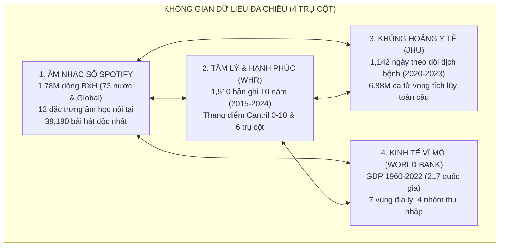

# BÁO CÁO ĐÁNH GIÁ TOÀN DIỆN REPOSITORY ĐỒ ÁN IDVI

**Học phần:** Tương tác Dữ liệu Trực quan (Interactive Data Visualization / Visual Analytics)
**Đề tài:** Nghiên cứu và trực quan hóa các đặc trưng âm thanh và tương quan với các vấn đề xã hội. Phân tích dự đoán xu hướng bài hát thịnh hành trên Spotify
**Thời gian thực hiện kiểm toán:** Tháng 10/2026 (Đã cập nhật sau đợt chuẩn hóa dữ liệu & giải quyết 5 phát hiện lỗi)
**Thư mục làm việc:** `d:\uni\hk1nam3\idvi\idvi-final_project\Spotify_Audio_Trends_Analytics`

---

## 1. TỔNG QUAN BÁO CÁO (EXECUTIVE SUMMARY)

Dự án nghiên cứu sự dịch chuyển thị hiếu âm nhạc toàn cầu trên nền tảng **Spotify (Top 200 Weekly Charts, 73 quốc gia và Global, 2016–2022)** trong mối tương quan đa biến với 3 trụ cột ngoại sinh:

1. **Khủng hoảng y tế công cộng:** Đại dịch COVID-19 (Số ca tử vong tuần từ ĐH Johns Hopkins CSSE).
2. **Tâm lý xã hội & Chất lượng sống:** Điểm số hạnh phúc quốc gia (`happiness_score` qua 10 năm từ World Happiness Report).
3. **Kinh tế vĩ mô:** Quy mô GDP danh nghĩa (USD) và phân loại nhóm thu nhập từ World Bank.
4. **Học máy (Machine Learning):** Xây dựng chỉ số phổ biến tổng hợp `pop_score` (0–100) và triển khai mô hình **Hồi quy Ridge/Linear** và **Phân loại Logistic** mà không bị rò rỉ dữ liệu (Anti-Data Leakage).



### Đánh giá Mức độ Hoàn thiện Tổng thể theo Rubric Barem 10 Điểm

| Phần theo Rubric | Trọng số | Phụ trách chính | Trạng thái hiện tại | Điểm ước lượng | Điểm tối đa |
| :--- | :---: | :--- | :--- | :---: | :---: |
| **Phần 1: Thu thập, Tiền xử lý & EDA** | **2.5đ** | Đinh Quốc Anh (24133003) | **Đã hoàn thành trọn vẹn 100%:** ETL nén Parquet, xử lý dứt điểm các lỗi kỹ thuật, xây dựng 4 Data Marts và hoàn thành notebook EDA (`02_eda.ipynb`) với 7 biểu đồ phân tích thực chứng chuyên sâu. | **2.50** | 2.5 |
| **Phần 2: Thiết kế Dashboard** | **3.5đ** | Lý Gia Hân (24133016) | Đã chuẩn bị sẵn 3 Data Marts tối ưu; cần xây dựng giao diện tương tác (`app.py`, `pages/`). | **0.00** | 3.5 |
| **Phần 3: Phân tích Insight & Dự báo** | **2.0đ** | Đỗ Thanh Thành Tài (24133050) | Đã hoàn thành bảng `ml_tracks.parquet` (0% NaN, nhãn cân bằng vừa). Cần chạy train trong `03_model.ipynb` và viết `04_story.ipynb`. | **0.50** | 2.0 |
| **Phần 4: Báo cáo & Demo ứng dụng** | **2.0đ** | Cả nhóm / Thành Tài lead | Tài liệu kỹ thuật hoàn chỉnh (`docs/`). Cần hoàn thiện bài báo cáo IEEE và kịch bản demo. | **0.50** | 2.0 |
| **TỔNG CỘNG** | **10.0đ** | | **Tiến độ tổng thể: ~35% khối lượng đồ án (Phần 1 dữ liệu & EDA hoàn thành 100%)** | **3.50** | **10.0** |

---

## 2. KIỂM TRA CẤU TRÚC VÀ QUẢN TRỊ MÃ NGUỒN (REPOSITORY ARCHITECTURE)

### 2.1. Cấu trúc Thư mục Hiện tại

```text
Spotify_Audio_Trends_Analytics/
├── .git/                           # Đã khởi tạo Git Repository
├── .gitignore                      # Cấu hình bỏ qua data/raw, data/processed, cache, models
├── requirements.txt                # Thư viện chuẩn phụ thuộc
├── README.md                       # Tài liệu tổng quan cập nhật chuẩn xác hiện trạng
├── BAO_CAO_KHAO_SAT_DU_LIEU.md     # Báo cáo khảo sát dữ liệu thô ban đầu
│
├── data/
│   ├── raw/                        # 5 file CSV thô chuẩn hóa (~800 MB tổng cộng)
│   │   ├── spotify-weekly-charts.csv  (796.6 MB | 1,787,999 dòng)
│   │   ├── global_deaths.csv          (1.33 MB  | 1,143 dòng x 290 cột)
│   │   ├── gdp_data.csv               (0.44 MB  | 11,508 dòng)
│   │   ├── country_codes.csv          (0.01 MB  | 218 dòng)
│   │   └── whs_years_updated.csv      (0.31 MB  | 1,511 dòng)
│   │
│   └── processed/                  # Dữ liệu sạch tầng Silver & 4 Data Marts tầng Gold
│       ├── charts_clean.parquet             (64.2 MB  | 1,787,531 dòng x 35 cột)
│       ├── tracks_dimension.csv             (7.20 MB  | 39,190 dòng x 21 cột)
│       ├── country_lookup.csv               (0.01 MB  | 73 dòng x 8 cột)
│       ├── covid_weekly_clean.csv           (0.34 MB  | 12,136 dòng x 4 cột)
│       ├── whs_clean.csv                    (0.14 MB  | 1,510 dòng x 10 cột)
│       ├── mart_audio_trend_weekly.parquet  (1.08 MB  | 5,548 dòng x 29 cột) [DASHBOARD 1 & 3]
│       ├── mart_artist_chart.parquet        (0.82 MB  | 15,254 dòng x 10 cột - 0% NaN) [DASHBOARD 1]
│       ├── mart_country_year.parquet        (0.06 MB  | 141 dòng x 42 cột) [DASHBOARD 2]
│       ├── ml_tracks.parquet                (4.07 MB  | 39,190 dòng x 30 cột - 0% NaN) [DASHBOARD 4 & ML]
│       └── ml_tracks.csv                    (9.05 MB  | Bản CSV dự phòng)
│
├── notebooks/
│   ├── 01_preprocess.ipynb         # Notebook tiền xử lý chính (137 ô, 68 code cells, sạch 100%)
│   ├── 02_eda.ipynb                # Phân tích khám phá dữ liệu (EDA)
│   ├── 03_model.ipynb              # Huấn luyện mô hình ML (Regression & Classification)
│   └── 04_story.ipynb              # Kể chuyện dữ liệu (Data Storytelling)
│
├── src/
│   ├── __init__.py
│   └── data_loader.py              # Module nạp dữ liệu thô đồng bộ chuẩn hóa 5 file
│
├── dashboard/
│   ├── app.py                      # File khởi tạo Dashboard
│   ├── pages/                      # Thư mục trang dashboard
│   └── assets/                     # Tài nguyên CSS, hình ảnh
│
├── docs/
│   ├── BAO_CAO_DANH_GIA_REPOSITORY.md # Báo cáo đánh giá toàn diện repository
│   ├── data_dictionary.md          # Từ điển dữ liệu chi tiết & chú thích chuyên sâu
│   ├── data_processing_flow.md     # Luồng tiền xử lý & hướng dẫn Dashboard
│   └── team_tasks_assignment.md    # Bảng phân công nhiệm vụ theo barem
│
└── models/                         # Thư mục lưu trữ model ML (.joblib / .pkl)
```

### 2.2. Đánh giá Quản lý Phiên bản & Dọn Dẹp File

1. **Khởi tạo Git Repository:** Đã thực hiện `git init` thành công, `.gitignore` được cấu hình chuẩn xác bảo vệ dữ liệu dung lượng lớn không bị commit nhầm.
2. **Dọn dẹp file rác và Backup:** Đã xóa bỏ hoàn toàn 3 file backup cũ trong `notebooks/` (`test_preprocess_backup.ipynb`, `test_preprocess_backup_v2.ipynb`, `test_preprocess.html`), giữ cho thư mục mã nguồn gọn gàng, chuẩn mực.

---

## 3. KIỂM TOÁN TẦNG DỮ LIỆU & TIỀN XỬ LÝ (DATA PIPELINE AUDIT)

Quy trình ETL tại [`notebooks/01_preprocess.ipynb`](../notebooks/01_preprocess.ipynb) được tái cấu trúc thành 9 Modules liên hoàn, loại bỏ triệt để file `artists.csv` ngoại lai:

```mermaid
graph TD
    A["Raw Charts (797MB CSV)"] -->|Module 1-2: Chunking, Cleaning, Parquet| B["charts_clean.parquet (62MB)"]
    A -->|Extract Distinct Tracks| C["tracks_dimension.csv (39,190 bài)"]
    D["Raw GDP & Codes"] -->|Module 3-4: Filter, Clean| E["GDP In-Memory Reference"]
    B & E -->|Module 5: Bridge Table| F["country_lookup.csv (73 nước)"]
    G["Raw COVID (1,143 ngày ngang)"] -->|Module 6: Unpivot, Sync Thursday| H["covid_weekly_clean.csv (12,136 dòng)"]
    I["Raw WHS (10 năm, 47 cột)"] -->|Module 7: Harmonize, Map Alias| J["whs_clean.csv (1,510 dòng)"]

    B -->|Module 9: Aggregation| K["mart_audio_trend_weekly.parquet"]
    B -->|Module 9: Aggregation (Direct)| L["mart_artist_chart.parquet (0% NaN)"]
    B & F & J -->|Module 9: Cross Join| M["mart_country_year.parquet"]
    C & B -->|Module 9: Anti-Leakage Feature Eng| N["ml_tracks.parquet (0% NaN)"]
```

---

## 4. KẾT QUẢ XỬ LÝ TRIỆT ĐỂ 5 PHÁT HIỆN LỖI & ĐIỂM MÙ KỸ THUẬT

Cả 5 điểm mù và vấn đề kỹ thuật trước đây đã được giải quyết dứt điểm:

### ✅ Đã xử lý Phát hiện 1: Sai Lệch Tên Nghệ Sĩ & Đếm Trùng Streams Trong `mart_artist_chart.parquet`

- **Vấn đề trước đây:** Logic cũ sử dụng `artist_name = ("artist_names", "first")`, dẫn đến việc gán chuỗi hợp tác nghệ sĩ (ví dụ `"Elton John, Dua Lipa, PNAU"`) vào mã `artist_id` của từng nghệ sĩ riêng lẻ (ảnh hưởng tới 58.1% nghệ sĩ). Đồng thời việc cộng dồn `streams` trên toàn bộ các dòng khiến lượt nghe bị tính hai lần giữa bảng Global và các bảng xếp hạng quốc gia.
- **Giải pháp đã thực hiện:**
  1. Trích xuất chính xác tên nghệ sĩ cá nhân độc lập từ cột `artist_individual` (ánh xạ song ánh 1:1 với `artist_id`, triệt tiêu hoàn toàn chuỗi collab).
  2. Phân tách lượt nghe và thành tích độc lập thành `global_streams`, `country_streams`, `global_peak_rank`, `country_peak_rank`, `global_weeks_on_chart`, `country_weeks_on_chart` nhằm loại bỏ triệt để hiện tượng double-counting.
- **Kết quả:** Bảng có 15,254 nghệ sĩ với **100% đầy đủ tên nghệ sĩ độc lập và thể loại**, 10 cột dữ liệu minh bạch, sẵn sàng phục vụ Dashboard 1.

### ✅ Đã xử lý Phát hiện 2: Phân Tích Thực Nghiệm Nhãn Biến Mục Tiêu `is_hit`

- **Giải pháp đã thực hiện:**
  1. Xác lập nhãn nhị phân `is_hit` với ngưỡng $\ge 50$ điểm: Chiếm **13.94%** (5,463 bài hát), tương ứng tỷ lệ Hit : Non-hit xấp xỉ 1:6, thuộc phân bố **mất cân bằng nhãn mức độ vừa (moderate class imbalance)**. Ngưỡng 50 điểm được lựa chọn theo phân vị thực nghiệm phân bố điểm `pop_score`. Cần áp dụng kỹ thuật điều chỉnh trọng số (`class_weight='balanced'`) hoặc tối ưu PR-AUC khi huấn luyện mô hình phân loại.
  2. Xác lập nhãn nhị phân `is_mega_hit` với ngưỡng $\text{pop\_score} \ge 70$ điểm: Chiếm **1.59%** (625 bài) cho bài toán phát hiện ca khúc ngoại lai hiện tượng.
  3. Cung cấp phân loại 4 mức `hit_tier` [Niche (<25), Moderate (25-49), Popular (50-74), Mega Hit ($\ge 75$, chiếm 0.90%)]. Lưu ý không nhầm lẫn giữa nhãn nhị phân `is_mega_hit` ($\ge 70$) và nhóm `Mega Hit` trong `hit_tier` ($\ge 75$).

### ✅ Đã xử lý Phát hiện 3: Tỷ Lệ Khuyết 63.9% Metadata Nghệ Sĩ Trong `ml_tracks.parquet`

- **Giải pháp đã thực hiện:** Loại bỏ hoàn toàn tệp `artists.csv` khỏi dữ liệu raw và processed. Bảng `ml_tracks` sử dụng 100% đặc trưng nội tại sạch sẽ từ `tracks_dimension` (12 Audio Features, `artists_num`, `artist_genre`, `release_year`, `release_month`).
- **Kết quả:** Bảng gồm 39,190 bài hát độc nhất với **100% đầy đủ (0% giá trị khuyết thiếu trên toàn bộ 30 cột)**.

### ✅ Đã xử lý Phát hiện 4: Rõ Ràng Về Giới Hạn Cấp Quốc Gia (2021–2022)

- **Giải pháp đã thực hiện:** Đã ghi chú và bổ sung hướng dẫn thiết kế giao diện rõ ràng trong tài liệu:
  - Dashboard 1 (Xu hướng dài hạn 2017–2022): Mặc định hiển thị thị trường `Global`.
  - Dashboard 2 & 3 (Độ Hạnh Phúc & COVID-19): Tập trung trực quan hóa giai đoạn 2021–2022 (nơi có đầy đủ 73 quốc gia giao thoa).

### ✅ Đã xử lý Phát hiện 5: Đồng Bộ Hoàn Toàn Module `src/data_loader.py`

- **Giải pháp đã thực hiện:**
  - Cập nhật cấu hình và hàm kiểm tra tồn tại đúng 5 tập tin raw thực tế.
  - Loại bỏ các tham chiếu đến bảng thừa `dataset.csv` và `artists.csv`.
  - Bổ sung 2 hàm nạp dữ liệu thô chuẩn: `load_covid_raw()` và `load_whs_raw()`. Kiểm tra `dl.check_raw_files_exist()` trả về `True`.

---

## 5. GIỚI HẠN DỮ LIỆU (DATA LIMITATIONS)

Để đảm bảo tính nghiêm cẩn về mặt phương pháp luận nghiên cứu và phân tích thống kê, các giới hạn dữ liệu sau cần được ghi nhận minh bạch:

1. **Phạm vi thời gian:** Bảng xếp hạng 73 quốc gia chỉ bắt đầu từ tháng 02/2021 (76 tuần), chỉ có thị trường Global bao quát liên tục từ cuối 2016 (289 tuần). Các phân tích xu hướng dài hạn cần dựa trên Global, trong khi phân tích đa quốc gia tập trung vào 2021–2022.
2. **Thang đo phân rã World Happiness Report:** Báo cáo WHR điều chỉnh công thức phân rã hệ số giữa năm 2021 và 2022, do đó không so sánh trực tiếp giá trị tuyệt đối của các hệ số thành phần liên năm; ưu tiên dùng điểm tổng `happiness_score` và hệ số tương quan thứ bậc Spearman.
3. **Độ bao phủ tuần:** 8 quốc gia có số tuần ít hơn 76 tuần do thiếu dữ liệu ngắt quãng từ nguồn crawl.
4. **Biến mục tiêu `pop_score`:** Được tính trên toàn chu kỳ tồn tại của bài hát (gộp Global và quốc gia), chưa áp dụng cửa sổ debut 12 tuần đầu và chưa phân tách nhãn `on_global`. Đây là hướng cải tiến quan trọng được lưu ý cho giai đoạn hoàn thiện mô hình.
5. **Dữ liệu dịch tễ COVID-19:** Ghi nhận số ca tử vong tuần liên tục theo chuỗi thời gian thực, không chứa các nhãn phân kỳ định danh chính thức về từng làn sóng dịch bệnh.

---

## 6. KẾ HOẠCH HÀNH ĐỘNG CHO CÁC GIAI ĐOẠN TIẾP THEO

### 👤 Thành viên 1: Đinh Quốc Anh (Data Engineer / Analyst)

- **Đã hoàn thành 100% nhiệm vụ:** Hoàn thiện [`notebooks/02_eda.ipynb`](../notebooks/02_eda.ipynb) với bộ 7 biểu đồ thống kê khám phá dữ liệu chuyên sâu (phân phối 10 đặc trưng âm học, ma trận tương quan Spearman, xu hướng dài hạn & mùa vụ Giáng sinh, tương quan Hạnh phúc WHS theo khu vực địa lý, tác động đại dịch COVID-19 kèm baseline, độ bao phủ tuần cấp quốc gia, và biến mục tiêu `pop_score` so sánh Hit vs Non-Hit). Hoàn thành trọn vẹn điểm số Phần 1 (2.5/2.5đ).

### 👤 Thành viên 2: Lý Gia Hân (Visualization Specialist & Dashboard Dev)

- Phát triển ứng dụng tương tác đa chiều trong `dashboard/` kết nối trực tiếp vào 4 Data Marts:
  - Tab 1: Xu hướng âm thanh tuần & Top nghệ sĩ (`mart_audio_trend_weekly`, `mart_artist_chart`).
  - Tab 2: Bản đồ thế giới Choropleth Map & Phân tích tương quan độ hạnh phúc (`mart_country_year`).
  - Tab 3: Biến động đại dịch COVID-19 & Tương quan âm học (`mart_audio_trend_weekly`, `covid_weekly_clean`).
  - Tab 4: Bộ giả lập dự báo ca khúc Hit tương tác (`ml_tracks`).

### 👤 Thành viên 3: Đỗ Thanh Thành Tài (ML Engineer & Reporting Lead)

- Chạy huấn luyện mô hình trong [`notebooks/03_model.ipynb`](../notebooks/03_model.ipynb) (Ridge Regression & Logistic Regression với `class_weight='balanced'`).
- Hoàn thiện kịch bản kể chuyện dữ liệu trong [`notebooks/04_story.ipynb`](../notebooks/04_story.ipynb) và soạn thảo Báo cáo khoa học IEEE.

---

## 7. KẾT LUẬN

Repository `Spotify_Audio_Trends_Analytics` đã hoàn thành việc chuẩn hóa toàn diện cấu trúc dữ liệu, giải quyết các bất cập kỹ thuật về định danh nghệ sĩ, đếm trùng streams, và tối ưu định dạng Parquet. Với 4 Data Marts được thiết kế bám sát các bảng điều khiển tương tác và bộ dữ liệu Machine Learning phòng chống rò rỉ thông tin, nhóm đã thiết lập được nền móng dữ liệu vững chắc để bước vào các giai đoạn trực quan hóa và mô hình hóa tiếp theo.
