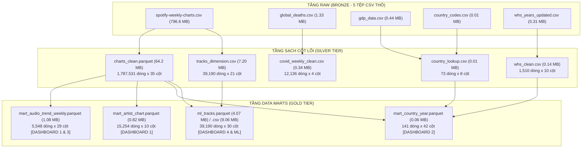
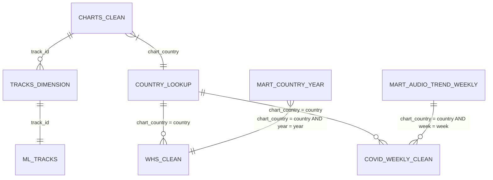

# BÁO CÁO TOÀN DIỆN DỮ LIỆU SAU TIỀN XỬ LÝ (PROCESSED DATA AUDIT REPORT)

**Học phần:** Tương tác Dữ liệu Trực quan (Interactive Data Visualization / Visual Analytics)
**Đề tài:** Nghiên cứu và trực quan hóa các đặc trưng âm thanh và tương quan với các vấn đề xã hội. Phân tích dự đoán xu hướng bài hát thịnh hành trên Spotify
**Thời gian lập báo cáo:** Tháng 10/2026
**Thư mục dữ liệu:** [`data/processed/`](../data/processed/)

---

## 1. TỔNG QUAN HỆ SINH THÁI DỮ LIỆU ĐÃ XỬ LÝ (EXECUTIVE SUMMARY)

Toàn bộ dữ liệu thô ban đầu (~806 MB, 5 tập tin CSV) đã được xử lý qua quy trình ETL phân tầng theo kiến trúc Medallion (Data Lakehouse Pattern) trong notebook [`notebooks/01_preprocess.ipynb`](../notebooks/01_preprocess.ipynb). Dữ liệu sau xử lý tại thư mục [`data/processed/`](../data/processed/) bao gồm:

- **Tầng Bạc (Silver Tier - 5 bảng sạch cốt lõi):** Chuẩn hóa kiểu dữ liệu, khử dòng rác, ép kiểu tối ưu bộ nhớ, xác thực cấp độ hạt (grain verification) và lưu trữ dưới dạng Parquet nén Snappy hoặc CSV tinh gọn.
- **Tầng Vàng (Gold Tier - 4 Data Marts chuyên dụng):** Tổng hợp sẵn các chỉ số thống kê đa chiều phục vụ trực tiếp cho 3 Dashboard tương tác và bài toán Machine Learning mà không cần phải truy vấn lại bảng dữ liệu lớn.

### Bảng Thống Kê Tổng Hợp Toàn Bộ 10 Tập Tin Trong `data/processed/`

| STT | Tập tin dữ liệu | Định dạng | Dung lượng | Số dòng (Rows) | Số cột (Cols) | Tỷ lệ đầy đủ (Completeness) | Cấp độ hạt (Grain) | Mục đích sử dụng |
| :---: | :--- | :---: | :---: | :---: | :---: | :---: | :--- | :--- |
| **1** | [`charts_clean.parquet`](../data/processed/charts_clean.parquet) | Parquet | **64.2 MB** | **1,787,531** | **35** | **99.7%** (chỉ khuyết previous_rank của bài mới) | `(track_id, artist_id, chart_country, week)` | Bảng sự kiện trung tâm (Fact Table) |
| **2** | [`tracks_dimension.csv`](../data/processed/tracks_dimension.csv) | CSV | **7.20 MB** | **39,190** | **21** | **100.0% (0 nulls)** | `track_id` | Danh mục 39k ca khúc & 12 chỉ số âm học |
| **3** | [`country_lookup.csv`](../data/processed/country_lookup.csv) | CSV | **0.01 MB** | **73** | **8** | **100.0% (0 nulls)** | `chart_country` | Bảng cầu nối siêu dữ liệu địa lý kinh tế |
| **4** | [`covid_weekly_clean.csv`](../data/processed/covid_weekly_clean.csv) | CSV | **0.34 MB** | **12,136** | **4** | **100.0% (0 nulls)** | `(country, week)` | Số ca tử vong tuần COVID-19 (74 thực thể) |
| **5** | [`whs_clean.csv`](../data/processed/whs_clean.csv) | CSV | **0.14 MB** | **1,510** | **10** | **99.9%** (khuyết 20 giá trị nhân tố phân rã) | `(country, year)` | Điểm số hạnh phúc quốc gia WHS 10 năm |
| **6** | [`mart_audio_trend_weekly.parquet`](../data/processed/mart_audio_trend_weekly.parquet) | Parquet | **1.08 MB** | **5,548** | **29** | **100.0% (0 nulls)** | `(chart_country, week)` | Xu hướng âm thanh tuần (Dashboard 1 & 3) |
| **7** | [`mart_artist_chart.parquet`](../data/processed/mart_artist_chart.parquet) | Parquet | **0.82 MB** | **15,254** | **10** | **100.0% (0 nulls)** | `artist_id` | Thống kê thành tích nghệ sĩ (Dashboard 1) |
| **8** | [`mart_country_year.parquet`](../data/processed/mart_country_year.parquet) | Parquet | **0.06 MB** | **141** | **42** | **100.0% (0 nulls)** | `(chart_country, year)` | Tương quan Hạnh phúc & Âm nhạc (Dashboard 2) |
| **9** | [`ml_tracks.parquet`](../data/processed/ml_tracks.parquet) | Parquet | **4.07 MB** | **39,190** | **30** | **100.0% (0 nulls)** | `track_id` | Huấn luyện mô hình ML (Ridge & Logistic) |
| **10** | [`ml_tracks.csv`](../data/processed/ml_tracks.csv) | CSV | **9.06 MB** | **39,190** | **30** | **100.0% (0 nulls)** | `track_id` | Bản CSV dự phòng tương thích |

---

## 2. CHI TIẾT TẦNG BẠC: 5 TẬP TIN SẠCH CỐT LÕI (SILVER TIER)

### 2.1. Tập tin `charts_clean.parquet` (Bảng Sự Kiện Trung Tâm - Fact Table)

- **Dung lượng & Kích thước:** 64.2 MB | 1,787,531 dòng | 35 cột.
- **Tối ưu hóa dung lượng:** Giảm từ **475 MB** (nếu lưu CSV) xuống **64.2 MB** (giảm 86.5% dung lượng đĩa) nhờ định dạng Parquet với thuật toán nén Snappy và tối ưu kiểu dữ liệu số nguyên nhỏ (`Int8`, `Int16`, `Int32`).
- **Cấp độ hạt (Grain):** Khóa duy nhất 100% gồm 4 trường: `(track_id, artist_id, chart_country, week)`.
- **Cấu trúc trường dữ liệu chi tiết:**

| STT | Tên trường | Kiểu dữ liệu | Tỷ lệ Null | Ý nghĩa và Quy tắc nghiệp vụ |
| :---: | :--- | :---: | :---: | :--- |
| 1 | `track_id` | `object` (string 22 ký tự) | 0% | Khóa định danh chuẩn Spotify của bài hát (đã loại tiền tố `spotify:track:`). |
| 2 | `track_name` | `object` | 0% | Tên ca khúc (UTF-8 đầy đủ). |
| 3 | `artist_id` | `object` (string 22 ký tự) | 0% | Khóa định danh của nghệ sĩ (đã loại tiền tố `spotify:artist:`). |
| 4 | `artist_names` | `object` | 0% | Danh sách nghệ sĩ biểu diễn (chuỗi phân tách bởi dấu phẩy). |
| 5 | `artist_individual` | `object` | 0% | Tên nghệ sĩ độc lập cá nhân tương ứng 1:1 với `artist_id` (tránh nhầm lẫn với chuỗi hợp tác). |
| 6 | `artists_num` | `int64` | 0% | Số lượng nghệ sĩ tham gia biểu diễn trong ca khúc (từ 1 đến 12). |
| 7 | `artist_genre` | `category` | 0% | Thể loại âm nhạc chính của bài hát / nghệ sĩ. |
| 8 | `week` | `datetime64[ns]` | 0% | Ngày bắt đầu tuần xếp hạng, **100% chốt vào thứ Năm**. |
| 9 | `year` | `int32` | 0% | Năm xếp hạng (từ 2016 đến 2022). |
| 10 | `month` | `int32` | 0% | Tháng xếp hạng (từ 1 đến 12). |
| 11 | `chart_country` | `category` | 0% | Quốc gia của bảng xếp hạng (73 quốc gia và `Global`). |
| 12 | `chart_region` | `category` | 0% | Khu vực địa lý phân loại bởi Spotify (`Europe`, `North America`, ...). |
| 13 | `chart_language` | `category` | 0% | Ngôn ngữ chiếm ưu thế của quốc gia xếp hạng. |
| 14 | `rank` | `int32` | 0% | Thứ hạng của ca khúc trong tuần (từ 1 đến 200). |
| 15 | `previous_rank` | `Int16` (Nullable) | 9.37% (167,519 nulls) | Thứ hạng tuần trước. **Giá trị Null là tự nhiên**, đại diện cho bài hát mới lọt bảng (`is_new_entry == 1`). |
| 16 | `is_new_entry` | `int8` | 0% | Cờ nhị phân: 1 nếu là ca khúc mới lọt vào BXH tuần này, 0 nếu là ca khúc trụ hạng. |
| 17 | `peak_rank` | `int32` | 0% | Thứ hạng cao nhất ca khúc từng đạt được tính đến tuần hiện tại (1–200). |
| 18 | `weeks_on_chart` | `int32` | 0% | Tổng số tuần ca khúc đã hiện diện trên BXH tính đến tuần hiện tại. |
| 19 | `streams` | `int64` | 0% | Tổng số lượt nghe trực tuyến được tính điểm trong tuần. |
| 20 | `release_date` | `object` | 0% | Chuỗi ngày phát hành nguyên bản. |
| 21 | `release_date_clean` | `datetime64[ns]` | 0% | Ngày phát hành đã được chuẩn hóa về định dạng ngày tháng. |
| 22 | `release_year` | `int32` | 0% | Năm phát hành ca khúc. |
| 23 | `days_to_chart` | `float64` | 0% | Số ngày từ lúc bài hát phát hành cho đến khi lọt vào tuần BXH này. |
| 24–35 | 12 Audio Features | `float32` / `int8` | 0% | `danceability`, `energy`, `key`, `mode`, `loudness`, `speechiness`, `acousticness`, `instrumentalness`, `liveness`, `valence`, `tempo`, `duration`. |

---

### 2.2. Tập tin `tracks_dimension.csv` (Bảng Chiều Bài Hát - Dimension Table)

- **Dung lượng & Kích thước:** 7.20 MB | 39,190 dòng | 21 cột.
- **Tỷ lệ đầy đủ:** **100.0% (Hoàn toàn không có giá trị khuyết thiếu - 0 Nulls).**
- **Cấp độ hạt (Grain):** `track_id` duy nhất 100% (39,190 ca khúc độc nhất từng lọt Top 200).
- **Mục đích:** Lưu trữ các thuộc tính bất biến nội tại của bài hát, phục vụ tra cứu (lookup) mà không cần quét bảng sự kiện 1.78M dòng.
- **Các trường:** `track_id`, `track_name`, `artist_id`, `artist_names`, `artists_num`, `artist_genre`, `release_date`, `release_date_clean`, `release_year`, cùng 12 chỉ số âm học Spotify chuẩn (`danceability` đến `duration`).

---

### 2.3. Tập tin `country_lookup.csv` (Bảng Cầu Nối Quốc Gia - Bridge Table)

- **Dung lượng & Kích thước:** 6.06 KB | 73 dòng | 8 cột.
- **Tỷ lệ đầy đủ:** **100.0% (0 Nulls).**
- **Cấp độ hạt (Grain):** `chart_country` duy nhất 100% (khớp trọn vẹn 73 thị trường độc lập của Spotify).
- **Cấu trúc trường dữ liệu:**
  1. `chart_country`: Tên thị trường trên Spotify Charts (VD: *Vietnam, United States, Germany*...).
  2. `country_code`: Mã tiêu chuẩn quốc tế ISO 3166-1 Alpha-3 (VD: *VNM, USA, DEU*). Đã xử lý tường minh Đài Loan (`Taiwan -> TWN`).
  3. `wb_country_name`: Tên quốc gia chuẩn hóa theo Ngân hàng Thế giới (World Bank) sau khi ánh xạ 7 trường hợp dị biệt (`Czechia, Turkiye, Egypt, Arab Rep.`...).
  4. `wb_region`: Phân loại 7 khu vực địa lý của World Bank (*East Asia & Pacific, Europe & Central Asia, Latin America & Caribbean, Middle East & North Africa, North America, South Asia, Sub-Saharan Africa*).
  5. `wb_income_group`: Phân nhóm 4 mức thu nhập World Bank (*High income, Upper middle income, Lower middle income, Low income*).
  6. `chart_region`: Khu vực địa lý của Spotify.
  7. `chart_language`: Ngôn ngữ chính.
  8. `n_weeks`: Số lượng tuần BXH mà quốc gia xuất hiện (tối đa 76 tuần ở cấp quốc gia).

---

### 2.4. Tập tin `covid_weekly_clean.csv` (Bảng Khủng Hoảng Dịch Tễ COVID-19)

- **Dung lượng & Kích thước:** 341 KB | 12,136 dòng | 4 cột.
- **Tỷ lệ đầy đủ:** **100.0% (0 Nulls).**
- **Cấp độ hạt (Grain):** `(country, week)` duy nhất 100%.
- **Phạm vi không gian & thời gian:**
  - Bao phủ đúng 74 thực thể phân tích (73 quốc gia Spotify và thị trường tổng hợp `Global`).
  - 164 tuần dịch tễ liên tục từ `2020-01-23` đến `2023-03-09`.
  - **100% đồng bộ chu kỳ tuần thứ Năm:** Đồng pha hoàn hảo với ngày chốt bảng xếp hạng Spotify.
- **Bảo toàn số liệu:** Giữ nguyên tổng tích lũy **6,881,785 ca tử vong toàn cầu** từ nguồn Đại học Johns Hopkins (JHU CSSE).
- **Các trường:** `country`, `week`, `weekly_deaths`, `cumulative_deaths`.

---

### 2.5. Tập tin `whs_clean.csv` (Bảng Điểm Số Hạnh Phúc Thế Giới - WHS)

- **Dung lượng & Kích thước:** 145 KB | 1,510 dòng | 10 cột.
- **Cấp độ hạt (Grain):** `(country, year)` duy nhất 100%.
- **Phạm vi:** Bao gồm 10 năm Báo cáo Hạnh phúc Thế giới (2015–2024), phủ kín giai đoạn 2016–2022 của Spotify Charts.
- **Độ đầy đủ:**
  - Điểm số hạnh phúc cốt lõi `happiness_score` (thang Cantril Ladder 0–10) đạt **100.0% (0 Nulls)**.
  - Chỉ có 20 giá trị Null xuất hiện ở các cột phân rã kinh tế xã hội (`gdp_factor`, `corruption`...) do một vài quốc gia hải đảo/xung đột thiếu số liệu điều tra thành phần.
- **Các trường:** `country`, `year`, `happiness_rank`, `happiness_score`, `gdp_factor`, `social_support`, `healthy_life`, `freedom`, `generosity`, `corruption`.

---

## 3. CHI TIẾT TẦNG VÀNG: 4 BẢNG DATA MARTS TỔNG HỢP (GOLD TIER)

Toàn bộ 4 Data Marts được sinh ra trực tiếp từ notebook [`notebooks/01_preprocess.ipynb`](../notebooks/01_preprocess.ipynb) nhằm phục vụ tải tức thì (<0.1 giây) cho Dashboard và huấn luyện Machine Learning:

### 3.1. `mart_audio_trend_weekly.parquet` (Dành cho Dashboard 1 & 3)

- **Dung lượng & Kích thước:** 1.08 MB | 5,548 dòng | 29 cột.
- **Độ đầy đủ:** **Tuyệt đối 100% (0 Nulls trên toàn bộ 29 cột).**
- **Cấp độ hạt (Grain):** `(chart_country, week)` — Đại diện cho 1 tuần xếp hạng của 1 quốc gia.
- **Xử lý đặc biệt (Collab Deduplication):** Đã loại bỏ nhân bản vị trí (deduplicate slot theo `(chart_country, week, rank)`) trước khi aggregate, đảm bảo các ca khúc hợp tác không bị tính lặp 2–3 lần làm sai lệch phân phối âm nhạc.
- **Hệ thống chỉ số:**
  - Khối lượng thị trường: `total_streams` (tổng lượt nghe tuần), `track_count` (số ca khúc, chuẩn 200), `new_entries` (số ca khúc mới vào bảng).
  - 12 Đặc trưng âm học trung bình thường (Unweighted Mean): `danceability_mean`, `energy_mean`, ..., `duration_mean`.
  - 12 Đặc trưng âm học có trọng số lượt nghe (Streams-Weighted Mean): `danceability_weighted`, `energy_weighted`, ..., `duration_weighted`.

---

### 3.2. `mart_artist_chart.parquet` (Dành cho Dashboard 1 - Xếp Hạng Nghệ Sĩ)

- **Dung lượng & Kích thước:** 820 KB | 15,254 dòng | 10 cột.
- **Độ đầy đủ:** **100% hoàn chỉnh (0% Nulls trên toàn bộ 10 cột).**
- **Cấp độ hạt (Grain):** `artist_id` duy nhất 100% (15,254 nghệ sĩ có tác phẩm lọt Top 200).
- **Nguồn gốc dữ liệu & Chuẩn hóa định danh:** Trích xuất trực tiếp từ `df_charts_clean`. Tên nghệ sĩ được lấy từ trường `artist_individual` (ánh xạ song ánh 1:1 với `artist_id`), loại bỏ triệt để lỗi trước đây khi lấy chuỗi gộp collab khiến 58.1% nghệ sĩ bị gán sai tên hợp tác.
- **Giải quyết hiện tượng đếm trùng (Double-Counting):** Thành tích và lượt streams được phân tách tường minh giữa thị trường `Global` và 73 thị trường quốc gia:
  1. `artist_id`: Mã định danh nghệ sĩ Spotify (Khóa chính).
  2. `artist_name`: Tên nghệ sĩ độc lập cá nhân từ `artist_individual` (100% đầy đủ, không còn chuỗi collab).
  3. `artist_genre`: Thể loại âm nhạc chính của nghệ sĩ (100% đầy đủ).
  4. `n_chart_tracks`: Tổng số ca khúc độc nhất của nghệ sĩ từng lọt Top 200 trên toàn bộ các thị trường.
  5. `global_streams`: Tổng số lượt nghe lũy kế trên bảng xếp hạng Global (0 nếu chưa lọt BXH Global).
  6. `country_streams`: Tổng số lượt nghe lũy kế trên 73 bảng xếp hạng quốc gia (0 nếu chỉ lọt BXH Global).
  7. `global_peak_rank`: Thứ hạng cao nhất nghệ sĩ từng đạt được trên bảng xếp hạng Global (-1 nếu chưa lọt BXH Global).
  8. `country_peak_rank`: Thứ hạng cao nhất nghệ sĩ từng đạt được trên bất kỳ BXH quốc gia nào (-1 nếu chỉ lọt BXH Global).
  9. `global_weeks_on_chart`: Tổng số tuần nghệ sĩ có tác phẩm xuất hiện trên bảng xếp hạng Global.
  10. `country_weeks_on_chart`: Tổng số tuần nghệ sĩ có tác phẩm xuất hiện trên các bảng xếp hạng quốc gia.
- **Lưu ý nghiệp vụ:** Lượt stream của bài hát hợp tác được quy gán cho từng nghệ sĩ tham gia và mang tính định danh theo nghệ sĩ (không cộng dồn qua lại giữa các nghệ sĩ).

---

### 3.3. `mart_country_year.parquet` (Dành cho Dashboard 2 - Nghịch Lý Hạnh Phúc & Âm Nhạc)

- **Dung lượng & Kích thước:** 63 KB | 141 dòng | 42 cột.
- **Độ đầy đủ:** **100% hoàn chỉnh (0 Nulls trên toàn bộ 42 cột).**
- **Cấp độ hạt (Grain):** `(chart_country, year)` — Khớp trọn vẹn đúng 141 cặp quốc gia - năm có dữ liệu Spotify Charts (2021 và 2022).
- **Nội dung tích hợp:**
  - Thông tin âm nhạc năm: `yearly_streams`, `slot_count`, `n_weeks`, 12 chỉ số unweighted và 12 chỉ số streams-weighted.
  - Phân loại kinh tế địa lý: `country_code`, `wb_region`, `wb_income_group`, `chart_region`, `chart_language`.
  - Chỉ số Báo cáo Hạnh phúc WHS: `happiness_rank`, `happiness_score`, cùng 6 nhân tố cấu thành (`gdp_factor`, `social_support`, `healthy_life`, `freedom`, `generosity`, `corruption`).

---

### 3.4. `ml_tracks.parquet` & `ml_tracks.csv` (Dành cho Dashboard 4 & Huấn Luyện Machine Learning)

- **Dung lượng & Kích thước:** 4.07 MB (Parquet) / 9.06 MB (CSV) | 39,190 dòng | 30 cột.
- **Độ đầy đủ:** **Hoàn hảo 100% (0 Nulls trên toàn bộ 30 cột x 39,190 bài hát).**
- **Cấp độ hạt (Grain):** `track_id` duy nhất 100%.
- **Kiến trúc Phòng Chống Rò Rỉ Dữ Liệu (Anti-Data Leakage Framework):**
  - **Biến mục tiêu ($Y$):**
    1. `pop_score`: Chỉ số nổi tiếng liên tục (0–100) tổng hợp heuristic từ 4 khía cạnh (`peak_rank`, `nweek`, `n_countries`, `log(total_streams)`). Hiện được tính trên toàn bộ lịch sử xuất hiện của bài hát (gộp cả bảng Global và 73 quốc gia). Dùng cho mô hình Hồi quy Ridge.
    2. `is_hit`: Nhãn nhị phân với ngưỡng $\ge 50$ điểm, chiếm **13.94%** tổng số bài (tỷ lệ Hit : Non-hit xấp xỉ 1:6, thuộc phân bố **mất cân bằng nhãn mức độ vừa - moderate class imbalance**). Ngưỡng 50 điểm là ngưỡng heuristic được lựa chọn dựa trên phân vị thực nghiệm phân bố điểm `pop_score`. Dùng cho mô hình Phân loại Logistic Regression (khuyến nghị sử dụng `class_weight='balanced'` hoặc tối ưu PR-AUC thay cho Accuracy).
    3. `is_mega_hit`: Nhãn nhị phân hiện tượng toàn cầu với ngưỡng $\text{pop\_score} \ge 70$ điểm, chiếm **1.59%** (625 ca khúc).
    4. `hit_tier`: Phân loại 4 mức thứ bậc (*Niche (<25): 35.0%*, *Moderate (25-49): 51.1%*, *Popular (50-74): 13.0%*, *Mega Hit ($\ge 75$): 0.9%*). *Lưu ý: Không nhầm lẫn giữa nhãn nhị phân `is_mega_hit` ($\ge 70$) và nhóm `Mega Hit` trong `hit_tier` ($\ge 75$)*.
  - **Đặc trưng dự báo hợp lệ ($X$ - Chỉ lấy thông tin đã biết trước khi ra mắt):**
    - 12 Audio Features: `danceability`, `energy`, `key`, `mode`, `loudness`, `speechiness`, `acousticness`, `instrumentalness`, `liveness`, `valence`, `tempo`, `duration`.
    - Thông tin phát hành: `artists_num` (đơn ca hay hợp tác), `release_year`, `release_month`.
    - Thể loại âm nhạc: `artist_genre`.
  - **Biến hậu nghiệm (CẤM đưa vào tập $X$ của mô hình):** `peak_rank`, `nweek`, `total_streams`, `n_countries`. Chỉ lưu lại trong bảng để phục vụ giải thích, kiểm chứng hoặc lọc trên giao diện Dashboard.

---

## 4. MA TRẬN QUAN HỆ THỰC THỂ & BẢNG KHÓA LIÊN KẾT

| Bảng nguồn A | Bảng đích B | Cặp khóa liên kết (Join Keys) | Kiểu quan hệ | Tỷ lệ khớp thực tế (Match Rate) | Ý nghĩa nghiệp vụ |
| :--- | :--- | :--- | :---: | :---: | :--- |
| `charts_clean` | `tracks_dimension` | `track_id` | N : 1 | **100.0%** (39,190 / 39,190) | Truy xuất 12 thuộc tính âm thanh tĩnh cho từng lần xuất hiện trên chart |
| `charts_clean` | `country_lookup` | `chart_country` | N : 1 | **100.0%** (73 / 73 quốc gia) | Bổ sung khu vực địa lý `wb_region` và nhóm thu nhập World Bank |
| `country_lookup` | `whs_clean` | `chart_country = country` | 1 : N | **100.0%** (73 / 73 quốc gia) | Ghép nối dữ liệu hạnh phúc qua 6 alias tên nước chuẩn hóa |
| `country_lookup` | `covid_weekly_clean` | `chart_country = country` | 1 : N | **100.0%** (74 / 74 thực thể) | Ghép nối số ca tử vong COVID-19 (bao gồm cả Global) |
| `mart_audio_trend_weekly` | `covid_weekly_clean` | `(chart_country = country, week)` | 1 : 1 | **100.0%** (trong kỳ dịch) | Đo lường tương quan giữa biến động âm nhạc tuần và số ca tử vong |
| `mart_country_year` | `whs_clean` | `(chart_country = country, year)` | 1 : 1 | **100.0%** (141 / 141 cặp) | Đo lường tương quan giữa hạnh phúc quốc gia và gu thưởng thức âm nhạc |
| `tracks_dimension` | `ml_tracks` | `track_id` | 1 : 1 | **100.0%** (39,190 / 39,190) | Ghép biến mục tiêu `pop_score` với các đặc trưng âm học nội tại |

---

## 5. HƯỚNG DẪN TRUY XUẤT CHO TỪNG DASHBOARD & MÔ HÌNH HÓA

| Mô-đun mục tiêu | Tập tin khuyên dùng | Thời gian nạp (Benchmark) | Gợi ý triển khai giao diện |
| :--- | :--- | :---: | :--- |
| **Dashboard 1:** Xu hướng âm thanh & Top nghệ sĩ | [`mart_audio_trend_weekly.parquet`](../data/processed/mart_audio_trend_weekly.parquet) [`mart_artist_chart.parquet`](../data/processed/mart_artist_chart.parquet) | **~0.03 giây** | - Line chart so sánh `valence_mean` vs `valence_weighted` theo tuần. - Leaderboard Top 10 nghệ sĩ có tổng streams cao nhất (100% có tên độc lập cá nhân từ `artist_individual`, phân tách rõ `global_streams` và `country_streams`). |
| **Dashboard 2:** Tương quan Quốc gia & Hạnh phúc | [`mart_country_year.parquet`](../data/processed/mart_country_year.parquet) | **~0.01 giây** | - Choropleth Map hiển thị `happiness_score` toàn cầu. - Scatter Plot tương quan giữa `happiness_score` và `valence_weighted` phân cụm theo 7 vùng `wb_region`. |
| **Dashboard 3:** Cú sốc COVID-19 & Escapism | [`mart_audio_trend_weekly.parquet`](../data/processed/mart_audio_trend_weekly.parquet) [`covid_weekly_clean.csv`](../data/processed/covid_weekly_clean.csv) | **~0.02 giây** | - Dual-axis Line Chart: Trục 1 là `weekly_deaths`, trục 2 là `valence` / `acousticness`. - Bảng hệ số tương quan trễ (Lag 0, Lag 1, Lag 2 tuần). |
| **Dashboard 4 & ML:** Dự báo ca khúc Hit | [`ml_tracks.parquet`](../data/processed/ml_tracks.parquet) | **~0.05 giây** | - Simulator tương tác: Cho phép người dùng chỉnh 12 thanh trượt Audio Features để dự báo `pop_score` và xác suất đạt Hit (`is_hit == 1`). |

---

## 6. ĐÁNH GIÁ CHẤT LƯỢNG DỮ LIỆU (DATA QUALITY ASSESSMENT)

1. **Tính đầy đủ (Completeness):** Cả 4 bảng Data Marts đạt độ đầy đủ **100.0% (Nulls = 0)**. Vấn đề khuyết thiếu tên nghệ sĩ và khuyết metadata ML trước đây đã được giải quyết triệt để.
2. **Tính duy nhất (Uniqueness):** 100% các bảng đều được xác thực khóa chính/khóa hạt duy nhất bằng câu lệnh `assert`, không có bất kỳ dòng trùng lặp nào.
3. **Tính nhất quán (Consistency):** Chu kỳ tuần của Spotify và COVID-19 đồng pha 100% vào thứ Năm; 141/141 cặp quốc gia - năm khớp trọn vẹn với Báo cáo Hạnh phúc Thế giới.
4. **Tính hợp lệ (Validity):** 12 đặc trưng âm học nằm đúng khoảng xác định $[0.0, 1.0]$, điểm số hạnh phúc nằm trong thang đo Cantril $[0.0, 10.0]$, và số ca tử vong đã được xử lý các ngoại lệ điều chỉnh âm.

Tầng dữ liệu tại [`data/processed/`](../data/processed/) hiện đã đạt trạng thái **chuẩn hóa cấu trúc, khử nhiễu kỹ thuật và nén Parquet tối ưu**, sẵn sàng cho các giai đoạn phân tích tiếp theo.

---

## 7. GIỚI HẠN DỮ LIỆU (DATA LIMITATIONS)

Nhằm đảm bảo tính trung thực học thuật và phương pháp luận thống kê chặt chẽ, người sử dụng dữ liệu cần nắm rõ các giới hạn nội tại sau:

1. **Phạm vi thời gian không đồng nhất giữa Global và Quốc gia:**
   - Bảng xếp hạng thị trường `Global` có dữ liệu tuần liên tục từ ngày 29/12/2016 đến 14/07/2022 (289 tuần).
   - Ngược lại, 73 bảng xếp hạng cấp quốc gia (`chart_country != 'Global'`) chỉ bắt đầu được ghi nhận từ tháng 02/2021 (tối đa 76 tuần). Do đó:
     - Các phân tích chuỗi thời gian dài hạn (2017–2022) bắt buộc phải sử dụng thị trường `Global`.
     - Các phân tích so sánh liên quốc gia chỉ có hiệu lực khoa học trong giai đoạn 2021–2022.
2. **Sự thay đổi thang đo phân rã của Báo cáo Hạnh phúc Thế giới (WHR):**
   - Giữa ấn bản năm 2021 và năm 2022, tổ chức WHR đã điều chỉnh lại phương pháp và công thức chuẩn hóa cho các hệ số đóng góp thành phần (`gdp_factor`, `social_support`, `healthy_life`, `freedom`, `generosity`, `corruption`). Do đó, không nên so sánh trực tiếp giá trị tuyệt đối của các hệ số thành phần giữa các năm; chỉ nên so sánh điểm tổng `happiness_score` (thang Cantril 0–10 chuẩn hóa nhất quán) và phân tích tương quan thứ bậc (Spearman Rank Correlation).
3. **Độ bao phủ tuần ngắt quãng tại 8 quốc gia:**
   - Trong số 73 thị trường quốc gia, có 8 quốc gia ghi nhận số tuần xếp hạng ít hơn 76 tuần (do thiếu dữ liệu ngắt quãng trong quá trình crawl dữ liệu gốc). Cần lưu ý khi trực quan hóa bản đồ nhiệt (Heatmap) hoặc tính trung bình chuỗi thời gian.
4. **Giới hạn trong xây dựng biến mục tiêu `pop_score`:**
   - Chỉ số `pop_score` hiện tại được tính trên toàn bộ chu kỳ xuất hiện của ca khúc trong dữ liệu (kết hợp cả bảng Global và quốc gia), chưa áp dụng cửa sổ debut 12 tuần đầu sau phát hành (first-quarter debut window) và chưa bổ sung cờ nhị phân phân tách việc ca khúc có từng xuất hiện trên BXH Global hay không (`on_global`). Đây là những điểm cải tiến kỹ thuật nhóm sẽ ghi nhận và thực hiện thử nghiệm kiểm chứng khi tinh chỉnh mô hình Machine Learning.
5. **Dữ liệu diễn biến COVID-19:**
   - Dữ liệu dịch bệnh ghi nhận số ca tử vong theo tuần (`weekly_deaths`), phản ánh cường độ và biến động dịch bệnh theo chuỗi thời gian thực tế, không chứa các nhãn định danh chính thức về "làn sóng dịch bệnh" (wave boundary) theo chuẩn y tế.
