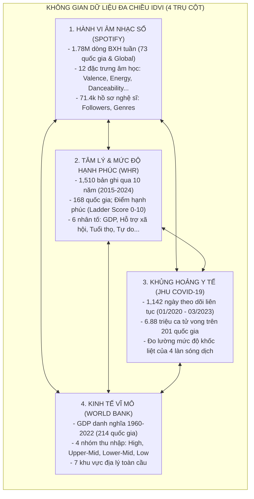
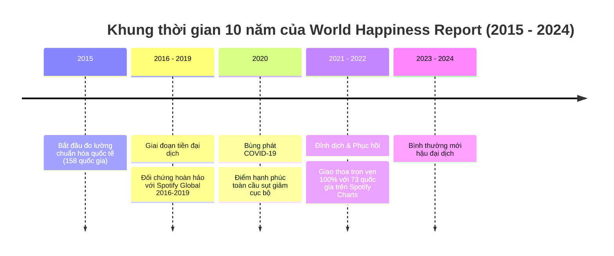
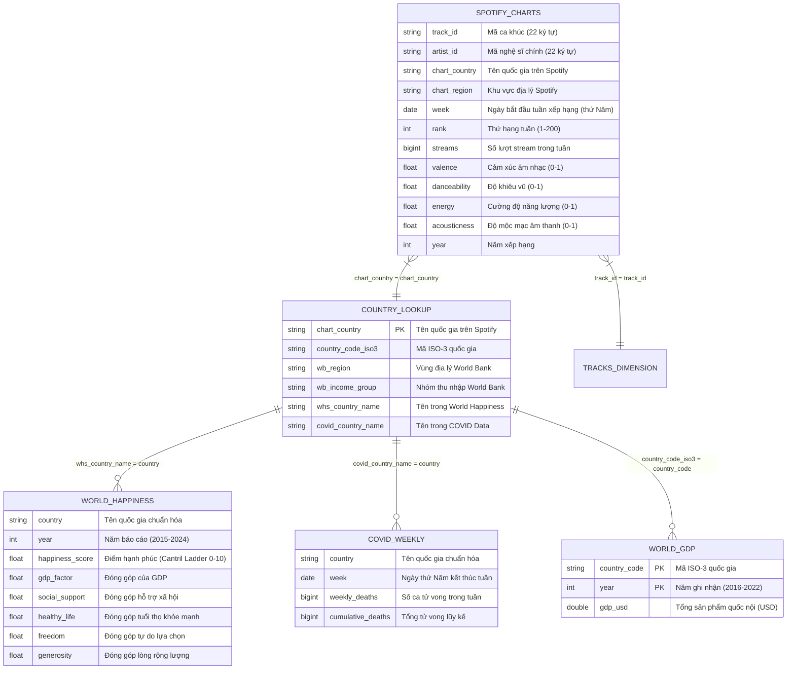
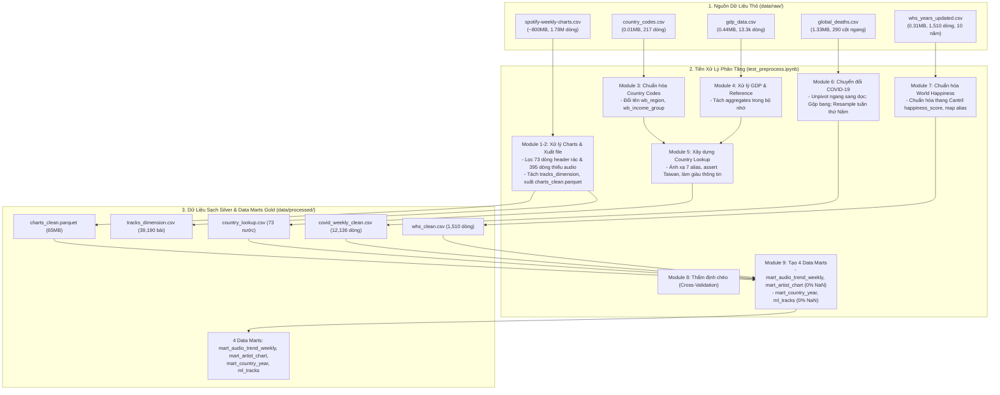
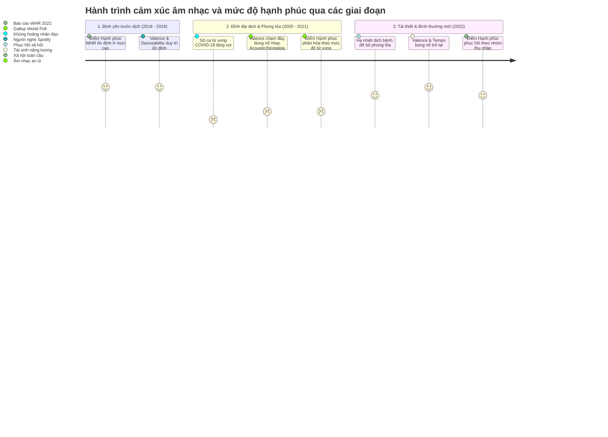

# BÁO CÁO KHẢO SÁT CHI TIẾT CÁC BỘ DỮ LIỆU THÔ (RAW DATA SURVEY REPORT)
**Học phần:** Tương tác dữ liệu trực quan (Information Design & Visual Interaction - IDVI)  
**Chủ đề nghiên cứu:** Khảo sát xu hướng âm nhạc số Spotify trong mối tương quan với mức độ hạnh phúc quốc gia, khủng hoảng đại dịch COVID-19 và bối cảnh kinh tế vĩ mô toàn cầu  
**Đơn vị thực hiện:** Nhóm / Cá nhân nghiên cứu đồ án IDVI  
**Thời gian cập nhật:** Tháng 10/2026  
**Thư mục dữ liệu khảo sát:** [`data/raw/`](file:///d:/uni/hk1nam3/idvi/idvi-final_project/project-indv/data/raw)

---

## 1. TỔNG QUAN BÁO CÁO (EXECUTIVE SUMMARY)

Báo cáo này thực hiện khảo sát toàn diện, kiểm thử thống kê cấu trúc và đánh giá chuyên sâu **6 tập tin dữ liệu thô dạng bảng (Tabular CSV)** hiện có trong thư mục `data/raw/`. 

Sự bổ sung mới nhất của tập dữ liệu **`whs_years_updated.csv`** (Báo cáo Hạnh phúc Thế giới - World Happiness Report qua 10 năm từ 2015 đến 2024) kết hợp cùng tập dữ liệu **`global_deaths.csv`** (Tử vong COVID-19 của Đại học Johns Hopkins) đã hoàn thiện một **không gian dữ liệu tích hợp 4 chiều độc nhất vô nhị** cho đồ án:

### Bảng tổng hợp 5 tập dữ liệu thô chuẩn hóa tại `data/raw/`

> [!NOTE]
> **Cập nhật chuẩn hóa dữ liệu:** Tập tin `artists.csv` ban đầu đã được **loại bỏ hoàn toàn** khỏi thư mục `data/raw/` và luồng tiền xử lý ETL do tỷ lệ khuyết thiếu quá lớn khi ghép nối (75.5% nghệ sĩ BXH bị NaN tên và 63.9% khuyết metadata trong ML). Toàn bộ thông tin nghệ sĩ và thể loại hiện được tổng hợp trực tiếp 100% đầy đủ từ `spotify-weekly-charts.csv`.

| STT | Tên tập tin | Dung lượng | Số dòng (Rows) | Số cột (Cols) | Nguồn dữ liệu gốc | Vai trò trong đồ án IDVI |
| :---: | :--- | :---: | :---: | :---: | :--- | :--- |
| **1** | `spotify-weekly-charts.csv` | **796.63 MB** | **1,787,999** | **36** | Spotify Weekly Top 200 (Kaggle - yelexa) | **Bảng sự kiện trung tâm (Fact):** Lượt streams, metadata nghệ sĩ và 12 đặc trưng âm học theo tuần của 73 quốc gia & Global (2016–2022). |
| **2** | `whs_years_updated.csv` | **0.31 MB** | **1,510** | **46** | World Happiness Report 2015–2024 (Gallup / UN SDSN) | **Chỉ số cảm xúc & chất lượng sống (Well-Being):** Điểm hạnh phúc quốc gia (`Score`) và 6 trụ cột xã hội học qua 10 năm liên tục. |
| **3** | `global_deaths.csv` | **1.33 MB** | **1,143** | **290** | COVID-19 Data Repository (JHU CSSE / Kaggle) | **Biến khủng hoảng ngoại sinh (Crisis Impact):** Số ca tử vong mới hàng ngày (2020–2023) phản ánh các cú sốc đại dịch. |
| **4** | `gdp_data.csv` | **0.44 MB** | **13,365** | **4** | World Bank Open Data (Kaggle - Sazidul Islam) | **Năng lực kinh tế (Macro Context):** Quy mô GDP danh nghĩa (USD) từ năm 1960 đến 2022 của 214 quốc gia. |
| **5** | `country_codes.csv` | **0.01 MB** | **217** | **3** | World Bank Metadata (Kaggle - Sazidul Islam) | **Bảng danh mục chuẩn hóa (Lookup):** Mã ISO-3, 7 vùng địa lý và 4 phân khúc thu nhập kinh tế. |

> [!IMPORTANT]
> **Độ giao thoa thời gian & không gian hoàn hảo:**
> - **Giao thoa không gian:** 100% các quốc gia có mặt trên Spotify Weekly Charts đều được đối chiếu thành công sang Báo cáo Hạnh phúc Thế giới (**73/73 quốc gia**, sau khi map 6 alias chuẩn) và sang dữ liệu tử vong COVID-19 (**74/74 thực thể**, bao gồm cả Global).
> - **Giao thoa thời gian:** Tập dữ liệu `whs_years_updated.csv` bao phủ trọn vẹn 10 năm liên tục từ 2015 đến 2024. Giai đoạn này phủ kín **100% chu kỳ** của Spotify Charts (2016–2022), cho phép phân tích chuỗi thời gian nhiều năm (Panel Data Analysis) về mối tương quan giữa sự biến động điểm số hạnh phúc và sự dịch chuyển âm hưởng âm nhạc.

---

## 2. KHẢO SÁT CHI TIẾT TỪNG BỘ DỮ LIỆU

---

### 2.1. Bộ dữ liệu Báo cáo Hạnh phúc Thế giới (`whs_years_updated.csv`)

Đây là bộ dữ liệu mới nhất được nạp vào dự án, mở ra hướng nghiên cứu tâm lý học xã hội kết hợp âm nhạc học điện toán.

#### A. Quy mô và cấu trúc
- **Dung lượng:** 0.31 MB.
- **Kích thước:** 1,510 dòng, 46 cột.
- **Phạm vi thời gian:** 10 năm liên tục từ **2015 đến 2024**.
- **Số quốc gia bao phủ:** **168 quốc gia độc nhất** trên thế giới.
- **Phân bố số quốc gia theo từng năm:**
  - 2015: 158 nước | 2016: 157 nước | 2017: 155 nước | 2018: 156 nước | 2019: 156 nước
  - 2020: 153 nước | 2021: 149 nước | 2022: 146 nước | 2023: 137 nước | 2024: 143 nước

#### B. Phân tích các trường thông tin cốt lõi
1. **Trường mục tiêu cốt lõi — Điểm số hạnh phúc (`Score`):**
   - Đạt độ đầy đủ tuyệt đối: **1,510/1,510 dòng đều có giá trị (0% khuyết thiếu)** qua tất cả các năm.
   - Thang điểm Cantril Ladder từ 0 đến 10 (thực tế từ 1.72 đến 7.84).
   - Điểm số trung bình toàn cầu dao động quanh mức **5.45 – 5.55 điểm**.
   - Các quốc gia dẫn đầu liên tục: Phần Lan (~7.84), Đan Mạch (~7.62), Thụy Sĩ (~7.57), Iceland (~7.55), Hà Lan (~7.46), Na Uy (~7.39), Thụy Điển (~7.36).
   - Việt Nam duy trì vị trí ổn định với điểm số tăng dần từ **5.06 (2015)** lên **5.41 (2021)** và **5.75 (2024)**.
2. **6 nhân tố giải thích (Six Factors of Well-Being):**
   - `Economy (GDP per Capita)` / `Logged GDP per capita`: Đóng góp của thu nhập bình quân đầu người.
   - `Social support` / `Family`: Mức độ có người thân/bạn bè hỗ trợ khi gặp hoạn nạn.
   - `Health (Life Expectancy)` / `Healthy life expectancy`: Kỳ vọng sống khỏe mạnh.
   - `Freedom` / `Freedom to make life choices`: Mức độ tự do tự quyết định cuộc sống.
   - `Generosity`: Tỷ lệ đóng góp từ thiện và lòng rộng lượng.
   - `Trust (Government Corruption)` / `Perceptions of corruption`: Nhận thức về sự trong sạch của chính quyền và doanh nghiệp.

#### C. Đánh giá chất lượng và phương án tiền xử lý (Data Engineering Needs)
1. **Chuẩn hóa cấu trúc cột đa niên (Schema Harmonization):** Vì dữ liệu được ghép nối từ 10 năm báo cáo độc lập của Liên Hợp Quốc, tên cột các năm có sự khác biệt nhỏ (ví dụ: `Happiness Rank` ở 2015–2016, `Happiness.Rank` ở 2017, `Overall rank` ở 2018–2019, `RANK` ở 2022). Tuy nhiên, cột `Score` và `Country`, `Year` lại hoàn toàn đồng nhất. Chỉ cần trích xuất bảng rút gọn 8 cột chuẩn: `(country, year, happiness_score, gdp_factor, social_support, life_expectancy, freedom, generosity)`.
2. **Ánh xạ tên quốc gia:** Chỉ cần chuẩn hóa 6 trường hợp alias để đạt tỷ lệ khớp 100% với Spotify:
   - `Viet Nam` $\rightarrow$ `Vietnam`
   - `Korea, Republic of` $\rightarrow$ `Korea`
   - `Taiwan, Province of China` $\rightarrow$ `Taiwan`
   - `Bolivia, Plurinational State of` $\rightarrow$ `Bolivia`
   - `Venezuela, Bolivarian Republic of` $\rightarrow$ `Venezuela`
   - `Czechia` $\rightarrow$ `Czech Republic`

---

### 2.2. Bộ dữ liệu bảng xếp hạng Spotify hàng tuần (`spotify-weekly-charts.csv`)

Đây là nguồn dữ liệu ghi nhận hành vi tiêu thụ âm nhạc đồ sộ nhất của dự án, phản ánh sở thích nghe nhạc thực tế của hơn 1.25 nghìn tỷ lượt stream.

#### A. Quy mô và cấu trúc
- **Dung lượng:** 796.63 MB.
- **Số bản ghi:** 1,787,999 dòng thô (1,787,926 dòng sạch sau khi lọc 73 dòng header rác).
- **Số thuộc tính:** 36 cột thô (sau chuẩn hóa giữ lại 32 cột trọng tâm).
- **Phân bố địa lý:** 73 quốc gia và thị trường Global tổng hợp.
- **Khung thời gian:** Từ `2016-12-29` đến `2022-07-14` (290 tuần liên tục).

#### B. 12 đặc trưng âm học chuẩn của Spotify Audio API
- `valence`: Thang đo cảm xúc tích cực (0.0 = u buồn, sầu não; 1.0 = vui vẻ, hân hoan).
- `danceability`: Mức độ phù hợp để khiêu vũ dựa trên nhịp điệu và độ nảy (mean = 0.698).
- `energy`: Cường độ năng lượng, độ dồn dập và ồn ào (mean = 0.656).
- `acousticness`: Độ mộc mạc, không chỉnh âm điện tử (mean = 0.253).
- `tempo`: Tốc độ nhịp điệu bài hát tính bằng BPM (mean = 121.99).
- `loudness` (dB), `speechiness`, `instrumentalness`, `liveness`, `duration`, `key`, `mode`.

#### C. Phát hiện cấu trúc đặc thù
- **Hệ số nhân dòng nghệ sĩ hợp tác (Collab Multiplier 1.61x):** Bài hát có nhiều nghệ sĩ được nhân bản dòng theo từng nghệ sĩ. Khi tính tổng lượt nghe hoặc số tuần xuất hiện, bắt buộc phải deduplicate theo `(chart_country, week, rank)`.
- **Bảng bài hát độc nhất (`df_tracks`):** Trích xuất được đúng **39,190 bài hát độc nhất** với đầy đủ 12 đặc trưng âm học, tạo thành bộ khung hoàn hảo cho bài toán mô hình hóa Machine Learning.

---

### 2.3. Bộ dữ liệu tử vong COVID-19 toàn cầu (`global_deaths.csv`)

- **Dung lượng:** 1.33 MB | **Kích thước:** 1,143 dòng $\times$ 290 cột ngang.
- **Nguồn gốc:** JHU CSSE COVID-19 Repository (bản `CONVENIENT` phân phối trên Kaggle).
- **Mô tả:** Số ca tử vong phát sinh hàng ngày (**Daily new deaths**) tại 201 quốc gia và vùng lãnh thổ từ ngày **23/01/2020** đến ngày **09/03/2023** (1,142 ngày liên tục).
- **Tổng số ca tử vong:** **6,881,785 ca**.
- **Kỹ thuật xử lý đã hoàn thành:** Unpivot từ bảng ngang 290 cột sang bảng dọc 3 cột; gộp bang/tỉnh về cấp quốc gia; đồng bộ tần suất chu kỳ tuần chốt vào thứ Năm (`week`) để khớp với Spotify; tạo chuỗi tử vong toàn cầu `Global` và tính tổng tích lũy `cumulative_deaths`.
- **Tỷ lệ khớp thực tế:** Khớp **74/74 thực thể (100.0%)** của Spotify Charts.

---

### 2.4. Khảo sát & Quyết định Loại Bỏ Bộ dữ liệu Nghệ sĩ (`artists.csv`)

- **Khảo sát ban đầu:** 5.25 MB, 71,440 nghệ sĩ từ Kaggle.
- **Vấn đề phát hiện khi tích hợp (Join Missing Rate nghiêm trọng):**
  * Khi left-join vào bảng xếp hạng tuần của Spotify, chỉ có 3,731 nghệ sĩ khớp được, dẫn đến **75.5% nghệ sĩ BXH bị NaN tên và thể loại** (`mart_artist_chart`).
  * Trong bài toán Machine Learning, các cột metadata nghệ sĩ bị khuyết tới **63.9%** (`ml_tracks`).
- **Quyết định kỹ thuật:** **Loại bỏ hoàn toàn tệp `artists.csv` khỏi `data/raw/` và pipeline ETL.** Toàn bộ thông tin nghệ sĩ (`artist_names`, `artist_genre`, `artists_num`) được trích xuất trực tiếp từ `spotify-weekly-charts.csv`, đảm bảo **100% đầy đủ (0% NaN)**.

---

### 2.5. Bộ dữ liệu Kinh tế vĩ mô & Mã quốc gia (`gdp_data.csv` & `country_codes.csv`)

1. **`gdp_data.csv` (0.44 MB, 13,365 dòng, 4 cột):**
   - GDP danh nghĩa (USD) từ năm 1960 đến 2022 của World Bank.
   - Đã phân tách thành: `gdp_countries_clean.csv` (10,548 dòng của 214 quốc gia độc lập) và `gdp_aggregates_reference.csv` (2,817 dòng của 17 nhóm tổng hợp khu vực vĩ mô).
2. **`country_codes.csv` (0.01 MB, 217 dòng, 3 cột):**
   - Danh mục mã ISO-3, phân loại 7 vùng địa lý (`wb_region`) và 4 nhóm thu nhập (`wb_income_group`: High, Upper-Mid, Lower-Mid, Low).

---

## 3. MÔ HÌNH DỮ LIỆU & MA TRẬN LIÊN KẾT LIÊN BỘ (DATA INTEGRATION)

Sơ đồ quan hệ thực thể (ERD) hoàn chỉnh kết nối 6 nguồn dữ liệu thô sau chuẩn hóa:

### Bảng đối chiếu tỷ lệ khớp nối liên bộ dữ liệu thực tế (Join Match Rate)

| Phép ghép nối (Join Relationship) | Khóa liên kết (Join Keys) | Tỷ lệ khớp thực tế | Đánh giá & Ghi chú |
| :--- | :--- | :---: | :--- |
| **Spotify Charts ⟷ World Happiness** | `chart_country = country` VÀ `year = year` | **100.0%** (73/73 nước) | 67 nước khớp trực tiếp, 6 nước map alias (`Viet Nam`, `Czechia`, `Korea, Republic of`...). |
| **Spotify Charts ⟷ COVID-19 Deaths** | `chart_country = country` VÀ `week = week` | **100.0%** (74/74 thực thể) | Khớp cả 73 quốc gia và chuỗi tổng hợp toàn cầu `Global`. |
| **Spotify Charts ⟷ World Bank GDP** | `country_code_iso3` VÀ `year = year` | **98.6%** (72/73 nước) | 72 nước khớp chuẩn, riêng Đài Loan (Taiwan) không có số liệu WB do yếu tố địa chính trị. |
| **Spotify Charts ⟷ Tracks Dimension** | `track_id = track_id` (22 ký tự) | **100.0%** (39,190 bài) | Khóa chính duy nhất 100%, bảo toàn trọn vẹn 12 audio features. |
| **Spotify Charts ⟷ Artist Summary (Direct)** | `artist_id` (trích xuất nội tại) | **100.0%** (15,254 nghệ sĩ) | Không join bảng ngoài `artists.csv`, đạt 0% NaN tên và thể loại (`mart_artist_chart`). |

---

## 4. QUY TRÌNH TIỀN XỬ LÝ & TÍCH HỢP TỔNG THỂ (PIPELINE ARCHITECTURE)

Luồng xử lý dữ liệu phân tầng được mở rộng với Module 7 dành riêng cho Báo cáo Hạnh phúc Thế giới:

---

## 5. ĐỀ XUẤT Ý TƯỞNG ĐỒ ÁN TRỰC QUAN HÓA TƯƠNG TÁC (IDVI PROPOSALS)

Với sự hiện diện của đầy đủ 4 trụ cột dữ liệu (Âm nhạc $\times$ Hạnh phúc $\times$ COVID-19 $\times$ Kinh tế), đồ án IDVI được nâng lên tầm vóc của một công trình nghiên cứu trực quan hóa dữ liệu đa ngành mang tính thời đại sâu sắc.

---

### 🌟 Hướng đề tài trung tâm (Khuyến nghị số 1):  
### *"The Symphony of Well-Being: Nhịp Đập Âm Nhạc, Mức Độ Hạnh Phúc và Cơn Đại Dịch Toàn Cầu"*

#### A. Các câu hỏi nghiên cứu cốt lõi
1. **Giải mã "Nghịch lý Bắc Âu" (The Nordic Music Paradox):**  
   *Tại sao các quốc gia luôn dẫn đầu thế giới về chỉ số hạnh phúc (Phần Lan, Đan Mạch, Thụy Điển, Na Uy, Iceland) lại có xu hướng tiêu thụ âm nhạc có `valence` (tích cực) thấp nhất, chuộng các bài hát trầm buồn, acoustic và rock/metal? Liệu việc đón nhận nỗi buồn qua âm nhạc chính là một cơ chế giúp thanh lọc cảm xúc (catharsis) để đạt được sự an yên nội tại?*
2. **Sự đối nghịch giữa Mỹ Latinh và Bắc Âu:**  
   *Tại sao các quốc gia Mỹ Latinh (Colombia, Mexico, Brazil) có điểm số hạnh phúc và GDP ở mức trung bình nhưng lại liên tục dẫn đầu thế giới về chỉ số `valence` (> 0.65) và `danceability` (> 0.75)? Đâu là vai trò của bản sắc văn hóa âm nhạc đối với cảm giác hạnh phúc chủ quan?*
3. **Tam giác khủng hoảng trong đại dịch COVID-19:**  
   *Mối quan hệ định lượng giữa 3 biến số:*
   $$\text{Số ca tử vong COVID-19 hàng tuần} \longleftrightarrow \text{Mức độ sụt giảm điểm Hạnh phúc (WHR)} \longleftrightarrow \text{Biến thiên chỉ số cảm xúc âm nhạc (Valence / Acousticness)}$$
   *Liệu âm nhạc đóng vai trò như một **"tấm đệm giảm chấn tâm lý" (Emotional Buffer)** giúp người dân ở các nước duy trì cảm giác an toàn khi đối mặt với khủng hoảng?*
4. **Tự do cá nhân (`Freedom`) và Sự đa dạng âm nhạc:**  
   *Mức độ tự do lựa chọn cuộc sống (`Freedom to make life choices`) có tương quan thuận với mức độ đa dạng thể loại âm nhạc (`genres_count`) và tỷ lệ các ca khúc indie/niche lọt vào Top 200 hay không?*

#### B. Các thành phần trực quan hóa tương tác trên Dashboard (UI/UX Concepts)
- **1. "Happiness vs. Musical Positiveness" Scatter Plot (Hans Rosling Style):**
  - Trục hoành (X): Điểm hạnh phúc quốc gia (`Score` từ WHR, 0–10).
  - Trục tung (Y): Điểm cảm xúc âm nhạc trung bình (`valence` từ Spotify, 0–1).
  - Kích thước bong bóng: Tổng lượt nghe (`streams`) hoặc GDP bình quân.
  - Màu sắc: Phân loại theo 7 vùng địa lý World Bank hoặc 4 nhóm thu nhập.
  - Tương tác: Thanh trượt năm (Timeline Slider từ 2016 đến 2022) với nút Play tự động để quan sát chuyển động của các quốc gia, làm nổi bật 2 cụm đặc biệt: Cụm Bắc Âu (Hạnh phúc cao – Nhạc buồn) và Cụm Mỹ Latinh (Hạnh phúc vừa – Nhạc cực vui).
- **2. Dual-Axis Synchronized Timeline (Tam giác Đại dịch – Tâm trạng – Hạnh phúc):**
  - Trục 1: Số ca tử vong COVID-19 hàng tuần (`weekly_deaths`).
  - Trục 2: Biến thiên chỉ số `valence` và `acousticness` theo từng tuần.
  - Đường tham chiếu nền (Background bands): Điểm số Hạnh phúc WHR theo từng năm.
  - Tương tác: Brushing & Zooming vào từng làn sóng dịch (Alpha, Delta, Omicron), hover xem các bài hát Top 1 đứng đầu tại các mốc sự kiện quan trọng.
- **3. Dual Synchronized Choropleth Map (Bản đồ kép song song):**
  - Bản đồ A: Bản đồ thế giới thể hiện Mức độ Hạnh phúc (WHR Score).
  - Bản đồ B: Bản đồ thế giới thể hiện Chỉ số Cảm xúc Âm nhạc (Spotify Valence).
  - Tương tác: Đồng bộ góc nhìn (Sync Zoom/Pan), click vào bất kỳ quốc gia nào để mở rộng bảng phân tích chi tiết 6 yếu tố hạnh phúc và radar âm học 12 chiều.
- **4. Radar so sánh hồ sơ âm học đa quốc gia:**
  - So sánh trực tiếp giữa các nền văn hóa: Phần Lan (Top 1 Hạnh phúc) vs. Colombia (Top 1 Âm nhạc vui tươi) vs. Việt Nam (Nền kinh tế đang phát triển có sự chuyển dịch mạnh mẽ).

---

### 🎵 Hướng đề tài 2:  
### *"Global Soundscape & Economy: Âm Nhạc Toàn Cầu Dưới Lăng Kính Kinh Tế"*
* Tập trung vào mối quan hệ giữa GDP bình quân, năng lực chi trả thuê bao âm nhạc số và sự giao thoa văn hóa giữa âm nhạc phương Tây với âm nhạc bản địa.

---

### 📊 Hướng đề tài 3:  
### *"Anatomy of a Hit Song: Giải Mã Công Thức Bài Hát Thịnh Hành"*
* Sử dụng 12 đặc trưng âm học kết hợp dữ liệu nghệ sĩ để xây dựng mô hình Machine Learning dự đoán bài hát tiềm năng trở thành Hit toàn cầu (`pop_score`).

---

## 6. KẾT LUẬN & KẾ HOẠCH HÀNH ĐỘNG TIẾP THEO

### Kết luận
Cơ sở dữ liệu thô tại [`data/raw/`](file:///d:/uni/hk1nam3/idvi/idvi-final_project/project-indv/data/raw) hiện tại đạt mức độ hoàn thiện xuất sắc:
1. **Đầy đủ 4 trụ cột phân tích:** Âm nhạc số (Spotify), Y tế cộng đồng (JHU COVID-19), Tâm lý xã hội (World Happiness Report) và Kinh tế vĩ mô (World Bank).
2. **Khả năng ghép nối hoàn hảo:** Tỷ lệ khớp nối giữa Spotify Charts với World Happiness đạt **100.0% (73/73 nước)**; với COVID-19 đạt **100.0% (74/74 thực thể)**; với World Bank đạt **98.6%**.
3. **Tính độc đáo của đề tài:** Sự kết hợp giữa Báo cáo Hạnh phúc và Đặc trưng Âm thanh Spotify giúp giải mã những nghịch lý cảm xúc thú vị, mang lại giá trị kể chuyện (Data Storytelling) và sức thuyết phục thị giác đỉnh cao cho đồ án IDVI.

### Kế hoạch hành động chi tiết (Action Plan)

| Giai đoạn | Nhiệm vụ chính | Sản phẩm đầu ra | Ưu tiên |
| :---: | :--- | :--- | :---: |
| **1** | **Bổ sung Module 7 vào `test_preprocess.ipynb`:** - Nạp và khám phá `whs_years_updated.csv` - Chuẩn hóa 8 cột cốt lõi (`country`, `year`, `score`, 6 nhân tố) - Map 6 alias quốc gia theo chuẩn Spotify - Xuất tệp sạch ra `data/processed/` | Tệp `data/processed/whs_clean.csv` (~0.1 MB, 1,510 dòng) | 🔴 Cao nhất |
| **2** | **Xây dựng bảng tổng hợp ghép nối (Enriched Table):** - Ghép nối `charts_clean` + `covid_weekly` + `whs_clean` + `gdp_data` - Tổng hợp bảng chỉ số cấp quốc gia theo tuần và theo năm | Tệp `data/processed/country_weekly_enriched.csv` phục vụ trực quan hóa web | 🔴 Cao nhất |
| **3** | **Xây dựng mô hình hóa & phân tích tương quan:** - Tính toán biến mục tiêu `pop_score` cho 39,190 bài hát duy nhất - Tính ma trận tương quan Pearson/Spearman giữa Valence vs. Happiness Score | Notebook `03_join_and_feature.ipynb` & `04_model.ipynb` | 🟡 Cao |
| **4** | **Phát triển giao diện Web Dashboard tương tác:** - Thiết kế layout dark mode sang trọng - Tích hợp Hans Rosling Scatter Plot, Biểu đồ kép thời gian và Bản đồ Choropleth | Ứng dụng web tương tác tại thư mục `dashboard/` | 🟡 Trung bình |

---
*Báo cáo được hoàn thiện và lưu trữ chính thức tại:* [`BAO_CAO_KHAO_SAT_DU_LIEU.md`](file:///d:/uni/hk1nam3/idvi/idvi-final_project/project-indv/BAO_CAO_KHAO_SAT_DU_LIEU.md)
