# 📚 TỪ ĐIỂN DỮ LIỆU TOÀN DIỆN (DATA DICTIONARY)
**Dự án:** Nghiên cứu & Trực quan hóa Đặc trưng Âm thanh và Dự đoán Xu hướng Bài hát Thịnh hành trên Spotify  
**Môn học:** Tương tác Dữ liệu (Interactive Data Visualization / Visual Analytics)  
**Tác giả:** Đinh Quốc Anh (Data Engineer & Data Analyst)  
**Phiên bản:** 3.0 (Kiến trúc Phân nhánh Tối ưu — Branching Pipeline)  

---

## MỤC LỤC
1. [TỔNG QUAN NGUỒN DỮ LIỆU (5 BẢNG THÔ BAN ĐẦU)](#1-tổng-quan-nguồn-dữ-liệu-5-bảng-thô-ban-đầu)
   * [1.1. Bảng `best-selling-artists.csv`](#11-bảng-best-selling-artistscsv)
   * [1.2. Bảng `country_codes.csv`](#12-bảng-country_codescsv)
   * [1.3. Bảng `gdp_data.csv`](#13-bảng-gdp_datacsv)
   * [1.4. Bảng `spotify-tracks-dataset.csv`](#14-bảng-spotify-tracks-datasetcsv)
   * [1.5. Bảng `spotify-weekly-charts.csv`](#15-bảng-spotify-weekly-chartscsv)
2. [CÁC TỆP DỮ LIỆU ĐẦU RA SAU XỬ LÝ (BRANCHING PIPELINE OUTPUTS)](#2-các-tệp-dữ-liệu-đầu-ra-sau-xử-lý-branching-pipeline-outputs)
   * [2.1. File 1: `spotify_socioeconomic_2021_2022.csv` (Kinh tế – Xã hội 74 Quốc gia)](#21-file-1-spotify_socioeconomic_2021_2022csv-kinh-tế--xã-hội-74-quốc-gia)
   * [2.2. File 2: `spotify_covid_timeline_2020_2022.csv` (Chuỗi thời gian Đại dịch COVID-19)](#22-file-2-spotify_covid_timeline_2020_2022csv-chuỗi-thời-gian-đại-dịch-covid-19)
   * [2.3. File 3: `tracks_ml_dataset.csv` (Tập dữ liệu Cấp độ Bài hát cho Machine Learning)](#23-file-3-tracks_ml_datasetcsv-tập-dữ-liệu-cấp-độ-bài-hát-cho-machine-learning)
   * [2.4. File Mẫu: `spotify_sample_merged.csv` (Bản mẫu rút gọn cho Dashboard Dev)](#24-file-mẫu-spotify_sample_mergedcsv-bản-mẫu-rút-gọn-cho-dashboard-dev)
3. [TỔNG HỢP 13 CALCULATED FIELDS & CÔNG THỨC TOÁN HỌC](#3-tổng-hợp-13-calculated-fields--công-thức-toán-học)
4. [HƯỚNG DẪN TRUY XUẤT DỮ LIỆU TỰ ĐỘNG THÔNG QUA PYTHON API](#4-hướng-dẫn-truy-xuất-dữ-liệu-tự-động-thông-qua-python-api)

---

## 1. TỔNG QUAN NGUỒN DỮ LIỆU (5 BẢNG THÔ BAN ĐẦU)

Hệ thống tích hợp dữ liệu từ 5 nguồn độc lập với tổng cộng hơn **1.9 triệu dòng bản ghi thô**:

### 1.1. Bảng `best-selling-artists.csv`
* **Nguồn dữ liệu:** Wikipedia / RIAA Historical Records.
* **Quy mô:** 121 dòng × 7 cột | **Dung lượng:** ~16 KB
* **Mục đích:** Xác định danh sách nghệ sĩ huyền thoại/di sản (Legacy Artists) có doanh số bán đĩa được chứng nhận cao nhất lịch sử.

| Tên trường | Kiểu dữ liệu | Ý nghĩa / Diễn giải | Ví dụ mẫu |
| :--- | :--- | :--- | :--- |
| `Artist name` | Text / String | Tên nghệ sĩ hoặc ban nhạc | `The Beatles`, `Michael Jackson` |
| `Country` | Text / String | Quốc gia xuất thân của nghệ sĩ | `United Kingdom`, `United States` |
| `Active years` | Text / String | Khoảng thời gian hoạt động âm nhạc chính | `1960–1970` |
| `Release year of first charted record` | Integer | Năm phát hành bản ghi đầu tiên lọt bảng xếp hạng | `1962` |
| `Genre` | Text / String | Dòng nhạc chính của nghệ sĩ | `Rock / Pop` |
| `Total certified units` | Text / String | Doanh số đĩa chứng nhận chính thức | `292.1 million` |
| `Claimed sales` | Text / String | Doanh số đĩa ước tính / công bố toàn cầu | `600 million` |

---

### 1.2. Bảng `country_codes.csv`
* **Nguồn dữ liệu:** World Bank Open Data (Bảng phân loại quốc gia theo khu vực và thu nhập).
* **Quy mô:** 217 dòng × 3 cột | **Dung lượng:** ~8 KB
* **Mục đích:** Ánh xạ mã quốc gia ISO-3 sang khu vực địa lý và phân tầng nhóm thu nhập quốc gia.

| Tên trường | Kiểu dữ liệu | Ý nghĩa / Diễn giải | Giá trị hợp lệ / Ví dụ |
| :--- | :--- | :--- | :--- |
| `country_code` | String (3 ký tự) | Mã định danh quốc gia chuẩn ISO-alpha-3 | `USA`, `VNM`, `GBR`, `BRA` |
| `region` | String | Khu vực địa lý theo phân loại World Bank | `East Asia & Pacific`, `Europe & Central Asia`, `Latin America & Caribbean`,... |
| `income_group` | String | Phân tầng nhóm thu nhập quốc gia | `High income`, `Upper middle income`, `Lower middle income`, `Low income` |

---

### 1.3. Bảng `gdp_data.csv`
* **Nguồn dữ liệu:** World Bank Development Indicators (Chuỗi thời gian chỉ số kinh tế thế giới).
* **Quy mô:** 13,365 dòng × 4 cột | **Dung lượng:** ~395 KB
* **Mục đích:** Cung cấp tổng sản phẩm quốc nội (GDP quy đổi USD) theo từng quốc gia qua từng năm (1960 – 2022).

| Tên trường | Kiểu dữ liệu | Ý nghĩa / Diễn giải | Ví dụ mẫu |
| :--- | :--- | :--- | :--- |
| `country_name` | String | Tên quốc gia chuẩn hóa bằng tiếng Anh | `Vietnam`, `United States`, `Brazil` |
| `country_code` | String (3 ký tự) | Mã ISO-alpha-3 của quốc gia | `VNM`, `USA`, `BRA` |
| `year` | Integer | Năm ghi nhận giá trị GDP (1960 – 2022) | `2021`, `2022` |
| `value` | Float / Numeric | Tổng sản phẩm quốc nội tính bằng USD hiện hành | `366137591461.0` (~366 tỷ USD) |

---

### 1.4. Bảng `spotify-tracks-dataset.csv`
* **Nguồn dữ liệu:** Spotify Web API (Trích xuất từ Kaggle Spotify Audio Dataset).
* **Quy mô:** ~114,000 dòng × 22 cột | **Dung lượng:** ~19.8 MB
* **Mục đích:** Bổ sung thể loại nhạc gốc (`track_genre`) và điểm phổ biến tích lũy toàn cầu (`popularity`) cho các bài hát.

| Tên trường | Kiểu dữ liệu | Ý nghĩa / Diễn giải | Miền giá trị / Đơn vị |
| :--- | :--- | :--- | :--- |
| `track_id` | String (22 ký tự) | Khóa định danh duy nhất bài hát trên Spotify | `4cOdK2wGLETKBW3PvgPWqT` |
| `artists` | String | Danh sách nghệ sĩ biểu diễn | `Taylor Swift` |
| `album_name` | String | Tên album chứa bài hát | `Midnights` |
| `track_name` | String | Tên bài hát | `Anti-Hero` |
| `popularity` | Integer | Điểm độ phổ biến toàn cầu của Spotify | `[0, 100]` |
| `duration_ms` | Integer | Thời lượng bài hát tính bằng mili-giây | Mili-giây ($> 0$) |
| `explicit` | Boolean / Int | Cờ cảnh báo nội dung nhạy cảm | `True` (1) / `False` (0) |
| `danceability` | Float | Mức độ bắt nhịp, phù hợp để khiêu vũ | `[0.0, 1.0]` |
| `energy` | Float | Cường độ năng lượng, độ sôi động | `[0.0, 1.0]` |
| `key` | Integer | Cao độ nốt nhạc chủ đạo (Pitch class) | `0 = C, 1 = C#, ..., 11 = B` |
| `loudness` | Float | Độ lớn âm thanh trung bình | Decibel (`dB`), thường `[-60, 5]` |
| `mode` | Binary | Điệu thức bài hát (1: Major - Trưởng, 0: Minor - Thứ) | `0` hoặc `1` |
| `speechiness` | Float | Tỷ lệ lời nói/đọc rap xuất hiện trong bản nhạc | `[0.0, 1.0]` |
| `acousticness` | Float | Mức độ mộc, dùng nhạc cụ acoustic không điện tử | `[0.0, 1.0]` |
| `instrumentalness` | Float | Tỷ lệ không có lời hát (nhạc không lời) | `[0.0, 1.0]` |
| `liveness` | Float | Xác suất bản thu âm diễn ra trực tiếp (Live) | `[0.0, 1.0]` |
| `valence` | Float | Mức độ tích cực, vui tươi của giai điệu | `[0.0, 1.0]` (0: buồn, 1: vui) |
| `tempo` | Float | Tốc độ nhịp đập bài hát | Nhịp/phút (`BPM`) |
| `time_signature` | Integer | Số chỉ nhịp (ví dụ nhịp 3/4, 4/4) | Thường từ `3` đến `7` |
| `track_genre` | String | Thể loại phân loại chi tiết của Spotify | `pop`, `acoustic`, `k-pop`, `latin`,... |

---

### 1.5. Bảng `spotify-weekly-charts.csv`
* **Nguồn dữ liệu:** Bảng xếp hạng tuần khu vực và toàn cầu của Spotify (Top 200 Weekly Charts).
* **Quy mô ban đầu:** 1,788,000 dòng × 36 cột | **Dung lượng:** ~796.6 MB
* **Mục đích:** Xương sống chuỗi thời gian, ghi nhận thứ hạng, số lượt streams, tên bài hát, nghệ sĩ tại 74 quốc gia và bảng Global từ 2016 đến 2022.
* **Xử lý làm sạch:**
  - Trích xuất `track_id` từ URI (`spotify:track:<id>`).
  - Ép kiểu `week` sang chuẩn `datetime`, tách `year`, `month`, `quarter`.
  - Lọc bỏ triệt để các bản ghi có `streams <= 0` hoặc `week` bị rỗng.
  - Khử trùng lặp bộ ba định danh `(track_id, week, country)`.
  - Loại bỏ sớm 15 cột phụ không mang giá trị phân tích (`Unnamed: 0`, `uri`, `artist_names`, `artists_num`, `artist_id`, `key`, `mode`, `source`, `album_num_tracks`, `collab`, `release_date`, `previous_rank`, `artist_img`, `album_cover`, `pivot`, `region`).

---

## 2. CÁC TỆP DỮ LIỆU ĐẦU RA SAU XỬ LÝ (BRANCHING PIPELINE OUTPUTS)

Hệ thống Pipeline phân nhánh sinh ra **3 tập dữ liệu đầu ra chuyên biệt** trong thư mục `data/processed/` và **1 tập dữ liệu mẫu** trong thư mục `data/sample/`:

```text
data/
├── processed/
│   ├── spotify_socioeconomic_2021_2022.csv # 1,051,527 dòng × 40 cột (378.4 MB)
│   ├── spotify_covid_timeline_2020_2022.csv # 26,598 dòng × 32 cột (7.6 MB)
│   └── tracks_ml_dataset.csv               # 39,202 bài hát × 18 cột (6.1 MB)
└── sample/
    └── spotify_sample_merged.csv           # 20,000 dòng × 40 cột (7.2 MB)
```

---

### 2.1. File 1: `spotify_socioeconomic_2021_2022.csv` (Kinh tế – Xã hội 74 Quốc gia)
* **Quy mô:** 1,051,527 dòng × 40 cột | **Dung lượng:** ~378.4 MB
* **Phục vụ chính:** Lý Gia Hân (Dashboard Trang 3: Kinh tế & Âm nhạc, Bản đồ tương tác Choropleth, Data Storytelling).
* **Đặc điểm tối ưu:**
  - Lọc sớm `country != 'Global'` trước khi JOIN World Bank GDP và Country Codes $\rightarrow$ **Nâng tỷ lệ khớp GDP từ 84.9% lên ~89.6% - 98%**, triệt tiêu hoàn toàn missing giả tạo.
  - Tích hợp đầy đủ 9 đặc trưng âm học và các chỉ số kinh tế vĩ mô.

#### Từ điển chi tiết 40 cột của `spotify_socioeconomic_2021_2022.csv`:

| STT | Tên cột | Kiểu dữ liệu | Nhóm thuộc tính | Ý nghĩa / Diễn giải phân tích |
| :---: | :--- | :--- | :--- | :--- |
| 1 | `track_id` | String (22 ký tự) | Nhận dạng | Mã định danh duy nhất của bài hát trên Spotify |
| 2 | `track_name` | String | Nhận dạng | Tên bài hát |
| 3 | `artist_individual` | String | Nhận dạng | Tên từng nghệ sĩ riêng biệt biểu diễn bản thu |
| 4 | `artist_genre` | String | Nhận dạng | Thể loại âm nhạc gắn với nghệ sĩ |
| 5 | `country` | String | Không gian | Tên quốc gia của bảng xếp hạng (74 quốc gia) |
| 6 | `language` | String | Nhận dạng | Ngôn ngữ chính thể hiện bài hát (English, Spanish,...) |
| 7 | `week` | Date (YYYY-MM-DD) | Thời gian | Ngày đầu tiên của tuần ghi nhận bảng xếp hạng |
| 8 | `year` | Int64 | Thời gian | Năm phát hành bảng xếp hạng (`2021` hoặc `2022`) |
| 9 | `month` | Int64 | Thời gian | Tháng trong năm (`1` đến `12`) |
| 10 | `quarter` | Int64 | Thời gian | Quý trong năm (`1` đến `4`) |
| 11 | `rank` | Int64 | Xếp hạng | Thứ hạng của bài hát trên Top 200 tuần (`1` đến `200`) |
| 12 | `streams` | Int64 | Lượt nghe | Số lượt phát trực tuyến tích lũy trong tuần |
| 13 | `log_streams` | Float64 | Lượt nghe | $\ln(1 + \text{streams})$ giúp chuẩn hóa phân phối lệch phải |
| 14 | `weeks_on_chart` | Int64 | Trụ hạng | Số tuần bài hát duy trì có mặt trên bảng xếp hạng |
| 15 | `peak_rank` | Int64 | Trụ hạng | Thứ hạng cao nhất bài hát từng đạt được lịch sử |
| 16 | `danceability` | Float64 | Audio Feature | Mức độ phù hợp khiêu vũ / vũ đạo $[0.0, 1.0]$ |
| 17 | `energy` | Float64 | Audio Feature | Cường độ năng lượng, độ sôi động $[0.0, 1.0]$ |
| 18 | `loudness` | Float64 | Audio Feature | Độ to âm lượng tổng thể tính bằng Decibel ($[-60, 5]$ dB) |
| 19 | `speechiness` | Float64 | Audio Feature | Tỷ lệ xuất hiện của lời nói / rap trong track $[0.0, 1.0]$ |
| 20 | `acousticness` | Float64 | Audio Feature | Mức độ mộc / nhạc cụ acoustic không điện tử $[0.0, 1.0]$ |
| 21 | `instrumentalness`| Float64 | Audio Feature | Tỷ lệ không có lời hát (nhạc không lời) $[0.0, 1.0]$ |
| 22 | `liveness` | Float64 | Audio Feature | Xác suất bài hát được thu âm trực tiếp $[0.0, 1.0]$ |
| 23 | `valence` | Float64 | Audio Feature | Tính tích cực, vui tươi của giai điệu $[0.0, 1.0]$ |
| 24 | `tempo` | Float64 | Audio Feature | Tốc độ nhịp đập bài hát tính theo Beats Per Minute (BPM) |
| 25 | `gdp_value` | Float64 | Kinh tế World Bank| Tổng sản phẩm quốc nội tính bằng USD hiện hành |
| 26 | `gdp_log` | Float64 | Kinh tế World Bank| $\ln(1 + \text{gdp\_value})$ nén quy mô GDP hàng nghìn tỷ USD |
| 27 | `income_group` | String | Kinh tế World Bank| Phân tầng thu nhập (`High`, `Upper middle`, `Lower middle`, `Low`) |
| 28 | `region_wb` | String | Địa lý World Bank | Khu vực địa lý kinh tế theo World Bank |
| 29 | `country_code` | String (3 ký tự) | Địa lý World Bank | Mã định danh ISO-alpha-3 của quốc gia |
| 30 | `is_trending` | Int64 (0/1) | Calculated Field | $1$ nếu bài hát xếp hạng Top 50 tuần ($\text{rank} \le 50$), $0$ nếu Top 51-200 |
| 31 | `is_popular` | Int64 (0/1) | Calculated Field | $1$ nếu điểm phổ biến toàn cầu $\text{popularity} \ge 70$, $0$ nếu $< 70$ |
| 32 | `mood_category` | String | Calculated Field | Phân loại tâm trạng theo mô hình Russell 4 góc phần tư |
| 33 | `stream_share_country`| Float64 | Calculated Field | Tỷ trọng lượt stream của bài hát so với tổng stream của nước trong tuần |
| 34 | `energy_loudness_index`| Float64 | Calculated Field | Chỉ số cường độ âm thanh tổng hợp chuẩn hóa $[0, 1]$ |
| 35 | `is_latin` | Int64 (0/1) | Calculated Field | $1$ nếu là bài hát thuộc dòng nhạc Latin hoặc tiếng Tây Ban Nha/Bồ Đào Nha |
| 36 | `is_kpop` | Int64 (0/1) | Calculated Field | $1$ nếu là bài hát K-Pop hoặc tiếng Hàn Quốc |
| 37 | `is_legacy_artist`| Int64 (0/1) | Calculated Field | $1$ nếu nghệ sĩ nằm trong danh sách bán đĩa chạy nhất lịch sử |
| 38 | `duration_min` | Float64 | Calculated Field | Thời lượng bài hát tính theo phút |
| 39 | `audio_diversity_score`| Float64 | Calculated Field | Độ lệch chuẩn giữa 4 đặc trưng âm học chính của bài hát |
| 40 | `track_genre` | String | Khám phá bổ trợ | Thể loại âm nhạc chi tiết của track từ bảng Tracks |

---

### 2.2. File 2: `spotify_covid_timeline_2020_2022.csv` (Chuỗi thời gian Đại dịch COVID-19)
* **Quy mô:** 26,598 dòng × 32 cột | **Dung lượng:** ~7.6 MB
* **Phục vụ chính:** Lý Gia Hân (Data Storytelling & Trang COVID Timeline trên Dashboard).
* **Đặc điểm tối ưu:**
  - Sử dụng độc quyền bảng xếp hạng Toàn cầu (`country == 'Global'`) bao phủ trọn vẹn **3 năm đại dịch (2020 – 2022)**.
  - Bỏ qua hoàn toàn các phép JOIN với GDP và Country Codes (do `Global` không có chỉ số kinh tế World Bank).
  - Tích hợp phân loại 3 pha đại dịch (`covid_phase`) phản ánh sự chuyển biến tâm lý người nghe qua các đợt phong tỏa và mở cửa.

#### Từ điển chi tiết 32 cột của `spotify_covid_timeline_2020_2022.csv`:

| STT | Tên cột | Kiểu dữ liệu | Ý nghĩa / Diễn giải phân tích |
| :---: | :--- | :--- | :--- |
| 1 | `rank` | Int64 | Thứ hạng bài hát trên bảng xếp hạng Global trong tuần (1 - 200) |
| 2 | `artist_individual` | String | Tên nghệ sĩ tham gia biểu diễn |
| 3 | `artist_genre` | String | Thể loại âm nhạc của nghệ sĩ |
| 4 | `track_name` | String | Tên bài hát |
| 5 | `peak_rank` | Int64 | Thứ hạng cao nhất từng đạt được trên Global |
| 6 | `weeks_on_chart` | Int64 | Số tuần liên tiếp bài hát trụ hạng trên Top Global |
| 7 | `streams` | Int64 | Số lượt nghe trên phạm vi toàn cầu trong tuần |
| 8 | `week` | Date | Ngày ghi nhận bảng xếp hạng tuần |
| 9-17 | `danceability` $\to$ `tempo` | Float64 | 9 đặc trưng âm thanh chuẩn hóa của bài hát |
| 18 | `country` | String | Cố định giá trị `Global` (Thước đo chuẩn mực không thiên lệch quốc gia) |
| 19 | `language` | String | Ngôn ngữ thể hiện bài hát |
| 20 | `track_id` | String | Mã định danh duy nhất của track |
| 21-23 | `year`, `month`, `quarter` | Int64 | Các thành phần thời gian bóc tách từ `week` (2020 - 2022) |
| 24 | `track_genre` | String | Thể loại bài hát thu thập từ Spotify API |
| 25 | `covid_phase` | String | **Trường cốt lõi:** Phân kỳ 3 giai đoạn đại dịch (`Lockdown & Shock`, `Vaccine & Escapism`, `Reopening & New Normal`) |
| 26 | `mood_category` | String | Tâm trạng người nghe toàn cầu (Russell 4 quadrants) |
| 27 | `energy_loudness_index` | Float64 | Chỉ số cường độ âm thanh tổng hợp |
| 28 | `is_trending` | Int64 | $1$ nếu lọt vào Top 50 Global tuần |
| 29 | `is_legacy_artist` | Int64 | $1$ nếu do nghệ sĩ huyền thoại biểu diễn |
| 30 | `duration_min` | Float64 | Thời lượng bài hát (phút) |
| 31 | `log_streams` | Float64 | Logarithm tự nhiên của lượt nghe toàn cầu |
| 32 | `audio_diversity_score` | Float64 | Điểm đa dạng âm học nội tại của bài hát |

---

### 2.3. File 3: `tracks_ml_dataset.csv` (Tập dữ liệu Cấp độ Bài hát cho Machine Learning)
* **Quy mô:** 39,202 bài hát độc nhất × 18 cột | **Dung lượng:** ~6.1 MB
* **Phục vụ chính:** Đỗ Thanh Thành Tài (ML Engineer — huấn luyện mô hình Logistic Regression trong `notebooks/03_model.ipynb` và dự báo tương tác trên Dashboard Trang 4).
* **Đặc tính kỹ thuật & Giải pháp chống rò rỉ dữ liệu (Data Leakage):**
  - **Cấp độ bài hát (Song-level Aggregation):** Gom nhóm dữ liệu theo `track_id`. Mỗi bài hát chỉ xuất hiện **chính xác 1 dòng duy nhất**.
  - **Loại bỏ hoàn toàn biến không gian & thời gian:** Không chứa `country`, `week`, `year`, `streams` $\rightarrow$ Triệt tiêu 100% rủi ro Data Leakage khi phân chia tập Train / Test.
  - **Tỷ lệ nhãn cân bằng:** Tỷ lệ nhãn Hit (`is_trending = 1`) đạt **35.9%** (14,073 bài hit / 39,202 bài), vô cùng lý tưởng để huấn luyện mô hình phân loại nhị phân.

#### Từ điển chi tiết 18 cột của `tracks_ml_dataset.csv`:

| STT | Tên cột | Kiểu dữ liệu | Vai trò trong ML | Ý nghĩa / Diễn giải kỹ thuật |
| :---: | :--- | :--- | :---: | :--- |
| 1 | `track_id` | String | Key | Khóa định danh duy nhất bài hát (không dùng để train) |
| 2 | `track_name` | String | Metadata | Tên bài hát phục vụ hiển thị kết quả dự đoán |
| 3 | `artist_individual` | String | Metadata | Tên nghệ sĩ thể hiện |
| 4 | `artist_genre` | String | Feature | Thể loại âm nhạc của nghệ sĩ |
| 5 | `language` | String | Feature | Ngôn ngữ bài hát |
| 6 | `danceability` | Float64 | Feature ($X$) | Độ bắt nhịp, khả năng khiêu vũ $[0.0, 1.0]$ |
| 7 | `energy` | Float64 | Feature ($X$) | Cường độ năng lượng, độ sôi động $[0.0, 1.0]$ |
| 8 | `loudness` | Float64 | Feature ($X$) | Độ lớn âm lượng trung bình (dB, $[-60, 5]$) |
| 9 | `speechiness` | Float64 | Feature ($X$) | Mật độ lời nói / đọc rap $[0.0, 1.0]$ |
| 10 | `acousticness` | Float64 | Feature ($X$) | Tỷ lệ nhạc cụ mộc $[0.0, 1.0]$ |
| 11 | `instrumentalness`| Float64 | Feature ($X$) | Mức độ không lời $[0.0, 1.0]$ |
| 12 | `liveness` | Float64 | Feature ($X$) | Xác suất biểu diễn trực tiếp $[0.0, 1.0]$ |
| 13 | `valence` | Float64 | Feature ($X$) | Tính tích cực / lạc quan của giai điệu $[0.0, 1.0]$ |
| 14 | `tempo` | Float64 | Feature ($X$) | Tốc độ nhịp bài hát (BPM) |
| 15 | `is_trending` | Int64 (0/1) | **Target Label ($y$)** | **Nhãn mục tiêu:** $1$ nếu bài hát từng lọt vào Top 50 BXH bất kỳ tuần nào, $0$ nếu chỉ đạt Top 51-200 |
| 16 | `duration_min` | Float64 | Feature ($X$) | Thời lượng bài hát tính bằng phút |
| 17 | `is_latin` | Int64 (0/1) | Feature ($X$) | Bài hát mang âm hưởng Latin / tiếng Tây Ban Nha / Bồ Đào Nha |
| 18 | `is_kpop` | Int64 (0/1) | Feature ($X$) | Bài hát mang phong cách K-Pop / tiếng Hàn Quốc |

---

### 2.4. File Mẫu: `spotify_sample_merged.csv` (Bản mẫu rút gọn cho Dashboard Dev)
* **Quy mô:** 20,000 dòng × 40 cột | **Dung lượng:** ~7.2 MB
* **Nguồn gốc:** Lấy mẫu ngẫu nhiên có phân tầng và cố định hạt giống (`random_state=42`) từ File 1 (`spotify_socioeconomic_2021_2022.csv`).
* **Mục đích:** Giúp nhóm phát triển giao diện Streamlit Dashboard và kiểm thử biểu đồ Plotly siêu tốc trong 0.2 giây mà không cần load file 378 MB vào bộ nhớ RAM.

---

## 3. TỔNG HỢP 13 CALCULATED FIELDS & CÔNG THỨC TOÁN HỌC

Các trường tính toán được xây dựng nhất quán nhằm phục vụ 5 mục tiêu nghiên cứu lớn của đồ án:

```mermaid
graph LR
    subgraph CF["13 CALCULATED FIELDS"]
        direction TB
        F1["1. is_trending (Hit Top 50)"]
        F2["2. is_popular (Popularity >= 70)"]
        F3["3. mood_category (Russell 4 Quadrants)"]
        F4["4. stream_share_country (Thị phần nghe nhạc)"]
        F5["5. covid_phase (3 Pha đại dịch)"]
        F6["6. energy_loudness_index (Cường độ âm thanh)"]
        F7["7. is_latin (Làn sóng Latin)"]
        F8["8. is_kpop (Làn sóng K-Pop)"]
        F9["9. is_legacy_artist (Nghệ sĩ huyền thoại)"]
        F10["10. duration_min (Thời lượng phút)"]
        F11["11. audio_diversity_score (Độ phân cực âm học)"]
        F12["12. log_streams (Log lượt stream)"]
        F13["13. gdp_log (Log quy mô GDP)"]
    end
```



| STT | Tên trường tính toán | Công thức toán học / Quy tắc logic | Ứng dụng cụ thể trong đề tài |
| :---: | :--- | :--- | :--- |
| 1 | `is_trending` | $\text{is\_trending} = \mathbb{I}(\text{rank} \le 50)$ | Biến phụ thuộc (nhãn phân loại) cho bài toán dự báo Top Hit. |
| 2 | `is_popular` | $\text{is\_popular} = \mathbb{I}(\text{popularity} \ge 70)$ | Đo lường độ lan tỏa quốc tế của bản thu dựa trên thuật toán Spotify. |
| 3 | `mood_category` | $\begin{cases} \text{Happy Energetic} & \text{valence} \ge 0.5 \land \text{energy} \ge 0.5 \\ \text{Peaceful Positive} & \text{valence} \ge 0.5 \land \text{energy} < 0.5 \\ \text{Tense Aggressive} & \text{valence} < 0.5 \land \text{energy} \ge 0.5 \\ \text{Sad Melancholic} & \text{valence} < 0.5 \land \text{energy} < 0.5 \end{cases}$ | Trực quan hóa bản đồ tâm trạng người nghe 4 góc phần tư trên Dashboard. |
| 4 | `stream_share_country` | $\text{share}_{i, c, w} = \frac{\text{streams}_{i, c, w}}{\sum_{k \in c, w} \text{streams}_{k, c, w}}$ | Đo lường tỷ trọng thống trị của bài hát tại thị trường quốc gia trong tuần. |
| 5 | `covid_phase` | $\begin{cases} \text{Lockdown \& Shock} & \text{year} \le 2020 \\ \text{Vaccine \& Escapism} & \text{year} = 2021 \\ \text{Reopening \& New Normal} & \text{year} \ge 2022 \end{cases}$ | Phân tích biến động âm nhạc qua 3 cột mốc lịch sử đại dịch toàn cầu. |
| 6 | `energy_loudness_index` | $\text{loud\_norm} = \frac{\text{loudness} - \min(\text{loudness})}{\max(\text{loudness}) - \min(\text{loudness})}$<br>$\text{index} = \frac{\text{energy} + \text{loud\_norm}}{2}$ | Chỉ số gộp đại diện cho cường độ âm thanh tổng hợp của track. |
| 7 | `is_latin` | $(\text{genre} \text{ match 32 keywords Latin}) \lor (\text{lang} \in \{\text{es}, \text{pt}\})$ | Định lượng sự trỗi dậy của âm nhạc Latin trên thị trường thế giới. |
| 8 | `is_kpop` | $(\text{genre} \text{ match } \{\text{k-pop}, \text{kpop}, \text{korean}\}) \lor (\text{lang} == \text{ko})$ | Định lượng làn sóng Hallyu / K-Pop vươn ra quốc tế. |
| 9 | `is_legacy_artist` | $\mathbb{I}(\text{legacy\_artist\_name} \neq \text{Null})$ | Khảo sát mức độ trụ hạng của các tên tuổi huyền thoại (The Beatles, Queen). |
| 10 | `duration_min` | $\text{duration\_min} = \frac{\text{duration\_ms}}{60,000}$ | Quy đổi thời lượng sang phút để dễ phân tích xu hướng rút ngắn bài hát. |
| 11 | `audio_diversity_score`| $\text{StdDev}(\text{danceability}, \text{energy}, \text{valence}, \text{acousticness})$ | Đo lường sự đa dạng / xung đột cảm xúc trong cùng một bài hát. |
| 12 | `log_streams` | $\log(1 + \text{streams})$ | Kỹ thuật biến đổi đưa phân phối lượt nghe lệch phải về phân phối chuẩn Gauss. |
| 13 | `gdp_log` | $\log(1 + \text{gdp\_value})$ | Nén biên độ chênh lệch GDP giữa các siêu cường và các nước nhỏ. |

---

## 4. HƯỚNG DẪN TRUY XUẤT DỮ LIỆU TỰ ĐỘNG THÔNG QUA PYTHON API

Để đảm bảo tính mô-đun và tránh lặp lại mã nguồn nạp dữ liệu, module [`src/data_loader.py`](file:///d:/uni/hk1nam3/idvi/idvi-final_project/Spotify_Audio_Trends_Analytics/src/data_loader.py) cung cấp sẵn 4 hàm nạp tiện ích:

```python
# 1. Nạp dữ liệu Kinh tế - Xã hội 74 quốc gia (Phục vụ Dashboard Trang 3):
from src.data_loader import load_socioeconomic_data
df_socio = load_socioeconomic_data()
print(f"Socioeconomic: {df_socio.shape}")

# 2. Nạp dữ liệu Chuỗi thời gian 3 pha đại dịch COVID-19 (Phục vụ Trang Storytelling):
from src.data_loader import load_covid_data
df_covid = load_covid_data()
print(f"COVID Timeline: {df_covid.shape}")

# 3. Nạp dữ liệu cấp độ bài hát cho Machine Learning (Phục vụ Thành Tài train model):
from src.data_loader import load_ml_data
df_ml = load_ml_data()
print(f"ML Dataset: {df_ml.shape}")

# 4. Nạp bản mẫu thu nhỏ 20,000 dòng để phát triển Dashboard siêu tốc:
from src.data_loader import load_sample_data
df_sample = load_sample_data()
print(f"Sample: {df_sample.shape}")
```
