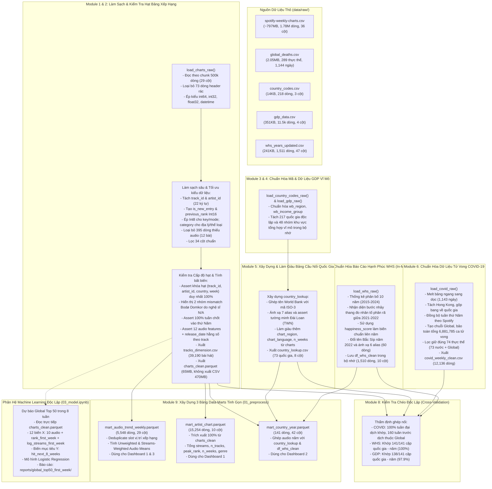

# LUỒNG TIỀN XỬ LÝ DỮ LIỆU TẦNG LÕI (CORE DATA PROCESSING FLOW)

Tài liệu này mô tả chi tiết kiến trúc và toàn bộ tiến trình xử lý dữ liệu thực tế đang được triển khai trong notebook [`notebooks/01_preprocess.ipynb`](../notebooks/01_preprocess.ipynb) của dự án Tương tác dữ liệu trực quan (IDVI).

Luồng xử lý được thiết kế theo nguyên tắc:

1. **Module `src/data_loader.py` tinh gọn:** Chỉ đảm nhiệm nạp dữ liệu thô từ đĩa, kiểm tra tính tồn tại của file và lưu trữ các hằng số tham chiếu chuẩn hóa.
2. **Notebook kiểm soát toàn diện:** Mọi logic làm sạch sâu, biến đổi cấu trúc, kiểm tra cấp độ hạt (grain verification), trích xuất đặc trưng và xuất tập tin sạch cốt lõi và các bảng Data Marts được thực hiện minh bạch từng bước, tuân thủ nghiêm ngặt quy tắc phong cách (mỗi ô một việc, có markdown giải thích, kiểm tra assertion trước/sau).
3. **Kiến trúc dữ liệu phân tầng tinh gọn (Data Lakehouse / Medallion Pattern):**
   * **Tầng Bronze (Raw Data):** 5 tập tin dữ liệu thô ban đầu (~800MB bảng xếp hạng, dữ liệu dịch tễ, GDP, mã quốc gia, WHS).
   * **Tầng Silver (Clean Tables):** Chỉ lưu trữ các bảng sạch cốt lõi ở định dạng tối ưu (`charts_clean.parquet`, `tracks_dimension.csv`, `country_lookup.csv`, `covid_weekly_clean.csv`). Dữ liệu WHS được làm sạch trong bộ nhớ (`df_whs_clean`) để ghép nối trực tiếp sang Data Mart.
   * **Tầng Gold (Data Marts):** Tổng hợp sẵn các chỉ số thống kê phục vụ trực tiếp Dashboard 1, 2, 3 (`mart_audio_trend_weekly.parquet`, `mart_artist_chart.parquet` / `.csv`, `mart_country_year.parquet`). Dữ liệu Machine Learning được trích xuất độc lập từ `charts_clean.parquet` tại `03_model.ipynb`.

---

## 1. SƠ ĐỒ LUỒNG XỬ LÝ TỔNG THỂ (MERMAID FLOWCHART)

---

## 2. NGUYÊN TẮC THIẾT KẾ CÁC BẢNG DATA MARTS VÀ PHÒNG CHỐNG DATA LEAKAGE

### 2.1. Bản chất của việc Deduplicate trước khi Aggregate

* **Hiện tượng Collab:** Trên bảng xếp hạng tuần của Spotify, một vị trí xếp hạng (slot) có thể chứa từ 2 đến 10 nghệ sĩ. Trong bảng `charts_clean`, dữ liệu được nhân bản dòng cho từng nghệ sĩ (hệ số trung bình 1.61).
* **Quy tắc tính toán:**
  * **Khi tính xu hướng âm thanh (Dashboard 1, 2, 3) hoặc chỉ số bài hát (ML):** Bắt buộc phải `drop_duplicates(subset=["chart_country", "week", "rank"])` trước khi `groupby`. Nếu không, các bài hát collab sẽ bị phóng đại trọng số (2x-3x) so với bài hát đơn ca, làm sai lệch phân bố âm thanh.
  * **Khi tính thành tích nghệ sĩ (`mart_artist_chart`):** Dùng toàn bộ bảng `charts_clean` để ghi nhận công bằng lượt nghe và thứ hạng cho mọi nghệ sĩ tham gia.

### 2.2. Dữ liệu đầu vào của mô hình hiện tại

Mô hình trong `03_model.ipynb` dự báo `hit_next_8_weeks`: bài đạt Global Top 50 ít nhất một lần trong tám tuần sau tuần đầu quan sát, không tính tuần đầu. Chỉ gán nhãn khi đủ tám tuần Top 50; các trường hợp thiếu cửa sổ không được coi là nhãn âm.

X gồm 10 audio liên tục (thời lượng dùng `duration_min`) cùng `rank_first_week` và `log_streams_first_week`. Các tổng thành tích cả lịch sử không thuộc X. Chia dữ liệu theo thời gian, purge cửa sổ nhãn tại biên và fit bộ xử lý trên Train. ID bài tách biệt giữa các tập, nhưng chưa đảm bảo nghệ sĩ hoặc các bản thu khác ID tách biệt.

Xem [từ điển dữ liệu](data_dictionary.md#4-cohort-và-nhãn-dự-báo-trong-03_modelipynb) để biết schema, nhãn và giới hạn. Các điểm `pop_score`/`is_hit` của nhánh cũ không thuộc pipeline hiện tại.

---

## 3. HƯỚNG DẪN KỸ THUẬT VÀ CHÚ THÍCH CHO TỪNG DASHBOARD & MÔ HÌNH HÓA

> [!TIP]
> Mỗi Dashboard và bài toán mô hình đều có một Data Mart tương ứng được thiết kế tối ưu sẵn. Bạn không cần nạp file `charts_clean.parquet` nặng 65MB vào ứng dụng giao diện.

### 3.1. Dashboard 1: Xu Hướng Đặc Trưng Âm Thanh BXH & Phân Tích Nghệ Sĩ

* **Tập tin sử dụng:** `mart_audio_trend_weekly.parquet` và `mart_artist_chart.parquet`.
* **Mục tiêu trực quan:**
  * Theo dõi biến thiên của các chỉ số âm thanh theo thời gian (2017–2022).
  * Khảo sát mức độ chuyển dịch thể loại âm nhạc thịnh hành qua các năm.
  * Xếp hạng nghệ sĩ thành công nhất theo tổng lượt streams trên bảng xếp hạng và số lượng ca khúc lọt top (**100% đầy đủ tên nghệ sĩ và thể loại**).
* **Chú thích toán học (Unweighted Mean vs. Streams-Weighted Mean):**
  * *Unweighted Mean ($\text{feature\_mean}$):* Trung bình cộng đều của 200 vị trí, phản ánh xu hướng sản xuất của toàn bộ thị trường âm nhạc.
  * *Streams-Weighted Mean ($\text{feature\_weighted}$):* Trung bình có trọng số lượt nghe:
    $$\text{Weighted Feature} = \frac{\sum_{i=1}^{200} (\text{feature}_i \times \text{streams}_i)}{\sum_{i=1}^{200} \text{streams}_i}$$
    Phản ánh chính xác gu nghe nhạc thực tế của người dùng.

---

### 3.2. Dashboard 2: Tương Quan Âm Thanh Theo Quốc Gia & Mức Độ Hạnh Phúc

* **Tập tin sử dụng:** `mart_country_year.parquet`.
* **Cấp độ hạt (Grain):** `(chart_country, year)` — đúng **141 dòng** (khớp 100% các chu kỳ năm có dữ liệu quốc gia của Spotify Charts).
* **Mục tiêu trực quan:**
  * Scatter plot tương quan giữa điểm số hạnh phúc (`happiness_score`) và các chỉ số tâm trạng âm nhạc (`valence`, `danceability`, `energy`).
  * Phân cụm so sánh văn hóa nghe nhạc theo khu vực địa lý (`wb_region`) hoặc nhóm thu nhập World Bank (`wb_income_group`).
* **Chú thích nghiệp vụ quan trọng:**
  * Bảng xếp hạng các quốc gia của Spotify chỉ bắt đầu xuất hiện từ năm 2021 đến 2022.
  * **Luôn dùng `happiness_score`** (thang Cantril 0–10) làm trục chính để so sánh giữa 2021 và 2022.

---

### 3.3. Dashboard 3: Xu Hướng Biến Động Âm Nhạc Trong Thời Kỳ Đại Dịch COVID-19

* **Tập tin sử dụng:** Ghép nối `mart_audio_trend_weekly.parquet` với `covid_weekly_clean.csv` trên cặp khóa `(chart_country = country, week)`.
* **Mục tiêu trực quan:**
  * Quan sát sự thay đổi của chỉ số tâm trạng tích cực `valence` và năng lượng `energy` khi số ca tử vong tuần `weekly_deaths` đạt đỉnh.
  * Kiểm chứng giả thuyết *Âm nhạc giải tỏa (Escapism Hypothesis)*: Người nghe có xu hướng tìm đến âm nhạc hoài niệm hoặc tiết tấu nhẹ nhàng (`acousticness` tăng) trong giai đoạn phong tỏa xã hội nghiêm ngặt.
* **Kỹ thuật Phân Tích Độ Trễ (Lagged Cross-Correlation):**
  * Tính toán hệ số tương quan Pearson giữa `weekly_deaths` ở tuần $t$ với `valence` ở các tuần $t, t+1, t+2$.

---

### 3.4. Phân Hệ Machine Learning Độc Lập (03_model.ipynb): Dự Báo Global Top 50 Trong 8 Tuần

* **Tập tin sử dụng:** Đọc trực tiếp từ `charts_clean.parquet` để trích xuất trạng thái quan sát đầu tiên của bài hát trên bảng xếp hạng Global Top 200.
* **Câu hỏi nghiên cứu:** Khi một bài hát lần đầu xuất hiện trên Global Top 200, dựa vào đặc trưng âm thanh và tín hiệu tuần đầu (thứ hạng và lượt nghe), liệu bài hát có khả năng lọt vào **Global Top 50 ít nhất một lần trong 8 tuần tiếp theo** hay không?
* **Kiến trúc bài toán:**
  1. **Tập dữ liệu phân tích:** Một dòng cho mỗi bài hát tại tuần đầu quan sát (`rank_first_week`, `log_streams_first_week`).
  2. **Biến mục tiêu ($Y$):** `hit_next_8_weeks` (nhị phân: 1 nếu đạt rank $\le 50$ trong vòng 8 tuần kế tiếp, 0 nếu không).
  3. **Tập đặc trưng dự báo ($X$ - 12 biến):**
     * 10 đặc trưng âm học: `danceability`, `energy`, `loudness`, `speechiness`, `acousticness`, `instrumentalness`, `liveness`, `valence`, `tempo`, `duration_min`.
     * 2 tín hiệu thị trường tuần đầu: `rank_first_week`, `log_streams_first_week`.
  4. **Mô hình triển khai:** Logistic Regression với chuẩn hóa `StandardScaler`.
  5. **Đánh giá hiệu năng:** ROC-AUC, PR-AUC, F1-Score, Brier Score, Odds Ratio phân tích tầm quan trọng của từng đặc trưng. Báo cáo chỉ số hiện có tại `reports/global_top50_first_week/model_metrics.json`; không coi artifact trong `models/` là cùng phiên bản nếu chưa đối chiếu.
* *Lưu ý:* Tập dữ liệu `ml_tracks.parquet` cũ (dựa trên điểm tổng hợp `pop_score` toàn lịch sử) đã được chuyển vào `archive/superseded_ml_tracks/` để đảm bảo không rò rỉ dữ liệu tương lai và giữ `data/processed/` tinh gọn tuyệt đối.

---

## 4. BẢNG TỔNG HỢP CÁC RÀNG BUỘC VÀ QUY TẮC KIỂM TOÁN DỮ LIỆU (AUDIT CONSTRAINTS)

| Mục kiểm toán | Điều kiện Assert / Ràng buộc | Trạng thái đạt được | Ý nghĩa nghiệp vụ |
| :--- | :--- | :--- | :--- |
| **Khóa hạt bảng xếp hạng** | `dup_grain_count == 0` | 0 dòng trùng lặp | Đảm bảo tính duy nhất của bộ khóa `(track_id, artist_id, chart_country, week)`. |
| **Tính bất biến âm học** | `audio_invariance == 1` | 100% đạt chuẩn | Đảm bảo 12 đặc trưng âm học không bị thay đổi theo thời gian hay quốc gia. |
| **Chu kỳ xếp hạng** | `dayofweek == 3` (Thứ Năm) | 100% đúng thứ Năm | Đồng bộ nhịp thời gian chốt tuần giữa Spotify và dữ liệu COVID-19. |
| **Ghép nối Báo cáo Hạnh phúc** | `missing_whs == 0` | 141/141 cặp (100%) | Đảm bảo mọi chu kỳ năm quốc gia của Spotify đều có điểm số hạnh phúc tương ứng trong bộ nhớ. |
| **Ghép nối Dịch tễ COVID-19** | `(left_only['country'] == 'Global').all()` | Đúng 160 tuần Global | Xác nhận toàn bộ giai đoạn khuyết dữ liệu dịch tễ nằm trước khi đại dịch bùng phát. |
| **Xử lý ngoại lệ Đài Loan** | `sc == 'Taiwan' -> code = 'TWN'` | Xử lý tường minh | World Bank không báo cáo riêng lẻ Đài Loan; bổ sung thủ công chuẩn hóa mã ISO. |
| **Dị biệt nghệ sĩ Bodø Domkor** | `mismatch == 2` | Đúng 2 slot xác định | Ca khúc *"Ja, Vi Elsker Dette Landet"* có nghệ sĩ thứ nhất là `"N/A"`, giải thích hoàn toàn dị biệt số dòng. |
| **Tỷ lệ đầy đủ của Data Marts** | `null_count == 0` | 100% hoàn chỉnh | Cả 3 Data Marts không còn khuyết thiếu tên nghệ sĩ, thuộc tính hoặc giá trị tổng hợp. |

