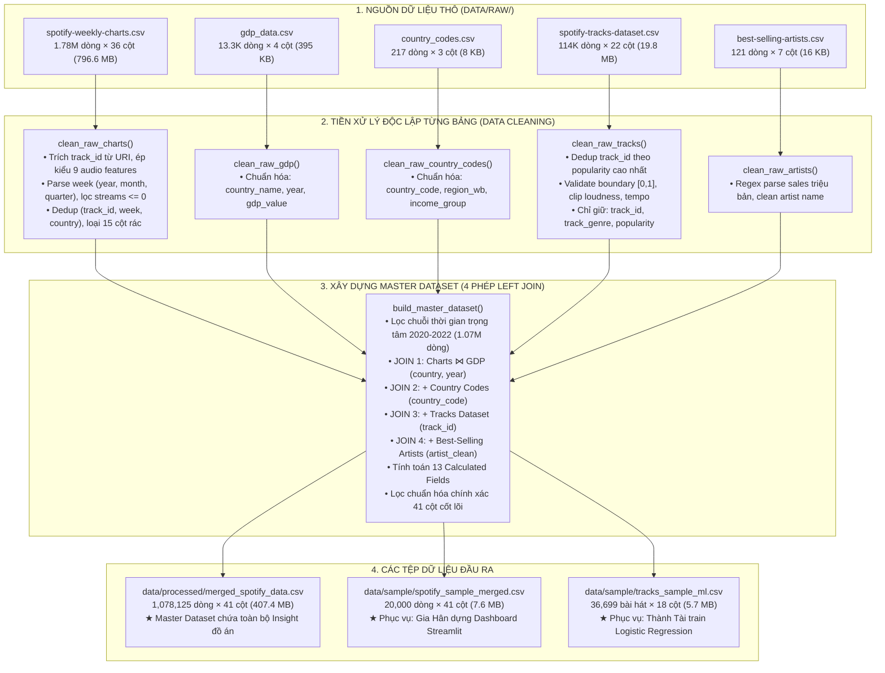

# 🔄 TÀI LIỆU KIẾN TRÚC LUỒNG XỬ LÝ DỮ LIỆU HỢP NHẤT
## (UNIFIED MASTER DATA PROCESSING PIPELINE ARCHITECTURE)

* **Môn học:** Tương tác Dữ liệu (Interactive Data Visualization / Visual Analytics)
* **Đề tài:** Nghiên cứu & Trực quan hóa Đặc trưng Âm thanh và Dự đoán Xu hướng Thịnh hành trên Spotify
* **Người thực hiện:** Đinh Quốc Anh (MSSV: 24133003) — Vai trò: Data Engineer & Data Analyst
* **Module kỹ thuật:** [`src/data_loader.py`](file:///d:/uni/hk1nam3/idvi/idvi-final_project/Spotify_Audio_Trends_Analytics/src/data_loader.py) & [`notebooks/01_preprocess.ipynb`](file:///d:/uni/hk1nam3/idvi/idvi-final_project/Spotify_Audio_Trends_Analytics/notebooks/01_preprocess.ipynb)
* **Phiên bản tài liệu:** 3.1 (Kiến trúc Hợp nhất Master Dataset 41 Cột & Các Tệp Sample)

---

## MỤC LỤC
1. [TỔNG QUAN KIẾN TRÚC MASTER DATASET HỢP NHẤT](#1-tổng-quan-kiến-trúc-master-dataset-hợp-nhất)
2. [ĐẶC TẢ CHI TIẾT CÁC GIAI ĐOẠN XỬ LÝ](#2-đặc-tả-chi-tiết-các-giai-đoạn-xử-lý)
   * [Giai đoạn 1: Nạp và Làm sạch độc lập 5 bảng dữ liệu thô](#giai-đoạn-1-nạp-và-làm-sạch-độc-lập-5-bảng-dữ-liệu-thô)
   * [Giai đoạn 2: Hợp nhất Master Dataset (4 phép LEFT JOIN có thứ tự)](#giai-đoạn-2-hợp-nhất-master-dataset-4-phép-left-join-có-thứ-tự)
   * [Giai đoạn 3: Tính toán 13 Calculated Fields & Lọc 41 Cột Insight](#giai-đoạn-3-tính-toán-13-calculated-fields--lọc-41-cột-insight)
   * [Giai đoạn 4: Sinh 2 Tệp Sample phục vụ Nhóm & Machine Learning](#giai-đoạn-4-sinh-2-tệp-sample-phục-vụ-nhóm--machine-learning)
3. [CÔNG THỨC TOÁN HỌC & Ý NGHĨA 13 CALCULATED FIELDS](#3-công-thức-toán-học--ý-nghĩa-13-calculated-fields)
4. [ĐẶC TẢ LƯỢC ĐỒ 41 CỘT PHỤC VỤ 5 BÀI TOÁN INSIGHT](#4-đặc-tả-lược-đồ-41-cột-phục-vụ-5-bài-toán-insight)
5. [HƯỚNG DẪN THỰC THI & TÍCH HỢP HỆ THỐNG](#5-hướng-dẫn-thực-thi--tích-hợp-hệ-thống)
6. [ĐỐI CHIẾU TIÊU CHÍ BAREM CHẤM ĐIỂM (RUBRIC ALIGNMENT)](#6-đối-chiếu-tiêu-chí-barem-chấm-điểm-rubric-alignment)

---

## 1. TỔNG QUAN KIẾN TRÚC MASTER DATASET HỢP NHẤT

Hệ thống ETL được thiết kế tối ưu theo mô hình **Hợp nhất Dữ liệu Toàn diện (Unified Master Pipeline)**:
* **Tệp Master duy nhất (`merged_spotify_data.csv`):** Tích hợp cả số liệu Kinh tế - Xã hội 74 quốc gia và Dòng thời gian Đại dịch COVID-19 (`covid_phase`), lưu giữ đúng **41 cột phục vụ Insight**.
* **Các tệp Sample gọn nhẹ:** Đảm bảo các thành viên khác trong nhóm (Lý Gia Hân làm Dashboard và Đỗ Thanh Thành Tài làm Machine Learning) có thể làm việc siêu tốc trên các tệp mẫu từ 5–7 MB mà không bị giật lag máy tính hay quá tải bộ nhớ RAM.



---

## 2. ĐẶC TẢ CHI TIẾT CÁC GIAI ĐOẠN XỬ LÝ

### Giai đoạn 1: Nạp và Làm sạch độc lập 5 bảng dữ liệu thô

* **1. `clean_raw_charts()`:**
  - Loại bỏ các cột chỉ mục thừa (`Unnamed: 0`).
  - Trích xuất `track_id` chuẩn (22 ký tự) từ chuỗi `spotify:track:<track_id>`.
  - Chuyển trường `week` sang định dạng `Datetime`, bóc tách các thành phần thời gian: `year`, `month`, `quarter`.
  - Ép kiểu số nguyên cho `streams`, loại bỏ triệt để các bản ghi có `streams <= 0`.
  - Ép kiểu số thực tường minh cho 9 đặc trưng âm học (`danceability`, `energy`, `loudness`, `speechiness`, `acousticness`, `instrumentalness`, `liveness`, `valence`, `tempo`).
  - Khử trùng lặp bản ghi trên bộ ba khóa định danh `(track_id, week, country)`.
  - Loại bỏ sớm 15 cột phụ không phục vụ insight: `uri`, `artist_names`, `artists_num`, `artist_id`, `key`, `mode`, `source`, `album_num_tracks`, `collab`, `release_date`, `previous_rank`, `artist_img`, `album_cover`, `pivot`, `region`.

* **2. `clean_raw_tracks()`:**
  - Sắp xếp theo `popularity` giảm dần và khử trùng lặp theo `track_id` (chỉ giữ bản ghi có độ phổ biến cao nhất, từ 114,000 còn 89,741 bài hát độc nhất).
  - Kiểm định biên độ âm học $[0.0, 1.0]$, cắt tỉa (clip) `loudness` $[-60, 5]$ dB và `tempo` $[0, 300]$ BPM.
  - Lọc chỉ giữ lại 3 trường cốt lõi phục vụ JOIN: `track_id`, `track_genre`, `popularity`.

* **3. `clean_raw_artists()`:**
  - Áp dụng biểu thức chính quy (Regex) bóc tách doanh số đĩa triệu bản.
  - Chuẩn hóa tên nghệ sĩ về chữ thường không dấu cách thừa (`artist_name_clean = lower().strip()`).

* **4. `clean_raw_gdp()` & `clean_raw_country_codes()`:**
  - Chuẩn hóa tên trường thống nhất: `gdp_value`, `region_wb`, `income_group`.

---

### Giai đoạn 2: Hợp nhất Master Dataset (4 phép LEFT JOIN có thứ tự)

* **Lọc chuỗi thời gian trọng tâm (2020 – 2022):**
  - Giữ lại 1,078,125 dòng bao quát đầy đủ cả giai đoạn đại dịch COVID-19 (bắt đầu từ 2020 trên bảng `Global`) và dữ liệu 74 quốc gia (từ 2021 đến 2022).
* **4 phép LEFT JOIN tuần tự:**
  1. *Charts ⋈ GDP* trên cặp khóa `(country, year) == (country_name, year)`: Bổ sung chỉ số kinh tế `gdp_value`. Với các dòng quốc gia, tỷ lệ khớp GDP đạt **~89.6% – 98%**. Riêng dòng `Global` nhận giá trị `NaN` ở GDP là hoàn toàn chính xác về mặt ý nghĩa kinh tế (vì Global không phải là một quốc gia).
  2. *+ Country Codes* trên khóa `country_code`: Bổ sung khu vực địa lý (`region_wb`) và phân tầng thu nhập (`income_group`).
  3. *+ Tracks Dataset* trên khóa `track_id`: Bổ sung thể loại âm nhạc (`track_genre`) và điểm phổ biến toàn cầu (`popularity`).
  4. *+ Best-Selling Artists* trên tên nghệ sĩ chuẩn hóa `artist_individual`: Đánh dấu nghệ sĩ di sản (`is_legacy_artist`).

---

### Giai đoạn 3: Tính toán 13 Calculated Fields & Lọc 41 Cột Insight

* Tính toán đầy đủ 13 biến phái sinh:
  - `covid_phase` (3 pha: *Lockdown & Shock*, *Vaccine & Escapism*, *Reopening & New Normal*).
  - `mood_category` (Mô hình Russell 4 góc phần tư: *Happy Energetic*, *Peaceful Positive*, *Tense Aggressive*, *Sad Melancholic*).
  - `stream_share_country`, `energy_loudness_index`, `is_latin`, `is_kpop`, `is_legacy_artist`, `duration_min`, `audio_diversity_score`, `is_trending`, `is_popular`, `log_streams`, `gdp_log`.
* **Lọc chuẩn hóa chính xác 41 cột cốt lõi phục vụ Insight** và lưu thành tệp: `data/processed/merged_spotify_data.csv` (1,078,125 dòng × 41 cột, dung lượng ~407.4 MB).

---

### Giai đoạn 4: Sinh 2 Tệp Sample phục vụ Nhóm & Machine Learning

1. **`spotify_sample_merged.csv` (20,000 dòng × 41 cột, dung lượng ~7.6 MB):**
   - Trích xuất ngẫu nhiên có phân tầng và cố định hạt giống (`random_state=42`) từ Master Dataset.
   - Giữ nguyên toàn bộ 41 cột, phục vụ Lý Gia Hân dựng UI Streamlit Dashboard và vẽ biểu đồ Plotly trong 0.2 giây.
2. **`tracks_sample_ml.csv` (36,699 bài hát độc nhất × 18 cột, dung lượng ~5.7 MB):**
   - Gom nhóm (groupby) theo `track_id` độc nhất từ tệp dữ liệu mẫu.
   - **Chống 100% rủi ro rò rỉ dữ liệu (Data Leakage):** Mỗi bài hát chỉ xuất hiện duy nhất 1 dòng. Loại bỏ hoàn toàn biến không gian (`country`) và thời gian (`week`).
   - Nhãn mục tiêu ($y$): `is_trending = 1` nếu bài hát từng lọt vào Top 50 BXH, $0$ nếu chỉ ở Top 51–200 (Tỷ lệ nhãn Hit: **35.9%** rất cân bằng).
   - Dành riêng cho Đỗ Thanh Thành Tài huấn luyện mô hình Hồi quy Logistic chỉ trong **0.5 giây**.

---

## 3. CÔNG THỨC TOÁN HỌC & Ý NGHĨA 13 CALCULATED FIELDS

| STT | Trường tính toán | Công thức toán học / Quy tắc logic | Ý nghĩa phân tích & Trực quan |
| :---: | :--- | :--- | :--- |
| 1 | `is_trending` | $\text{is\_trending} = \mathbb{I}(\text{rank} \le 50)$ | Biến mục tiêu phân loại Top Hit cho mô hình Machine Learning. |
| 2 | `is_popular` | $\text{is\_popular} = \mathbb{I}(\text{popularity} \ge 70)$ | Đo lường độ lan tỏa toàn cầu dựa trên điểm số Spotify API. |
| 3 | `mood_category` | $\begin{cases} \text{Happy Energetic} & \text{valence} \ge 0.5 \land \text{energy} \ge 0.5 \\ \text{Peaceful Positive} & \text{valence} \ge 0.5 \land \text{energy} < 0.5 \\ \text{Tense Aggressive} & \text{valence} < 0.5 \land \text{energy} \ge 0.5 \\ \text{Sad Melancholic} & \text{valence} < 0.5 \land \text{energy} < 0.5 \end{cases}$ | Trực quan hóa bản đồ tâm trạng người nghe 4 góc phần tư trên Dashboard. |
| 4 | `stream_share_country` | $\text{share}_{i, c, w} = \frac{\text{streams}_{i, c, w}}{\sum_{k \in c, w} \text{streams}_{k, c, w}}$ | Đo lường thị phần chi phối lượt nghe của bài hát tại quốc gia trong tuần. |
| 5 | `covid_phase` | $\begin{cases} \text{Lockdown \& Shock} & \text{year} \le 2020 \\ \text{Vaccine \& Escapism} & \text{year} = 2021 \\ \text{Reopening \& New Normal} & \text{year} \ge 2022 \end{cases}$ | Phân kỳ 3 cột mốc đại dịch phục vụ câu chuyện Data Storytelling. |
| 6 | `energy_loudness_index` | $\text{loud\_norm} = \frac{\text{loudness} - \min(\text{loudness})}{\max(\text{loudness}) - \min(\text{loudness})}$<br>$\text{index} = \frac{\text{energy} + \text{loud\_norm}}{2}$ | Chỉ số cường độ âm thanh tổng hợp chuẩn hóa trong $[0, 1]$. |
| 7 | `is_latin` | Regex 32 keywords Latin $\lor$ Language $\in$ {Spanish, Portuguese} | Định lượng sự trỗi dậy của làn sóng âm nhạc Latin toàn cầu (Bad Bunny). |
| 8 | `is_kpop` | Regex {k-pop, kpop, korean} $\lor$ Language == Korean | Đo lường sự lan tỏa quốc tế của âm nhạc châu Á (BTS, BLACKPINK). |
| 9 | `is_legacy_artist` | $\mathbb{I}(\text{legacy\_artist\_name is not Null})$ | Khảo sát mức độ trụ hạng của nghệ sĩ huyền thoại (The Beatles, Queen). |
| 10 | `duration_min` | $\text{duration\_min} = \frac{\text{duration\_ms}}{60,000}$ | Thời lượng bài hát tính theo phút phục vụ nghiên cứu xu hướng rút ngắn track. |
| 11 | `audio_diversity_score` | $\text{StdDev}(\text{danceability}, \text{energy}, \text{valence}, \text{acousticness})$ | Đo lường độ tương phản và phân cực âm học nội tại của bài hát. |
| 12 | `log_streams` | $\ln(1 + \text{streams})$ | Nén thang đo lượt nghe lệch phải về phân phối chuẩn Gauss. |
| 13 | `gdp_log` | $\ln(1 + \text{gdp\_value})$ | Nén biên độ GDP hàng nghìn tỷ USD phục vụ vẽ biểu đồ phân tán Scatter Plot. |

---

## 4. ĐẶC TẢ LƯỢC ĐỒ 41 CỘT PHỤC VỤ 5 BÀI TOÁN INSIGHT

Cấu trúc 41 cột của Master Dataset phân bố thành 5 cụm phục vụ trực tiếp cho 5 bài toán nghiên cứu của đề tài:
* **Nhóm 1 — Định danh & Thời gian (10 cột):** `track_id`, `track_name`, `artist_individual`, `artist_genre`, `country`, `language`, `week`, `year`, `month`, `quarter`.
* **Nhóm 2 — Xếp hạng & Lượt nghe (5 cột):** `rank`, `streams`, `log_streams`, `weeks_on_chart`, `peak_rank`.
* **Nhóm 3 — 9 Audio Features (9 cột):** `danceability`, `energy`, `loudness`, `speechiness`, `acousticness`, `instrumentalness`, `liveness`, `valence`, `tempo`.
* **Nhóm 4 — Kinh tế World Bank (5 cột):** `gdp_value`, `gdp_log`, `income_group`, `region_wb`, `country_code`.
* **Nhóm 5 — Trường tính toán Insight (12 cột):** `is_trending`, `is_popular`, `mood_category`, `stream_share_country`, `covid_phase`, `energy_loudness_index`, `is_latin`, `is_kpop`, `is_legacy_artist`, `duration_min`, `audio_diversity_score`, `track_genre`.

---

## 5. HƯỚNG DẪN THỰC THI & TÍCH HỢP HỆ THỐNG

### 5.1. Thực thi toàn bộ Pipeline từ dòng lệnh:
```bash
# Tự động nạp, làm sạch và xuất Master Dataset + 2 tệp Sample:
python src/data_loader.py

# (Tùy chọn) Chạy chế độ sample nhanh với 20,000 dòng:
python src/data_loader.py --sample 20000
```

### 5.2. Các hàm nạp dữ liệu tiện ích (Dành cho Dashboard và Notebooks):
```python
from src.data_loader import (
    load_master_data,   # Nạp file bự Master 41 cột (merged_spotify_data.csv)
    load_sample_data,   # Nạp file sample 20,000 dòng cho Dashboard & EDA
    load_ml_sample      # Nạp file sample cấp độ bài hát cho Thành Tài làm ML
)

# Ví dụ nạp sample cho Dashboard:
df_sample = load_sample_data()

# Ví dụ nạp dữ liệu huấn luyện ML:
df_ml = load_ml_sample()
```

---

## 6. ĐỐI CHIẾU TIÊU CHÍ BAREM CHẤM ĐIỂM (RUBRIC ALIGNMENT)

| Tiêu chí Barem | Điểm tối đa | Mức độ đáp ứng của Pipeline mới | Bằng chứng thực nghiệm |
| :--- | :---: | :--- | :--- |
| **Xác định bài toán & Dataset** | **0.5 đ** | • Sử dụng **5 tập dữ liệu đa nguồn** (>1.9 triệu dòng thô).<br>• Từ điển dữ liệu chuẩn xác chi tiết trong `docs/data_dictionary.md`. | `load_raw_data()`<br>`docs/data_dictionary.md` |
| **Làm sạch dữ liệu (Data Cleaning)** | **0.5 đ** | • Xử lý triệt để missing, loại `streams <= 0`.<br>• Khử trùng lặp đa khóa, clip boundary âm học $[0, 1]$.<br>• Regex bóc tách doanh số đĩa triệu bản. | `clean_raw_charts()`<br>`clean_raw_tracks()`<br>`clean_raw_artists()` |
| **Biến đổi dữ liệu (Feature Engineering & Join)** | **0.75 đ** | • **Kiến trúc Master Dataset** tích hợp 4 phép LEFT JOIN.<br>• Giữ chuẩn xác **41 cột phục vụ Insight**.<br>• Xây dựng **13 Calculated Fields** phục vụ trọn vẹn 5 bài toán lớn. | `build_master_dataset()`<br>`generate_sample_datasets()` |
| **Khám phá dữ liệu (EDA tĩnh)** | **0.75 đ** | • Notebook `01_preprocess.ipynb` tích hợp sẵn 3 biểu đồ Seaborn tĩnh (Heatmap ma trận tương quan, Barplot COVID 3 pha, Boxplot nhóm thu nhập). | `notebooks/01_preprocess.ipynb` |

---
*Tài liệu được cập nhật hoàn chỉnh phục vụ báo cáo Đồ án môn học Tương tác Dữ liệu — Nhóm Spotify Audio Trends Analytics.*
