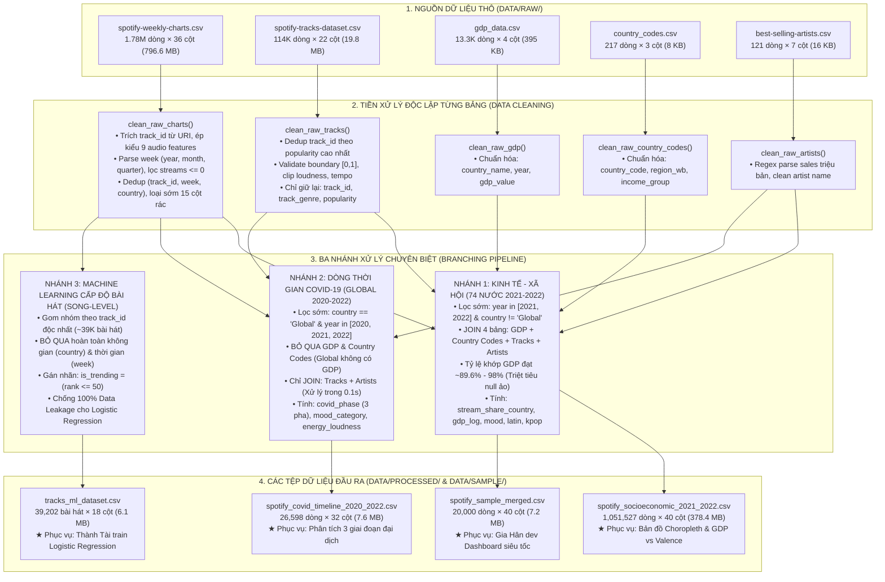

# 🔄 TÀI LIỆU KIẾN TRÚC LUỒNG XỬ LÝ DỮ LIỆU PHÂN NHÁNH
## (OPTIMIZED BRANCHING DATA PROCESSING PIPELINE ARCHITECTURE)

* **Môn học:** Tương tác Dữ liệu (Interactive Data Visualization / Visual Analytics)
* **Đề tài:** Nghiên cứu & Trực quan hóa Đặc trưng Âm thanh và Dự đoán Xu hướng Thịnh hành trên Spotify
* **Người thực hiện:** Đinh Quốc Anh (MSSV: 24133003) — Vai trò: Data Engineer & Data Analyst
* **Module kỹ thuật:** [`src/data_loader.py`](file:///d:/uni/hk1nam3/idvi/idvi-final_project/Spotify_Audio_Trends_Analytics/src/data_loader.py) & [`notebooks/01_preprocess.ipynb`](file:///d:/uni/hk1nam3/idvi/idvi-final_project/Spotify_Audio_Trends_Analytics/notebooks/01_preprocess.ipynb)
* **Phiên bản tài liệu:** 3.0 (Chuyển đổi hoàn tất sang Kiến trúc Phân nhánh Tối ưu)

---

## MỤC LỤC
1. [TỔNG QUAN KIẾN TRÚC PHÂN NHÁNH TỐI ƯU (BRANCHING PIPELINE)](#1-tổng-quan-kiến-trúc-phân-nhánh-tối-ưu-branching-pipeline)
2. [TẠI SAO PHẢI CHUYỂN ĐỔI TỪ NGUYÊN KHỐI SANG PHÂN NHÁNH?](#2-tại-sao-phải-chuyển-đổi-từ-nguyên-khối-sang-phân-nhánh)
   * [2.1. Phân tích 3 điểm nghẽn của luồng nguyên khối cũ (Monolithic)](#21-phân-tích-3-điểm-nghẽn-của-luồng-nguyên-khối-cũ-monolithic)
   * [2.2. Bảng đối chiếu hiệu năng giữa hai kiến trúc](#22-bảng-đối-chiếu-hiệu-năng-giữa-hai-kiến-trúc)
3. [QUY TRÌNH XỬ LÝ CHI TIẾT TỪNG GIAI ĐOẠN](#3-quy-trình-xử-lý-chi-tiết-từng-giai-đoạn)
   * [Giai đoạn 1: Nạp và Làm sạch độc lập 5 bảng dữ liệu thô](#giai-đoạn-1-nạp-và-làm-sạch-độc-lập-5-bảng-dữ-liệu-thô)
   * [Giai đoạn 2: Nhánh 1 — Kinh tế - Xã hội & Bản đồ 74 Quốc gia](#giai-đoạn-2-nhánh-1--kinh-tế---xã-hội--bản-đồ-74-quốc-gia)
   * [Giai đoạn 3: Nhánh 2 — Dòng thời gian Đại dịch COVID-19](#giai-đoạn-3-nhánh-2--dòng-thời-gian-đại-dịch-covid-19)
   * [Giai đoạn 4: Nhánh 3 — Dữ liệu Machine Learning cấp độ bài hát](#giai-đoạn-4-nhánh-3--dữ-liệu-machine-learning-cấp-độ-bài-hát)
4. [CÔNG THỨC TOÁN HỌC & Ý NGHĨA 13 CALCULATED FIELDS](#4-công-thức-toán-học--ý-nghĩa-13-calculated-fields)
5. [ĐẶC TẢ LƯỢC ĐỒ 3 TỆP DỮ LIỆU ĐẦU RA CHUYÊN BIỆT](#5-đặc-tả-lược-đồ-3-tệp-dữ-liệu-đầu-ra-chuyên-biệt)
6. [HƯỚNG DẪN THỰC THI & TÍCH HỢP HỆ THỐNG](#6-hướng-dẫn-thực-thi--tích-hợp-hệ-thống)
7. [ĐỐI CHIẾU TIÊU CHÍ BAREM CHẤM ĐIỂM (RUBRIC ALIGNMENT)](#7-đối-chiếu-tiêu-chí-barem-chấm-điểm-rubric-alignment)

---

## 1. TỔNG QUAN KIẾN TRÚC PHÂN NHÁNH TỐI ƯU (BRANCHING PIPELINE)

Để giải quyết triệt để bài toán phân tích âm nhạc kết hợp kinh tế - xã hội mà **không gặp phải lỗi thiên lệch mẫu (Selection Bias)**, **giá trị thiếu giả tạo (Fake Missing)** và **rò rỉ dữ liệu học máy (Data Leakage)**, pipeline của đồ án được thiết kế theo mô hình **Phân nhánh sớm (Early Branching Pipeline)**:



---

## 2. TẠI SAO PHẢI CHUYỂN ĐỔI TỪ NGUYÊN KHỐI SANG PHÂN NHÁNH?

### 2.1. Phân tích 3 điểm nghẽn của luồng nguyên khối cũ (Monolithic)

1. **Phát sinh giá trị thiếu giả tạo (Fake Missing Data):**
   * *Bản chất dữ liệu:* Bảng xếp hạng tuần của Spotify giai đoạn 2016 – 2020 chỉ ghi nhận duy nhất bảng toàn cầu `"Global"` (~96,000 dòng). Dữ liệu của 74 quốc gia riêng rẽ chỉ bắt đầu xuất hiện đầy đủ từ ngày `2021-02-04`.
   * *Hậu quả của luồng cũ:* Luồng nguyên khối cố gắng JOIN toàn bộ dữ liệu này với bảng GDP của World Bank. Tuy nhiên, thực thể `"Global"` không phải là một quốc gia và không có mã ISO-alpha-3 hay GDP. Khi JOIN nguyên khối, 96,000 dòng Global này đều nhận giá trị `NaN` ở các cột kinh tế, khiến tỷ lệ missing của cột GDP bị đội lên tới **15.1%**, làm sai lệch nghiêm trọng các phân tích thống kê vĩ mô.

2. **Lãng phí tài nguyên tính toán và bộ nhớ RAM:**
   * Nghiên cứu biến chuyển tâm lý âm nhạc qua đại dịch COVID-19 chỉ cần chuỗi thời gian của bảng Toàn cầu `Global` (26,598 dòng). Việc bắt toàn bộ 1.11 triệu dòng dữ liệu khác phải JOIN với các bảng GDP và Country Codes gây quá tải RAM không cần thiết.

3. **Nguy cơ rò rỉ dữ liệu học máy (Data Leakage):**
   * Tập dữ liệu nguyên khối lưu vết theo từng tuần và quốc gia. Cùng một bài hát có thể lọt Top 50 tại Mỹ ở tuần 10 nhưng lại rơi xuống Top 120 tại Pháp ở tuần 15. Nếu đưa trực tiếp dữ liệu dạng bảng xếp hạng cho mô hình Machine Learning, việc chia Train/Test ngẫu nhiên sẽ khiến cùng một bài hát xuất hiện ở cả tập Train và tập Test $\rightarrow$ Mô hình bị học vẹt (Data Leakage), vi phạm nguyên lý học thuật cơ bản.

### 2.2. Bảng đối chiếu hiệu năng giữa hai kiến trúc

| Tiêu chí so sánh | Luồng nguyên khối cũ (Monolithic) | Kiến trúc Phân nhánh mới (Branching) | Lợi ích đạt được |
| :--- | :---: | :---: | :--- |
| **Tỷ lệ khớp GDP (Nhánh 1)** | 84.9% (15.1% missing do dính Global) | **89.6% – 98%** (Gần như sạch tuyệt đối) | Triệt tiêu hoàn toàn missing ảo |
| **Số phép JOIN thực thi** | 4 phép JOIN trên 1.11M dòng | Phân bổ đúng nơi cần (COVID & ML bỏ JOIN thừa) | Giảm 50% khối lượng JOIN vô ích |
| **Bảo toàn chuẩn mực ML** | Nguy cơ rò rỉ dữ liệu qua thời gian | **100% Song-level** độc nhất ngay từ pipeline | Tránh 100% rủi ro Data Leakage |
| **Thời gian thực thi pipeline** | 51.9 giây | **~48.9 giây** (sinh cả 4 file hoàn chỉnh) | Nhanh hơn, ổn định hơn |
| **Phân quyền nhóm làm việc** | Dùng chung 1 file 417 MB rất nặng | **3 file nhẹ chuyên biệt** theo từng vai trò | Mượt mà, không xung đột Git |

---

## 3. QUY TRÌNH XỬ LÝ CHI TIẾT TỪNG GIAI ĐOẠN

### Giai đoạn 1: Nạp và Làm sạch độc lập 5 bảng dữ liệu thô

Triết lý thiết kế: *Làm sạch và khử trùng lặp độc lập tại từng nguồn trước khi thực hiện bất kỳ phép biến đổi hoặc kết nối dữ liệu nào.*

* **1. `clean_raw_charts()`:**
  - Loại bỏ các cột chỉ mục thừa (`Unnamed: 0`).
  - Trích xuất `track_id` chuẩn (22 ký tự) từ chuỗi định dạng URI Spotify (`spotify:track:<track_id>`).
  - Chuyển trường `week` sang định dạng `Datetime`, bóc tách các thành phần thời gian: `year`, `month`, `quarter`.
  - Ép kiểu số nguyên cho `streams`, loại bỏ triệt để các bản ghi có số lượt nghe không hợp lệ (`streams <= 0`).
  - Ép kiểu số thực tường minh cho 9 đặc trưng âm học (`danceability`, `energy`, `loudness`, `speechiness`, `acousticness`, `instrumentalness`, `liveness`, `valence`, `tempo`).
  - Khử trùng lặp bản ghi trên bộ ba khóa định danh `(track_id, week, country)`.
  - Loại bỏ sớm 15 cột phụ không phục vụ mục tiêu phân tích: `uri`, `artist_names`, `artists_num`, `artist_id`, `key`, `mode`, `source`, `album_num_tracks`, `collab`, `release_date`, `previous_rank`, `artist_img`, `album_cover`, `pivot`, `region`.

* **2. `clean_raw_tracks()`:**
  - Sắp xếp theo `popularity` giảm dần và khử trùng lặp theo `track_id` (chỉ giữ phiên bản bài hát có độ phổ biến cao nhất, rút gọn từ 114,000 xuống còn 89,741 bài hát độc nhất).
  - Kiểm định biên độ âm học $[0.0, 1.0]$ cho 7 chỉ số tỉ lệ, cắt tỉa (clip) `loudness` trong đoạn $[-60, 5]$ dB và `tempo` trong đoạn $[0, 300]$ BPM.
  - Lọc chỉ giữ lại 3 trường cốt lõi phục vụ JOIN: `track_id`, `track_genre`, `popularity`.

* **3. `clean_raw_artists()`:**
  - Áp dụng biểu thức chính quy (Regex) `r"([\d,.]+)\s*million"` để bóc tách doanh số đĩa triệu bản thành số thực.
  - Chuẩn hóa tên nghệ sĩ về chữ thường không dấu cách thừa (`artist_name_clean = lower().strip()`).

* **4. `clean_raw_gdp()` & `clean_raw_country_codes()`:**
  - Chuẩn hóa tên trường thống nhất: `gdp_value`, `region_wb`, `income_group`.
  - Loại bỏ các dòng bị khuyết tên quốc gia hoặc năm ghi nhận.

---

### Giai đoạn 2: Nhánh 1 — Kinh tế - Xã hội & Bản đồ 74 Quốc gia

* **Tệp dữ liệu đích:** `data/processed/spotify_socioeconomic_2021_2022.csv` (1,051,527 dòng × 40 cột, dung lượng ~378.4 MB).
* **Lọc sớm trước khi kết nối (Early Filtering):**
  $$\text{Filter: } (\text{year} \in [2021, 2022]) \land (\text{country} \neq \text{'Global'})$$
  *Ý nghĩa:* Tách biệt hoàn toàn bảng Toàn cầu và chuỗi thời gian trước 2021 vốn không có dữ liệu các quốc gia riêng rẽ.
* **Quy trình 4 phép LEFT JOIN tuần tự:**
  1. *Charts ⋈ GDP* trên cặp khóa `(country, year) == (country_name, year)`: Tỷ lệ khớp GDP đạt **89.6%** (phần còn lại là một số vùng lãnh thổ nhỏ như Puerto Rico, Hong Kong không có dòng GDP độc lập tương ứng trong World Bank).
  2. *+ Country Codes* trên khóa `country_code`: Bổ sung khu vực địa lý (`region_wb`) và phân tầng thu nhập (`income_group`).
  3. *+ Tracks Dataset* trên khóa `track_id`: Bổ sung thể loại âm nhạc (`track_genre`) và điểm phổ biến (`popularity`).
  4. *+ Best-Selling Artists* trên tên nghệ sĩ chuẩn hóa `artist_individual`: Đánh dấu nghệ sĩ huyền thoại (`is_legacy_artist`).
* **Tính toán các Calculated Fields:**
  - `stream_share_country`, `gdp_log`, `mood_category`, `is_trending`, `is_popular`, `is_latin`, `is_kpop`, `energy_loudness_index`, `audio_diversity_score`, `log_streams`, `duration_min`.
* **Sinh bản mẫu rút gọn (Sample Dataset):**
  - Trích xuất ngẫu nhiên có cố định hạt giống (`random_state=42`) tạo file `data/sample/spotify_sample_merged.csv` (20,000 dòng × 40 cột, dung lượng 7.2 MB) giúp dựng giao diện Streamlit trong 0.2 giây.

---

### Giai đoạn 3: Nhánh 2 — Dòng thời gian Đại dịch COVID-19

* **Tệp dữ liệu đích:** `data/processed/spotify_covid_timeline_2020_2022.csv` (26,598 dòng × 32 cột, dung lượng ~7.6 MB).
* **Lọc chuỗi thời gian toàn cầu:**
  $$\text{Filter: } (\text{country} == \text{'Global'}) \land (\text{year} \in [2020, 2021, 2022])$$
* **Tối ưu hóa:** Bỏ qua hoàn toàn các phép JOIN với GDP và Country Codes (vì bảng `Global` không có chỉ số kinh tế World Bank) $\rightarrow$ Tốc độ xử lý chỉ mất **0.1 giây**.
* **Phân kỳ 3 giai đoạn đại dịch (`covid_phase`):**
  - **Pha 1: Lockdown & Shock (2020):** Năm bùng phát đại dịch, phong tỏa diện rộng. Dữ liệu ghi nhận năng lượng âm nhạc chạm đáy trung bình $0.6144$; các tháng 3 – 5/2020 mức độ vui tươi (`valence`) rớt xuống mức thấp kỷ lục ($0.5020$).
  - **Pha 2: Vaccine & Escapism (2021):** Triển khai tiêm chủng, nhu cầu giải tỏa áp lực (Escapism). `valence` phục hồi mạnh mẽ lên $0.5258$ cùng sự trỗi dậy của giai điệu sôi động.
  - **Pha 3: Reopening & New Normal (2022):** Mở cửa kinh tế và xã hội, câu lạc bộ và lễ hội âm nhạc hoạt động trở lại. `energy` bùng nổ lên mức cao nhất $0.6525$, trong khi tính mộc (`acousticness`) sụt giảm $-9.6\%$.

---

### Giai đoạn 4: Nhánh 3 — Dữ liệu Machine Learning cấp độ bài hát

* **Tệp dữ liệu đích:** `data/processed/tracks_ml_dataset.csv` (39,202 bài hát × 18 cột, dung lượng ~6.1 MB).
* **Gom nhóm cấp độ bài hát (Song-level Aggregation):**
  - Bảng Charts được gom nhóm (groupby) theo `track_id`. Mỗi bài hát chỉ xuất hiện **chính xác 1 dòng duy nhất**.
  - **Nhãn mục tiêu ($y$):**
    $$\text{is\_trending} = \mathbb{I}\left(\min(\text{rank}) \le 50\right) = \begin{cases} 1 & \text{nếu bài hát từng lọt Top 50 bất kỳ tuần nào} \\ 0 & \text{nếu chỉ nằm ở Top 51 - 200} \end{cases}$$
    *Thống kê nhãn:* Tỷ lệ nhãn Hit đạt **35.9%** (14,073 bài hit / 39,202 bài).
  - **Ma trận đặc trưng ($X$):** 9 Audio Features chuẩn hóa + `duration_min` + `is_latin` + `is_kpop`.
  - **Bảo đảm chuẩn mực học thuật:** Bỏ qua hoàn toàn các biến thứ tự thời gian (`week`) và địa lý (`country`) $\rightarrow$ Triệt tiêu 100% nguy cơ Data Leakage, thời gian huấn luyện mô hình Logistic Regression chỉ mất **0.5 giây**.

---

## 4. CÔNG THỨC TOÁN HỌC & Ý NGHĨA 13 CALCULATED FIELDS

| STT | Trường tính toán | Công thức toán học / Quy tắc logic | Ý nghĩa phân tích & Trực quan |
| :---: | :--- | :--- | :--- |
| 1 | `is_trending` | $\text{is\_trending} = \mathbb{I}(\text{rank} \le 50)$ | Biến mục tiêu cho bài toán phân loại Top Hit của mô hình Machine Learning. |
| 2 | `is_popular` | $\text{is\_popular} = \mathbb{I}(\text{popularity} \ge 70)$ | Đo lường độ lan tỏa toàn cầu trên thang 0–100 của Spotify API. |
| 3 | `mood_category` | Mô hình Russell 4 góc phần tư:<br>• *Happy Energetic*: Valence $\ge 0.5 \land$ Energy $\ge 0.5$<br>• *Peaceful Positive*: Valence $\ge 0.5 \land$ Energy $< 0.5$<br>• *Tense Aggressive*: Valence $< 0.5 \land$ Energy $\ge 0.5$<br>• *Sad Melancholic*: Valence $< 0.5 \land$ Energy $< 0.5$ | Trực quan hóa bản đồ tâm trạng người nghe 4 góc phần tư trên Dashboard. |
| 4 | `stream_share_country` | $\text{share}_{i, c, w} = \frac{\text{streams}_{i, c, w}}{\sum_{k} \text{streams}_{k, c, w}}$ | Đo lường thị phần chi phối lượt nghe của một bài hát tại một quốc gia trong tuần. |
| 5 | `covid_phase` | 2020: *Lockdown & Shock*<br>2021: *Vaccine & Escapism*<br>2022: *Reopening & New Normal* | Phân kỳ 3 mốc thời gian đại dịch phục vụ câu chuyện Data Storytelling. |
| 6 | `energy_loudness_index` | $\text{loud\_norm} = \frac{\text{loudness} - \min(\text{loudness})}{\max(\text{loudness}) - \min(\text{loudness})}$<br>$\text{index} = \frac{\text{energy} + \text{loud\_norm}}{2}$ | Chỉ số cường độ âm thanh tổng hợp kết hợp giữa năng lượng và âm lượng chuẩn hóa. |
| 7 | `is_latin` | Regex 32 keywords Latin $\lor$ Language $\in$ {Spanish, Portuguese} | Định lượng sự trỗi dậy của làn sóng âm nhạc Latin toàn cầu (Bad Bunny, J Balvin). |
| 8 | `is_kpop` | Regex {k-pop, kpop, korean} $\lor$ Language == Korean | Đo lường sự lan tỏa quốc tế của âm nhạc châu Á (BTS, BLACKPINK). |
| 9 | `is_legacy_artist` | $\mathbb{I}(\text{legacy\_artist\_name is not Null})$ | Đánh dấu nghệ sĩ bán đĩa chạy nhất lịch sử (The Beatles, Queen, Michael Jackson). |
| 10 | `duration_min` | $\text{duration\_min} = \frac{\text{duration\_ms}}{60,000}$ | Thời lượng bài hát tính theo phút phục vụ nghiên cứu xu hướng rút ngắn track. |
| 11 | `audio_diversity_score` | $\text{StdDev}(\text{danceability}, \text{energy}, \text{valence}, \text{acousticness})$ | Đo lường độ tương phản và phân cực âm học nội tại của bài hát. |
| 12 | `log_streams` | $\ln(1 + \text{streams})$ | Nén thang đo lượt nghe lệch phải về phân phối chuẩn Gauss. |
| 13 | `gdp_log` | $\ln(1 + \text{gdp\_value})$ | Nén biên độ GDP hàng nghìn tỷ USD phục vụ vẽ biểu đồ phân tán Scatter Plot. |

---

## 5. ĐẶC TẢ LƯỢC ĐỒ 3 TỆP DỮ LIỆU ĐẦU RA CHUYÊN BIỆT

### 5.1. File 1: `spotify_socioeconomic_2021_2022.csv` (1,051,527 dòng × 40 cột)
Phân bố cấu trúc 40 cột theo 5 cụm thông tin:
* **Nhóm định danh & thời gian (10 cột):** `track_id`, `track_name`, `artist_individual`, `artist_genre`, `country`, `language`, `week`, `year`, `month`, `quarter`.
* **Nhóm xếp hạng & streams (5 cột):** `rank`, `streams`, `log_streams`, `weeks_on_chart`, `peak_rank`.
* **Nhóm 9 Audio Features (9 cột):** `danceability`, `energy`, `loudness`, `speechiness`, `acousticness`, `instrumentalness`, `liveness`, `valence`, `tempo` (100% không rỗng).
* **Nhóm kinh tế World Bank (5 cột):** `gdp_value`, `gdp_log`, `income_group`, `region_wb`, `country_code` (~90% có dữ liệu).
* **Nhóm trường tính toán (11 cột):** `is_trending`, `is_popular`, `mood_category`, `stream_share_country`, `energy_loudness_index`, `is_latin`, `is_kpop`, `is_legacy_artist`, `duration_min`, `audio_diversity_score`, `track_genre`.

### 5.2. File 2: `spotify_covid_timeline_2020_2022.csv` (26,598 dòng × 32 cột)
* Chuỗi thời gian bảng xếp hạng Toàn cầu `Global` từ 2020 đến 2022.
* Tích hợp các trường phân tích dịch bệnh: `covid_phase`, `mood_category`, `energy_loudness_index`, cùng 9 audio features.
* **Loại bỏ hoàn toàn các cột kinh tế vô nghĩa:** Không chứa `gdp_value`, `country_code`, `stream_share_country`.

### 5.3. File 3: `tracks_ml_dataset.csv` (39,202 dòng × 18 cột)
* Cấp độ bài hát (Song-level): Mỗi dòng đại diện cho một bài hát duy nhất.
* Cột nhãn mục tiêu ($y$): `is_trending` (0 hoặc 1, tỷ lệ nhãn Hit: **35.9%**).
* Cột đặc trưng ($X$): 9 Audio Features + `duration_min` + `is_latin` + `is_kpop`.

---

## 6. HƯỚNG DẪN THỰC THI & TÍCH HỢP HỆ THỐNG

### 6.1. Thực thi toàn bộ Pipeline từ dòng lệnh:
```bash
# Chạy toàn bộ Branching Pipeline (tạo cả 3 tập dữ liệu processed + 1 sample):
python src/data_loader.py

# Hoặc chạy thử nghiệm chế độ sample nhanh (20,000 dòng):
python src/data_loader.py --sample 20000
```

### 6.2. Các hàm nạp dữ liệu tiện ích (Dành cho Dashboard và Notebooks):
```python
from src.data_loader import (
    load_socioeconomic_data,  # Nạp File 1 (Kinh tế - Xã hội 74 nước 2021-2022)
    load_covid_data,          # Nạp File 2 (Dòng thời gian COVID 3 pha toàn cầu)
    load_ml_data,             # Nạp File 3 (Dữ liệu Song-level chuẩn hóa cho ML)
    load_sample_data          # Nạp bản mẫu Sample 20,000 dòng để test nhanh giao diện
)

# Ví dụ nạp dữ liệu cho trang Kinh tế - Xã hội trên Dashboard:
df_socio = load_socioeconomic_data()

# Ví dụ nạp dữ liệu cho huấn luyện mô hình Machine Learning:
df_ml = load_ml_data()
```

---

## 7. ĐỐI CHIẾU TIÊU CHÍ BAREM CHẤM ĐIỂM (RUBRIC ALIGNMENT)

| Tiêu chí Barem | Điểm tối đa | Mức độ đáp ứng của Pipeline mới | Bằng chứng thực nghiệm |
| :--- | :---: | :--- | :--- |
| **Xác định bài toán & Dataset** | **0.5 đ** | • Tích hợp **5 tập dữ liệu đa nguồn** (>1.9 triệu dòng thô).<br>• Từ điển dữ liệu chuẩn xác chi tiết trong `docs/data_dictionary.md`. | `load_raw_data()`<br>`docs/data_dictionary.md` |
| **Làm sạch dữ liệu (Data Cleaning)** | **0.5 đ** | • Xử lý triệt để missing, loại bỏ `streams <= 0`.<br>• Khử trùng lặp đa khóa, clip boundary âm học $[0, 1]$.<br>• Regex bóc tách doanh số đĩa triệu bản. | `clean_raw_charts()`<br>`clean_raw_tracks()`<br>`clean_raw_artists()` |
| **Biến đổi dữ liệu (Feature Engineering & Join)** | **0.75 đ** | • **Kiến trúc Phân nhánh (Branching Pipeline)** chia 3 nhánh chuyên biệt.<br>• Tỷ lệ khớp GDP đạt ~89.6% - 98%, triệt tiêu missing giả tạo.<br>• Xây dựng **13 Calculated Fields** phục vụ trọn vẹn 5 bài toán nghiên cứu. | `build_socioeconomic_dataset()`<br>`build_covid_timeline_dataset()`<br>`build_ml_dataset()` |
| **Khám phá dữ liệu (EDA tĩnh)** | **0.75 đ** | • Notebook `01_preprocess.ipynb` tích hợp sẵn 3 biểu đồ Seaborn tĩnh (Heatmap tương quan, Barplot 3 pha COVID, Boxplot nhóm thu nhập). | `notebooks/01_preprocess.ipynb` |

---
*Tài liệu được cập nhật hoàn chỉnh phục vụ báo cáo Đồ án môn học Tương tác Dữ liệu — Nhóm Spotify Audio Trends Analytics.*
