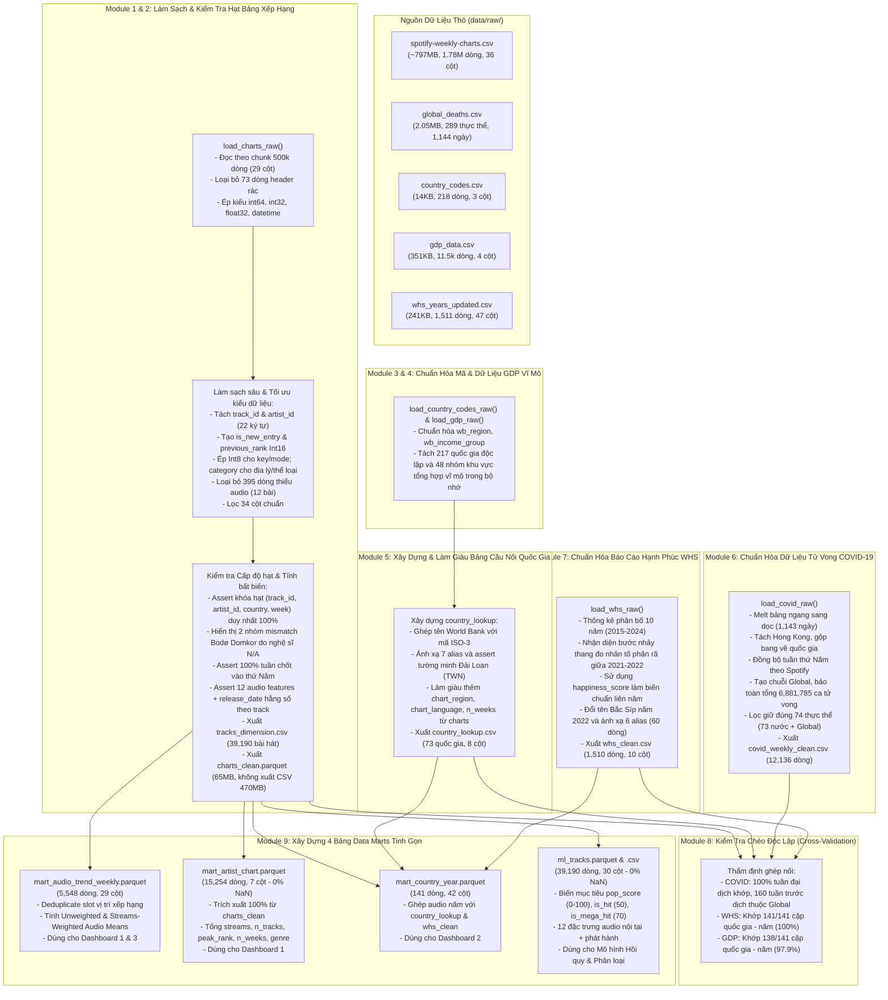

# LUỒNG TIỀN XỬ LÝ DỮ LIỆU TẦNG LÕI (CORE DATA PROCESSING FLOW)

Tài liệu này mô tả chi tiết kiến trúc và toàn bộ tiến trình xử lý dữ liệu thực tế đang được triển khai trong notebook [`notebooks/01_preprocess.ipynb`](../notebooks/01_preprocess.ipynb) của dự án Tương tác dữ liệu trực quan (IDVI).

Luồng xử lý được thiết kế theo nguyên tắc:

1. **Module `src/data_loader.py` tinh gọn:** Chỉ đảm nhiệm nạp dữ liệu thô từ đĩa, kiểm tra tính tồn tại của file và lưu trữ các hằng số tham chiếu chuẩn hóa.
2. **Notebook kiểm soát toàn diện:** Mọi logic làm sạch sâu, biến đổi cấu trúc, kiểm tra cấp độ hạt (grain verification), trích xuất đặc trưng và xuất tập tin sạch cốt lõi và các bảng Data Marts được thực hiện minh bạch từng bước, tuân thủ nghiêm ngặt quy tắc phong cách (mỗi ô một việc, có markdown giải thích, kiểm tra assertion trước/sau).
3. **Kiến trúc dữ liệu phân tầng tinh gọn (Data Lakehouse / Medallion Pattern):**
   * **Tầng Bronze (Raw Data):** 5 tập tin dữ liệu thô ban đầu (~800MB bảng xếp hạng, dữ liệu dịch tễ, GDP, mã quốc gia, WHS).
   * **Tầng Silver (Clean Tables):** Chỉ lưu trữ các bảng sạch cốt lõi ở định dạng tối ưu (`charts_clean.parquet`, `tracks_dimension.csv`, `country_lookup.csv`, `covid_weekly_clean.csv`, `whs_clean.csv`). Loại bỏ hoàn toàn các file CSV trùng lặp kích thước lớn hoặc bảng trung gian ngoại lai không đảm bảo độ phủ.
   * **Tầng Gold (Data Marts):** Tổng hợp sẵn các chỉ số thống kê phục vụ trực tiếp Dashboard 1, 2, 3 và Machine Learning (`mart_audio_trend_weekly.parquet`, `mart_artist_chart.parquet`, `mart_country_year.parquet`, `ml_tracks.parquet`).

---

## 1. SƠ ĐỒ LUỒNG XỬ LÝ TỔNG THỂ (MERMAID FLOWCHART)



---

## 2. NGUYÊN TẮC THIẾT KẾ CÁC BẢNG DATA MARTS VÀ PHÒNG CHỐNG DATA LEAKAGE

### 2.1. Bản chất của việc Deduplicate trước khi Aggregate

* **Hiện tượng Collab:** Trên bảng xếp hạng tuần của Spotify, một vị trí xếp hạng (slot) có thể chứa từ 2 đến 10 nghệ sĩ. Trong bảng `charts_clean`, dữ liệu được nhân bản dòng cho từng nghệ sĩ (hệ số trung bình 1.61).
* **Quy tắc tính toán:**
  * **Khi tính xu hướng âm thanh (Dashboard 1, 2, 3) hoặc chỉ số bài hát (ML):** Bắt buộc phải `drop_duplicates(subset=["chart_country", "week", "rank"])` trước khi `groupby`. Nếu không, các bài hát collab sẽ bị phóng đại trọng số (2x-3x) so với bài hát đơn ca, làm sai lệch phân bố âm thanh.
  * **Khi tính thành tích nghệ sĩ (`mart_artist_chart`):** Dùng toàn bộ bảng `charts_clean` để ghi nhận công bằng lượt nghe và thứ hạng cho mọi nghệ sĩ tham gia.

### 2.2. Phòng chống triệt để Rò rỉ Dữ liệu (Data Leakage) trong Machine Learning

* **Bối cảnh bài toán:** Một nghệ sĩ hoặc hãng đĩa muốn dự đoán: *"Với một bài hát mới có các đặc trưng âm thanh X và thông tin phát hành, bài hát này có tiềm năng đạt điểm phổ biến `pop_score` bao nhiêu (Hồi quy) và có trở thành Hit (`is_hit == 1`) hay không (Phân loại)?"*
* **Phân định rạch ròi giữa X và Y:**
  * **Biến mục tiêu ($Y$):** `pop_score` (0–100), `is_hit` (ngưỡng 50 điểm - cân bằng 13.9%), `is_mega_hit` (ngưỡng 70 điểm), `hit_tier` (4 mức).
  * **Biến hậu nghiệm (Cấm đưa vào $X$):** `peak_rank`, `nweek`, `total_streams`, `avg_streams`, `n_countries`, `rank`, `previous_rank`, `weeks_on_chart`. Đây là các chỉ số sinh ra sau quá trình ca khúc trụ hạng trên thị trường. Nếu đưa vào $X$, mô hình sẽ bị rò rỉ dữ liệu 100% (đạt điểm số $R^2 = 1.0$ giả tạo nhưng vô dụng khi triển khai thực tế).
  * **Đặc trưng dự báo hợp lệ ($X$):**
    1. 12 Đặc trưng âm học nội tại (`danceability`, `energy`, `valence`, `tempo`, `key`, `mode`, `loudness`, `acousticness`, `instrumentalness`, `speechiness`, `liveness`, `duration`).
    2. Thông tin phát hành: `artists_num` (đơn ca vs hợp tác), `artist_genre`, `release_year`, `release_month`.

---

## 3. HƯỚNG DẪN KỸ THUẬT VÀ CHÚ THÍCH CHO TỪNG DASHBOARD & MÔ HÌNH HÓA

> [!TIP]
> Mỗi Dashboard và bài toán mô hình đều có một Data Mart tương ứng được thiết kế tối ưu sẵn. Bạn không cần nạp file `charts_clean.parquet` nặng 65MB vào ứng dụng giao diện.

### 3.1. Dashboard 1: Xu Hướng Đặc Trưng Âm Thanh BXH & Phân Tích Nghệ Sĩ

* **Tập tin sử dụng:** `mart_audio_trend_weekly.parquet` và `mart_artist_chart.parquet`.
* **Mục tiêu trực quan:**
  * Theo dõi biến thiên của các chỉ số âm thanh theo thời gian (2017–2022).
  * Khảo sát mức độ chuyển dịch thể loại âm nhạc thịnh hành qua các năm.
  * Xếp hạng nghệ sĩ thành công nhất theo tổng lượt streams trên bảng xếp hạng và số lượng ca khúc lọt top (**100% đầy đủ tên nghệ sĩ và thể loại**).
* **Chú thích toán học (Unweighted Mean vs. Streams-Weighted Mean):**
  * *Unweighted Mean ($\text{feature\_mean}$):* Trung bình cộng đều của 200 vị trí, phản ánh xu hướng sản xuất của toàn bộ thị trường âm nhạc.
  * *Streams-Weighted Mean ($\text{feature\_weighted}$):* Trung bình có trọng số lượt nghe:
    $$\text{Weighted Feature} = \frac{\sum_{i=1}^{200} (\text{feature}_i \times \text{streams}_i)}{\sum_{i=1}^{200} \text{streams}_i}$$
    Phản ánh chính xác gu nghe nhạc thực tế của người dùng.

---

### 3.2. Dashboard 2: Tương Quan Âm Thanh Theo Quốc Gia & Mức Độ Hạnh Phúc

* **Tập tin sử dụng:** `mart_country_year.parquet`.
* **Cấp độ hạt (Grain):** `(chart_country, year)` — đúng **141 dòng** (khớp 100% các chu kỳ năm có dữ liệu quốc gia của Spotify Charts).
* **Mục tiêu trực quan:**
  * Scatter plot tương quan giữa điểm số hạnh phúc (`happiness_score`) và các chỉ số tâm trạng âm nhạc (`valence`, `danceability`, `energy`).
  * Phân cụm so sánh văn hóa nghe nhạc theo khu vực địa lý (`wb_region`) hoặc nhóm thu nhập World Bank (`wb_income_group`).
* **Chú thích nghiệp vụ quan trọng:**
  * Bảng xếp hạng các quốc gia của Spotify chỉ bắt đầu xuất hiện từ năm 2021 đến 2022.
  * **Luôn dùng `happiness_score`** (thang Cantril 0–10) làm trục chính để so sánh giữa 2021 và 2022.

---

### 3.3. Dashboard 3: Xu Hướng Biến Động Âm Nhạc Trong Thời Kỳ Đại Dịch COVID-19

* **Tập tin sử dụng:** Ghép nối `mart_audio_trend_weekly.parquet` với `covid_weekly_clean.csv` trên cặp khóa `(chart_country = country, week)`.
* **Mục tiêu trực quan:**
  * Quan sát sự thay đổi của chỉ số tâm trạng tích cực `valence` và năng lượng `energy` khi số ca tử vong tuần `weekly_deaths` đạt đỉnh.
  * Kiểm chứng giả thuyết *Âm nhạc giải tỏa (Escapism Hypothesis)*: Người nghe có xu hướng tìm đến âm nhạc hoài niệm hoặc tiết tấu nhẹ nhàng (`acousticness` tăng) trong giai đoạn phong tỏa xã hội nghiêm ngặt.
* **Kỹ thuật Phân Tích Độ Trễ (Lagged Cross-Correlation):**
  * Tính toán hệ số tương quan Pearson giữa `weekly_deaths` ở tuần $t$ với `valence` ở các tuần $t, t+1, t+2$.

---

### 3.4. Dashboard 4 & Machine Learning: Hồi Quy Tuyến Tính & Hồi Quy Logistic

* **Tập tin sử dụng:** `ml_tracks.parquet` (hoặc `ml_tracks.csv`) với 39,190 bài hát độc nhất 100% và **0% giá trị khuyết thiếu**.
* **Kiến trúc hai bài toán Machine Learning:**
  1. **Hồi quy Tuyến tính (Ridge / Linear Regression):**
     * **Mục tiêu:** Dự đoán điểm phổ biến liên tục $\hat{y} = \text{pop\_score} \in [0, 100]$.
     * **Đánh giá hiệu năng:** $R^2$ Score, Mean Absolute Error (MAE), Root Mean Squared Error (RMSE).
  2. **Hồi quy Logistic (Logistic Regression Classifier):**
     * **Mục tiêu:** Phân loại nhị phân ca khúc có trở thành "Hit" hay không ($P(\text{is\_hit} = 1) \ge 0.5$).
     * **Cân bằng nhãn:** Sử dụng nhãn `is_hit` ($\ge 50$ điểm) chiếm 13.9% và tham số `class_weight='balanced'`.
     * **Đánh giá hiệu năng:** ROC-AUC, PR-AUC, F1-Score, Confusion Matrix.
* **Code mẫu khởi tạo mô hình trong Scikit-Learn:**

  ```python
  import pandas as pd
  from sklearn.model_selection import train_test_split
  from sklearn.linear_model import Ridge, LogisticRegression
  from sklearn.preprocessing import StandardScaler
  from sklearn.metrics import r2_score, roc_auc_score

  df_ml = pd.read_parquet("../data/processed/ml_tracks.parquet")

  # 1. Định nghĩa tập đặc trưng dự báo X (chỉ lấy các biến trước khi ca khúc phát hành)
  features = [
      "danceability", "energy", "key", "mode", "loudness", 
      "speechiness", "acousticness", "instrumentalness", 
      "liveness", "valence", "tempo", "duration",
      "artists_num", "release_year", "release_month"
  ]
  X = df_ml[features]

  # 2. Huấn luyện Hồi quy pop_score
  y_reg = df_ml["pop_score"]
  X_train, X_test, y_train_reg, y_test_reg = train_test_split(X, y_reg, test_size=0.2, random_state=42)
  scaler = StandardScaler()
  X_train_scaled = scaler.fit_transform(X_train)
  X_test_scaled = scaler.transform(X_test)

  model_reg = Ridge(alpha=1.0)
  model_reg.fit(X_train_scaled, y_train_reg)
  print(f"R2 Test Score: {r2_score(y_test_reg, model_reg.predict(X_test_scaled)):.4f}")

  # 3. Huấn luyện Phân loại is_hit
  y_clf = df_ml["is_hit"]
  _, _, y_train_clf, y_test_clf = train_test_split(X, y_clf, test_size=0.2, random_state=42)
  model_clf = LogisticRegression(max_iter=1000, class_weight="balanced")
  model_clf.fit(X_train_scaled, y_train_clf)
  print(f"ROC-AUC Test: {roc_auc_score(y_test_clf, model_clf.predict_proba(X_test_scaled)[:, 1]):.4f}")
  ```

---

## 4. BẢNG TỔNG HỢP CÁC RÀNG BUỘC VÀ QUY TẮC KIỂM TOÁN DỮ LIỆU (AUDIT CONSTRAINTS)

| Mục kiểm toán | Điều kiện Assert / Ràng buộc | Trạng thái đạt được | Ý nghĩa nghiệp vụ |
| :--- | :--- | :--- | :--- |
| **Khóa hạt bảng xếp hạng** | `dup_grain_count == 0` | 0 dòng trùng lặp | Đảm bảo tính duy nhất của bộ khóa `(track_id, artist_id, chart_country, week)`. |
| **Tính bất biến âm học** | `audio_invariance == 1` | 100% đạt chuẩn | Đảm bảo 12 đặc trưng âm học không bị thay đổi theo thời gian hay quốc gia. |
| **Chu kỳ xếp hạng** | `dayofweek == 3` (Thứ Năm) | 100% đúng thứ Năm | Đồng bộ nhịp thời gian chốt tuần giữa Spotify và dữ liệu COVID-19. |
| **Ghép nối Báo cáo Hạnh phúc** | `missing_whs == 0` | 141/141 cặp (100%) | Đảm bảo mọi chu kỳ năm quốc gia của Spotify đều có điểm số hạnh phúc tương ứng. |
| **Ghép nối Dịch tễ COVID-19** | `(left_only['country'] == 'Global').all()` | Đúng 160 tuần Global | Xác nhận toàn bộ giai đoạn khuyết dữ liệu dịch tễ nằm trước khi đại dịch bùng phát. |
| **Xử lý ngoại lệ Đài Loan** | `sc == 'Taiwan' -> code = 'TWN'` | Xử lý tường minh | World Bank không báo cáo riêng lẻ Đài Loan; bổ sung thủ công chuẩn hóa mã ISO. |
| **Dị biệt nghệ sĩ Bodø Domkor** | `mismatch == 2` | Đúng 2 slot xác định | Ca khúc *"Ja, Vi Elsker Dette Landet"* có nghệ sĩ thứ nhất là `"N/A"`, giải thích hoàn toàn dị biệt số dòng. |
| **Tỷ lệ đầy đủ của Data Marts** | `null_count == 0` | 100% hoàn chỉnh | Cả 4 Data Marts không còn khuyết thiếu tên nghệ sĩ hay đặc trưng mô hình. |
