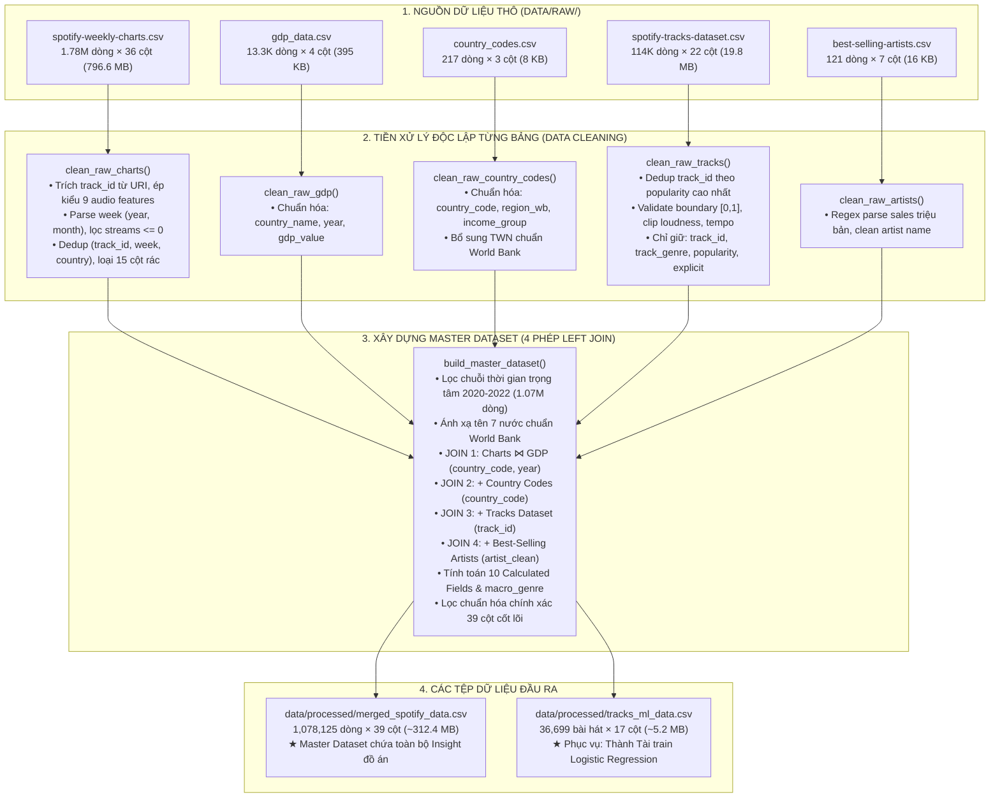

# 🔄 TÀI LIỆU KIẾN TRÚC LUỒNG XỬ LÝ DỮ LIỆU HỢP NHẤT
## (UNIFIED MASTER DATA PROCESSING PIPELINE ARCHITECTURE)

* **Môn học:** Tương tác Dữ liệu (Interactive Data Visualization / Visual Analytics)
* **Đề tài:** Nghiên cứu & Trực quan hóa Đặc trưng Âm thanh và Dự đoán Xu hướng Thịnh hành trên Spotify
* **Người thực hiện:** Đinh Quốc Anh (MSSV: 24133003) — Vai trò: Data Engineer & Data Analyst
* **Module kỹ thuật:** [`src/data_loader.py`](file:///d:/uni/hk1nam3/idvi/idvi-final_project/Spotify_Audio_Trends_Analytics/src/data_loader.py) & [`notebooks/01_preprocess.ipynb`](file:///d:/uni/hk1nam3/idvi/idvi-final_project/Spotify_Audio_Trends_Analytics/notebooks/01_preprocess.ipynb)
* **Phiên bản tài liệu:** 3.3 (Kiến trúc Hợp nhất Master Dataset 39 Cột, Macro Genre & ML Dataset 17 Cột)

---

## MỤC LỤC
1. [TỔNG QUAN KIẾN TRÚC MASTER DATASET HỢP NHẤT](#1-tổng-quan-kiến-trúc-master-dataset-hợp-nhất)
2. [ĐẶC TẢ CHI TIẾT CÁC GIAI ĐOẠN XỬ LÝ](#2-đặc-tả-chi-tiết-các-giai-đoạn-xử-lý)
   * [Giai đoạn 1: Nạp và Làm sạch độc lập 5 bảng dữ liệu thô](#giai-đoạn-1-nạp-và-làm-sạch-độc-lập-5-bảng-dữ-liệu-thô)
   * [Giai đoạn 2: Hợp nhất Master Dataset (4 phép LEFT JOIN có thứ tự)](#giai-đoạn-2-hợp-nhất-master-dataset-4-phép-left-join-có-thứ-tự)
   * [Giai đoạn 3: Tính toán 10 Calculated Fields & Lọc 39 Cột Insight](#giai-đoạn-3-tính-toán-10-calculated-fields--lọc-39-cột-insight)
   * [Giai đoạn 4: Trích xuất Dữ liệu Cấp Bài hát Chống Rò rỉ cho Machine Learning](#giai-đoạn-4-trích-xuất-dữ-liệu-cấp-bài-hát-chống-rò-rỉ-cho-machine-learning)
3. [CÔNG THỨC TOÁN HỌC & Ý NGHĨA 10 CALCULATED FIELDS](#3-công-thức-toán-học--ý-nghĩa-10-calculated-fields)
4. [ĐẶC TẢ LƯỢC ĐỒ 39 CỘT PHỤC VỤ CÁC BÀI TOÁN INSIGHT](#4-đặc-tả-lược-đồ-39-cột-phục-vụ-các-bài-toán-insight)
5. [HƯỚNG DẪN THỰC THI & TÍCH HỢP HỆ THỐNG](#5-hướng-dẫn-thực-thi--tích-hợp-hệ-thống)
6. [ĐỐI CHIẾU TIÊU CHÍ BAREM CHẤM ĐIỂM (RUBRIC ALIGNMENT)](#6-đối-chiếu-tiêu-chí-barem-chấm-điểm-rubric-alignment)

---

## 1. TỔNG QUAN KIẾN TRÚC MASTER DATASET HỢP NHẤT

Hệ thống ETL được thiết kế tối ưu theo mô hình **Hợp nhất Dữ liệu Toàn diện (Unified Master Pipeline)**:
* **Tệp Master duy nhất (`merged_spotify_data.csv`):** Tích hợp số liệu Kinh tế - Xã hội 73 quốc gia và bảng Global, chuẩn hóa dòng nhạc vĩ mô `macro_genre`, lưu giữ đúng **39 cột phục vụ Insight** (loại bỏ `log_streams` và `covid_phase` để tránh gây nhiễu và thiên lệch).
* **Tệp dữ liệu ML (`tracks_ml_data.csv`):** Tinh gọn ở cấp độ bài hát (Song-level, 36,699 dòng × 17 cột) với nhãn `is_trending`, triệt tiêu hoàn toàn nguy cơ rò rỉ dữ liệu (Data Leakage).



---

## 2. ĐẶC TẢ CHI TIẾT CÁC GIAI ĐOẠN XỬ LÝ

### Giai đoạn 1: Nạp và Làm sạch độc lập 5 bảng dữ liệu thô

* **1. `clean_raw_charts()`:**
  - Loại bỏ các cột chỉ mục thừa (`Unnamed: 0`).
  - Trích xuất `track_id` chuẩn (22 ký tự) từ chuỗi `spotify:track:<track_id>`.
  - Chuyển trường `week` sang định dạng `Datetime`, bóc tách các thành phần thời gian: `year`, `month`.
  - Ép kiểu số nguyên cho `streams`, loại bỏ triệt để các bản ghi có `streams <= 0`.
  - Ép kiểu số thực tường minh cho 9 đặc trưng âm học (`danceability`, `energy`, `loudness`, `speechiness`, `acousticness`, `instrumentalness`, `liveness`, `valence`, `tempo`).
  - Khử trùng lặp bản ghi trên bộ ba khóa định danh `(track_id, week, country)`.
  - Loại bỏ sớm 15 cột phụ không phục vụ insight: `uri`, `artist_names`, `artists_num`, `artist_id`, `key`, `mode`, `source`, `album_num_tracks`, `collab`, `release_date`, `previous_rank`, `artist_img`, `album_cover`, `pivot`, `region`.

* **2. `clean_raw_tracks()`:**
  - Sắp xếp theo `popularity` giảm dần và khử trùng lặp theo `track_id` (chỉ giữ bản ghi có độ phổ biến cao nhất, từ 114,000 còn 89,741 bài hát độc nhất).
  - Kiểm định biên độ âm học $[0.0, 1.0]$, cắt tỉa (clip) `loudness` $[-60, 5]$ dB và `tempo` $[0, 300]$ BPM.
  - Lọc chỉ giữ lại các trường cốt lõi phục vụ JOIN: `track_id`, `track_genre`, `popularity`, `explicit`.

* **3. `clean_raw_artists()`:**
  - Áp dụng biểu thức chính quy (Regex) bóc tách doanh số đĩa triệu bản.
  - Chuẩn hóa tên nghệ sĩ về chữ thường không dấu cách thừa (`artist_name_clean = lower().strip()`).

* **4. `clean_raw_gdp()` & `clean_raw_country_codes()`:**
  - Chuẩn hóa tên trường thống nhất: `gdp_value`, `region_wb`, `income_group`.
  - Bổ sung bản ghi cho Đài Loan (`TWN`, `High income`, `East Asia & Pacific`).

---

### Giai đoạn 2: Hợp nhất Master Dataset (4 phép LEFT JOIN có thứ tự)

* **Lọc chuỗi thời gian trọng tâm (2020 – 2022):**
  - Giữ lại 1,078,125 dòng bao quát đầy đủ cả giai đoạn đại dịch COVID-19 (bắt đầu từ 2020 trên bảng `Global`) và dữ liệu 73 quốc gia (từ 2021 đến 2022).
* **4 phép LEFT JOIN tuần tự:**
  1. *Charts ⋈ GDP* trên cặp khóa `(country_code, year)` sau khi chuẩn hóa 7 quốc gia World Bank (`Korea, Rep.`, `Turkiye`, `Czechia`, `Hong Kong SAR, China`, `Egypt, Arab Rep.`, `Slovak Republic`, `Venezuela, RB`): Bổ sung chỉ số kinh tế `gdp_value`. Với các dòng quốc gia, tỷ lệ khớp GDP đạt **98.23%**. Riêng dòng `Global` nhận giá trị `NaN` ở GDP là hoàn toàn chính xác về mặt ý nghĩa kinh tế (vì Global không phải là một quốc gia).
  2. *+ Country Codes* trên khóa `country_code`: Bổ sung khu vực địa lý (`region_wb`) và phân tầng thu nhập (`income_group`), đạt tỷ lệ khớp **100%** (0 dòng thiếu).
  3. *+ Tracks Dataset* trên khóa `track_id`: Bổ sung thể loại âm nhạc (`track_genre`), điểm phổ biến toàn cầu (`popularity`) và cờ nhạy cảm (`explicit`).
  4. *+ Best-Selling Artists* trên tên nghệ sĩ chuẩn hóa `artist_individual`: Đánh dấu nghệ sĩ di sản (`is_legacy_artist`).

---

### Giai đoạn 3: Tính toán 10 Calculated Fields & Lọc 39 Cột Insight

* Tính toán đầy đủ 10 biến phái sinh:
  - `macro_genre`: Chuẩn hóa 6 dòng nhạc vĩ mô (`Pop`, `Latin`, `Hip-Hop/Rap`, `Rock/Metal`, `K-Pop`, `Others`).
  - `mood_category` (Mô hình Russell 4 góc phần tư: *Happy Energetic*, *Peaceful Positive*, *Tense Aggressive*, *Sad Melancholic*).
  - `stream_share_country`, `energy_loudness_index`, `is_legacy_artist`, `duration_min`, `audio_diversity_score`, `is_trending`, `is_popular`, `gdp_log`.
* **Loại bỏ 2 cột gây rò rỉ hoặc thiên lệch:**
  - `log_streams`: Biến dẫn xuất thuần túy $\ln(1 + \text{streams})$.
  - `covid_phase`: Trùng lẫn hoàn toàn với thực thể Global của năm 2020 (thiếu GDP và thu nhập), gây méo mó phân tích so sánh giữa các quốc gia.
* **Lọc chuẩn hóa chính xác 39 cột cốt lõi phục vụ Insight** và lưu thành tệp: `data/processed/merged_spotify_data.csv` (1,078,125 dòng × 39 cột, dung lượng ~312.4 MB).

---

### Giai đoạn 4: Trích xuất Dữ liệu Cấp Bài hát Chống Rò rỉ cho Machine Learning

* **`tracks_ml_data.csv` (36,699 bài hát độc nhất × 17 cột, dung lượng ~5.2 MB):**
  - Lưu tại: `data/processed/tracks_ml_data.csv`.
  - Gom nhóm (groupby) theo `track_id` độc nhất từ tập bài hát trong Master Dataset.
  - **Chống rò rỉ dữ liệu (Data Leakage):** Mỗi bài hát chỉ xuất hiện duy nhất 1 dòng. Tách hoàn toàn các biến kết quả sau phát hành (`country`, `week`, `year`, `streams`, `stream_share_country`, `weeks_on_chart`, `peak_rank`).
  - Nhãn mục tiêu ($y$): `is_trending = 1` nếu bài hát từng lọt vào Top 50 BXH bất kỳ, $0$ nếu chỉ ở Top 51–200 (Tỷ lệ nhãn Hit: **35.9%** rất cân bằng).
  - Phục vụ Đỗ Thanh Thành Tài huấn luyện mô hình Hồi quy Logistic nhanh chóng và chính xác.

---

## 3. CÔNG THỨC TOÁN HỌC & Ý NGHĨA 10 CALCULATED FIELDS

| STT | Trường tính toán | Quy tắc logic / Công thức toán học | Ý nghĩa phân tích & Trực quan |
| :---: | :--- | :--- | :--- |
| 1 | `is_trending` | $$\text{is\_trending} = \mathbb{I}(\text{rank} \le 50)$$ | Biến mục tiêu phân loại Top Hit cho mô hình Machine Learning. |
| 2 | `is_popular` | $$\text{is\_popular} = \mathbb{I}(\text{popularity} \ge 70)$$ | Đo lường độ lan tỏa toàn cầu dựa trên điểm số Spotify API. |
| 3 | `mood_category` | $$\begin{cases} \text{Happy Energetic} & \text{valence} \ge 0.5 \land \text{energy} \ge 0.5 \\ \text{Peaceful Positive} & \text{valence} \ge 0.5 \land \text{energy} < 0.5 \\ \text{Tense Aggressive} & \text{valence} < 0.5 \land \text{energy} \ge 0.5 \\ \text{Sad Melancholic} & \text{valence} < 0.5 \land \text{energy} < 0.5 \end{cases}$$ | Trực quan hóa bản đồ tâm trạng người nghe 4 góc phần tư trên Dashboard. |
| 4 | `stream_share_country` | $$\text{share}_{i, c, w} = \frac{\text{streams}_{i, c, w}}{\sum_{k \in \text{Top200}(c, w)} \text{streams}_{k, c, w}}$$ | Đo lường thị phần chi phối lượt nghe của bài hát tại quốc gia trong tuần. |
| 5 | `energy_loudness_index` | $$\text{loud\_norm} = \frac{\text{loudness} - \min(\text{loudness})}{\max(\text{loudness}) - \min(\text{loudness})}, \quad \text{index} = \frac{\text{energy} + \text{loud\_norm}}{2}$$ | Chỉ số cường độ âm thanh tổng hợp chuẩn hóa trong $[0, 1]$. |
| 6 | `macro_genre` | Phân loại ưu tiên 6 nhóm:<br>• **K-Pop:** K-Pop keywords $\lor$ `language == "korean"`<br>• **Latin:** Latin keywords $\lor$ `language` $\in$ {Spanish, Portuguese}<br>• **Hip-Hop/Rap:** "hip hop", "rap", "trap"<br>• **Rock/Metal:** "rock", "metal", "punk"<br>• **Pop:** "pop", "dance pop", "electropop"<br>• **Others:** Các trường hợp còn lại | Danh mục dòng nhạc vĩ mô chuẩn hóa, loại bỏ thiên lệch và phục vụ vẽ biểu đồ so sánh thị phần. |
| 7 | `is_legacy_artist` | $$\mathbb{I}(\text{legacy\_artist\_name is not Null})$$ | Khảo sát mức độ trụ hạng của nghệ sĩ huyền thoại (The Beatles, Queen). |
| 8 | `duration_min` | $$\text{duration\_min} = \frac{\text{duration\_ms}}{60,000}$$ | Thời lượng bài hát tính theo phút phục vụ nghiên cứu xu hướng rút ngắn track. |
| 9 | `audio_diversity_score` | $$\text{StdDev}(\text{danceability}, \text{energy}, \text{valence}, \text{acousticness})$$ | Đo lường độ tương phản và phân cực âm học nội tại của bài hát. |
| 10 | `gdp_log` | $$\text{gdp\_log} = \ln(1 + \text{gdp\_value})$$ | Nén biên độ GDP hàng nghìn tỷ USD phục vụ vẽ biểu đồ phân tán Scatter Plot. |

---

## 4. ĐẶC TẢ LƯỢC ĐỒ 39 CỘT PHỤC VỤ CÁC BÀI TOÁN INSIGHT

Cấu trúc 39 cột của Master Dataset phân bố thành 5 cụm:
* **Nhóm 1 — Định danh, Không gian & Thời gian (9 cột):** `track_id`, `track_name`, `artist_individual`, `artist_genre`, `country`, `language`, `week`, `year`, `month`.
* **Nhóm 2 — Xếp hạng & Lượt nghe (4 cột):** `rank`, `streams`, `weeks_on_chart`, `peak_rank`.
* **Nhóm 3 — 9 Audio Features (9 cột):** `danceability`, `energy`, `loudness`, `speechiness`, `acousticness`, `instrumentalness`, `liveness`, `valence`, `tempo`.
* **Nhóm 4 — Kinh tế World Bank (5 cột):** `gdp_value`, `gdp_log`, `income_group`, `region_wb`, `country_code`.
* **Nhóm 5 — Trường tính toán & Bổ trợ Insight (12 cột):** `is_trending`, `is_popular`, `mood_category`, `stream_share_country`, `energy_loudness_index`, `macro_genre`, `is_legacy_artist`, `duration_min`, `audio_diversity_score`, `track_genre`, `popularity`, `explicit`.

---

## 5. HƯỚNG DẪN THỰC THI & TÍCH HỢP HỆ THỐNG

### 5.1. Thực thi toàn bộ Pipeline từ dòng lệnh:
```bash
# Tự động nạp, làm sạch và xuất Master Dataset + tệp dữ liệu ML:
python src/data_loader.py
```

### 5.2. Các hàm nạp dữ liệu tiện ích (Dành cho Dashboard và Notebooks):
```python
from src.data_loader import (
    load_master_data,   # Nạp file Master 39 cột (merged_spotify_data.csv ~332.7 MB)
    load_ml_data        # Nạp file dữ liệu bài hát cho Thành Tài làm ML (tracks_ml_data.csv ~4.8 MB)
)

# Ví dụ nạp dữ liệu Master:
df_master = load_master_data()

# Ví dụ nạp dữ liệu huấn luyện ML:
df_ml = load_ml_data()
```

---

## 6. ĐỐI CHIẾU TIÊU CHÍ BAREM CHẤM ĐIỂM (RUBRIC ALIGNMENT)

| Tiêu chí Barem | Điểm tối đa | Mức độ đáp ứng của Pipeline mới | Bằng chứng thực nghiệm |
| :--- | :---: | :--- | :--- |
| **Xác định bài toán & Dataset** | **0.5 đ** | • Sử dụng **5 tập dữ liệu đa nguồn** (>1.9 triệu dòng thô).<br>• Từ điển dữ liệu chuẩn xác chi tiết trong `docs/data_dictionary.md`. | `load_raw_data()`<br>`docs/data_dictionary.md` |
| **Làm sạch dữ liệu (Data Cleaning)** | **0.5 đ** | • Xử lý triệt để missing, loại `streams <= 0`.<br>• Khử trùng lặp đa khóa, clip boundary âm học $[0, 1]$.<br>• Chuẩn hóa tên 7 quốc gia World Bank và gán mã ISO-3 (khớp 98.2% GDP, 0 dòng thiếu income_group). | `clean_raw_charts()`<br>`clean_raw_tracks()`<br>`clean_raw_country_codes()` |
| **Biến đổi dữ liệu (Feature Engineering & Join)** | **0.75 đ** | • **Kiến trúc Master Dataset** tích hợp 4 phép LEFT JOIN.<br>• Giữ chuẩn xác **39 cột phục vụ Insight**.<br>• Chuẩn hóa **`macro_genre`** và **10 Calculated Fields**. | `build_master_dataset()`<br>`generate_ml_dataset()` |
| **Khám phá dữ liệu (EDA tĩnh)** | **0.75 đ** | • Notebook `02_eda.ipynb` tích hợp 6 biểu đồ tĩnh Seaborn/Matplotlib chuẩn mực tập trung chuyên sâu vào phân tích phân phối & xu hướng theo đúng barem: (1) Phân phối 9 đặc trưng âm học 3x3 kèm Skewness & Kurtosis, (2) Phân phối Lượt nghe Streams & Biến đổi $\ln(1+\text{streams})$, (3) Ma trận tương quan Pearson & Cặp tương quan mạnh, (4) Boxplot Hit vs Non-hit kèm kiểm định Mann-Whitney U & Cohen's d, (5) Xu hướng biến động tăng/giảm theo chuỗi thời gian 2020 - 2022, (6) So sánh phân phối 6 dòng nhạc vĩ mô `macro_genre` qua Violin plots. | `notebooks/02_eda.ipynb` |

---
*Tài liệu được cập nhật hoàn chỉnh phục vụ báo cáo Đồ án môn học Tương tác Dữ liệu — Nhóm Spotify Audio Trends Analytics.*
